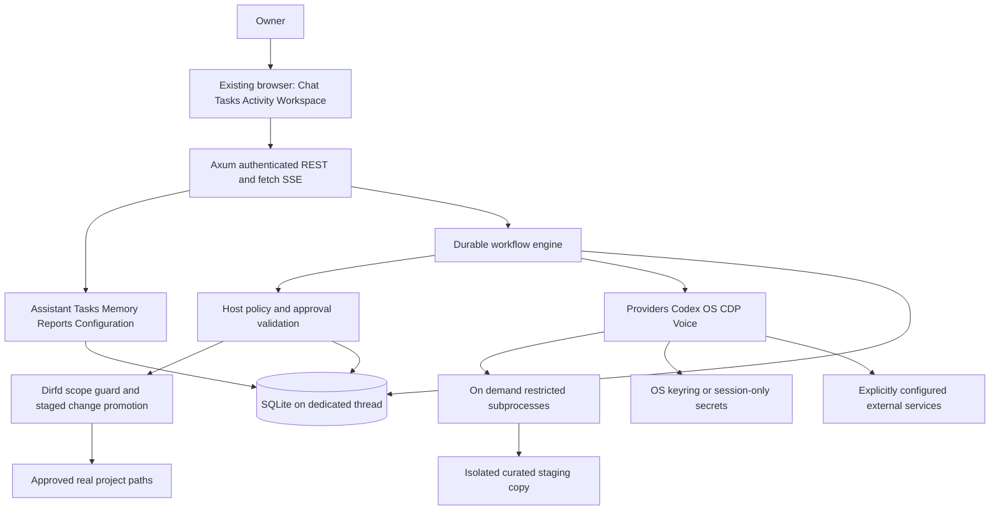
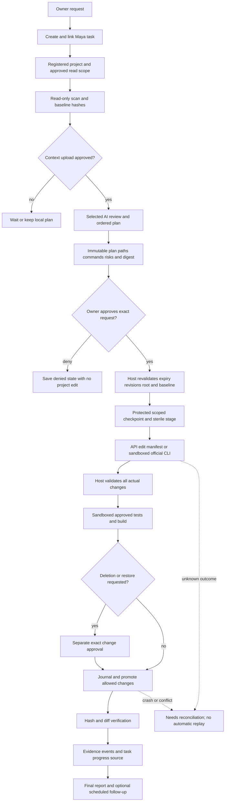

# Maya Mini v0.1 — Master Implementation Blueprint

**Document date:** 2026-10-20 (Asia/Kolkata). **Deliverable:** architecture and implementation contract only. **Implementation agent:** Gemini. **Product status:** not implemented; no runtime or integration results are asserted here.

**Goal:** implement all 55 approved features in one complete Ubuntu application delivery, with host-enforced permissions, truthful evidence and low resource use.

**Architecture:** one Rust process owns Axum, Tokio, SQLite, scheduling, policy and adapters; an existing browser renders embedded HTML/CSS/vanilla JavaScript. External AI, coding tools, Chromium and speech services are optional configured capabilities, started or contacted on demand.

**Paths:** project `/home/thakur/projects/MiniAi`; frozen source `/home/thakur/projects/MiniAi/MAYA_MINI_PRODUCT_DOCS_v0.1`; all eventual application files `/home/thakur/projects/MiniAi/Maya`; this document `/home/thakur/projects/MiniAi/MASTER_IMPLEMENTATION_BLUEPRINT.md`.

## 1. Authority, process override and audited evidence

1. The owner's current request controls delivery process and the final stack. `docs/00_APPROVED_FEATURE_SCOPE.md` controls feature scope. This document resolves derived technical contracts. Original documentation stays intact.
2. **Explicit process override PO-01:** milestone-limited execution, partial shipping and “stop after the selected work package” instructions in README, AGENTS, GEMINI, CLAUDE, PLANS, docs 12/13/16/18 and diagram 08 are superseded for this deliverable and the subsequently authorized implementation. Implement **one integrated v0.1 release containing all approved features**. The ordered checkpoints in §15 are dependency/test checkpoints inside that delivery, never separate releases or deferred feature scope.
3. This request authorizes writing this blueprint, **not application code, dependency installation, service installation, migrations, project edits or publication**. A later owner approval of this concrete blueprint and implementation scope authorizes Gemini's single development delivery. Runtime approval of each coding plan, scoped paths, destructive operation and recovery action remains mandatory. A product implementation approval never grants blanket permission for product runtime actions.
4. New product features, weakened security, changed performance target or removal of an approved feature require an explicit owner change request. Gemini must not redesign contracts during implementation; report an evidenced contradiction and propose the smallest correction before dependent work.
5. Skills' default extra spec/plan files and per-package handoffs are consolidated into this one owner-requested document. No additional speculative plan or source files are created by this task. The implementation checklist is included here for context recovery.

### 1.1 Complete source audit

All **39 files** in the documentation tree were read. The ZIP contains the same 39 paths and byte-identical contents, verified without extraction. No additional root README/AGENTS/GEMINI/CLAUDE/PLANS or application source existed at audit time; Maya/ was an empty directory; the directory is not a Git repository. The archive is a duplicate reference, not another authority.

| Audited inputs (paths relative to source directory) | Requirements/decisions carried into this document |
|---|---|
| `README.md`, `AGENTS.md`, `GEMINI.md`, `CLAUDE.md`, `PLANS.md` | stack, ownership, approval/evidence conventions; PO-01 resolves milestone restrictions |
| `docs/00_APPROVED_FEATURE_SCOPE.md` | exact 55-feature inventory; four tabs, six settings groups; exclusions; seven definition-of-done cases |
| `docs/01_PRD.md`, `02_SRS_ACCEPTANCE.md` | FR-01–08, NFR-01–09, offline use, scoped actions, provenance, graceful unavailability |
| `docs/03_WORKSPACE_UX.md`, `04_ARCHITECTURE.md`, `05_INTEGRATION_CONTRACTS.md` | configuration, one process, adapter contracts, context/privacy, CLI/browser/voice fallback |
| `docs/06_DATA_MODEL.md`, `07_HTTP_API.md` | persistence, migrations, auth, REST/SSE; incomplete proposals completed in §§5–8 |
| `docs/08_FLOWCHARTS.md`; `diagrams/01_system_architecture.mmd`, `02_project_to_code_flow.mmd`, `03_coding_sequence.mmd`, `04_task_lifecycle.mmd`, `05_job_state_machine.mmd`, `06_provider_routing.mmd`, `07_security_decision.mmd`, `08_sdlc.mmd`, `diagrams/README.md` | all eight diagrams inspected; replacement diagrams below add staging, reconciliation and single-release semantics |
| `docs/09_SECURITY_PRIVACY.md`, `10_TEST_STRATEGY.md`, `11_PERFORMANCE_BUDGET.md` | trust boundaries, baseline T-01–24, memory accounting, test evidence |
| `docs/12_SDLC_WORKFLOW.md`, `13_ROADMAP_BACKLOG.md` | retain dependencies/checkpoints/review; replace incremental release instructions with PO-01 |
| `docs/14_OPERATIONS_RUNBOOK.md`, `15_DECISIONS_RISKS.md` | XDG, backup/recovery, ten open decisions resolved in §2 or capability-gated in §17 |
| `docs/16_TRACEABILITY.md`, `17_USER_STORIES.md`, `18_AGENT_HANDOFF.md`, `19_RELEASE_CHECKLIST.md` | 55 IDs, US-01–10, eight UAT steps, release gates and truthful handoff |
| `DOCUMENTATION_QA.md` | prior structural QA is not implementation/security validation |
| `templates/APPROVAL_RECORD_EXAMPLE.json`, `CHANGE_REQUEST_TEMPLATE.md`, `HANDOFF_TEMPLATE.md`, `DOCUMENT_MANIFEST.json` | approval bindings, scope control, evidence fields; example approval never valid authorization |

Frozen scope SHA-256: `963ff40c0fbd96a45b34947650474e50967cfc4d234eebf44eb275495117e693`. Count: A=5, B=8, C=5, D=9, E=9, F=6, G=5, H=8; total **55 unique IDs**. Requirements inventory and ownership are in §12; cross-cutting requirements in §2; acceptance/test inventory in §13.

### 1.2 Contradictions resolved explicitly

| Source ambiguity/contradiction | Binding resolution and reason |
|---|---|
| milestone gates versus owner's single delivery | PO-01; preserve security/release review, implement all features together |
| PRD says “MVP”/voice extension; scope includes G01–05 | all 55 are mandatory implementation obligations; installed services remain optional capabilities |
| UX approval preview for “any write” | direct owner local task/settings CRUD is explicit intent via typed UI/API; project effects, secret transfer, command execution and deletion require the separate policy described here; model/free text cannot approve |
| `NeedsReconciliation` proposed but missing from some state lists | make it a durable first-class state, exposed as `needs_reconciliation` |
| cwd/diff audit suggested as confinement | neither prevents escape; require OS confinement plus host promotion; fail closed if unavailable |
| “done” despite failed/no tests | coding completion needs actual approved verification or explicit `not_configured` with `completed_with_issues`; read-only reports use `not_applicable`; tasks may be manually marked done with manual provenance |
| global source context versus private project files | scans remain local; upload only previewed, approved bounded context; sensitive paths excluded |
| API examples omit estimates/model registry/memory/execute actions | canonical DTOs and exhaustive route table below replace draft API proposals |
| model cost versus subscription | record reported usage/cost, currency and billing provenance separately; null means unknown; no inferred subscription entitlement or invented prices |
| source <500 MB target versus unqualified guarantee | reproducible release measurement gate; no all-workload or all-external-process guarantee |
| optional browser automation versus complete feature coverage | implement CDP capability detection, shortcuts, permitted page reading and manual response handoff; no fabricated AI-site automation |

## 2. Fixed engineering decisions and nonfunctional contract

### 2.1 Runtime/platform/dependencies

Target Ubuntu **24.04 LTS x86_64** desktop; also test Ubuntu 26.04 LTS x86_64 before claiming support there. These are test baselines, not claims that tests ran. Wayland and X11 use capability probes. No root privileges at runtime. No Electron, React, Docker requirement, Node/Python runtime, local LLM, web server development daemon, wake word, agent swarm, built-in IDE, multi-user/cloud sync/calendar/email, banking/purchasing, password extraction or automatic package installation.

One Cargo package `maya-mini`, Rust 2024, binary `maya-mini`, library `maya_mini`. Use a current stable toolchain **resolved once at implementation start**, record the exact numeric version in `rust-toolchain.toml`, pin direct dependencies with exact versions and commit Cargo.lock. Do not guess an October 2026 toolchain/crate version in this blueprint. This is a bounded dependency-resolution check, not an architecture decision or an extra release. Run offline fixture tests before contacting real providers. Required API families:

| Dependency | Features/purpose |
|---|---|
| `tokio` | `rt-multi-thread,macros,net,time,sync,signal,process,io-util,fs`; two worker threads; bounded blocking pool 4 |
| `axum`, `tower`, `tower-http` | Axum 0.8-compatible routing/extractors; Tower services/tests; HTTP trace, body limit and headers only; no permissive CORS |
| `rusqlite` | bundled SQLite + backup; one dedicated DB thread; no async SQL pool/ORM |
| `serde`, `serde_json` | derive, strict DTOs, checked JSON |
| `reqwest`, `futures-util`, `tokio-util`, `bytes` | rustls, JSON, stream, multipart; HTTP cancellation, bounded streams, CancellationToken |
| `chrono`, `chrono-tz` | UTC arithmetic + IANA wall-time recurrence; no natural-language date dependency |
| `uuid`, `sha2`, `hex`, `rand`, `base64`, `subtle` | v4 IDs, hashes, CSPRNG session/capability bytes, constant-time comparisons |
| `keyring`, `zeroize` | Linux Secret Service backend, secret buffers; no plaintext persistence fallback |
| `tracing`, `tracing-subscriber` | structured redacted logging; no raw request/response body logging |
| `thiserror`, `url`, `mime`, `percent-encoding` | typed errors, safe URL/path parsing |
| `rustix` | Linux openat2/dirfd, process groups, resource limits, file locks, filesystem statistics, clocks; enable only used modules |
| `tokio-tungstenite` | rustls CDP WebSocket client; no Chromium driver bundle |
| `zbus` | direct desktop notification DBus/Secret Service supporting facilities; lazy session bus connection |
| dev: `tempfile`, `http-body-util` | disposable DB/project fixtures and HTTP assertions; no live credentials |

Versions must be mutually compatible with pinned stable and Ubuntu baseline. Record licenses/security advisories and required native build tools; unused dependencies are removed. Bash scripts are development/release helpers. Optional installed executables: `git`, `bwrap`, `codex`, `code`, `chromium`/`chromium-browser`, `pdftotext`, `wl-copy`/`wl-paste` or `xclip`, `espeak-ng`, `xdg-open`. Probe absolute executable path/version; never auto-install. SQLite is bundled, so no SQLite server/library runtime dependency.

### 2.2 Quantified bounds

These are implementation limits, not measured results. `MB` for budget means decimal 1,000,000 bytes; byte limits below use KiB/MiB.

| Resource | Bound/default |
|---|---|
| Maya-owned RSS | target peak <500,000,000 B for normal fixtures (§14); warning at 400 MB; at 450 MB stop admitting expensive jobs, preserve local CRUD |
| concurrency | one editing job globally and one writer per project; two API requests total; two subprocesses total; one voice request; one CDP session; queue 32 jobs |
| HTTP | JSON body 256 KiB; voice upload 8 MiB/60s; 30s request header/body deadline; local handler 10s; explicit speech routes up to65s, scan/probe/backup up to60s and SSE/download streaming excluded (bounded separately); message send always returns a202 job before provider call; 128 simultaneous connections; four SSE clients |
| lists | default 50, max 100 items; opaque validated cursor; no unbounded arrays |
| chat/context | user message 16 KiB; 20 recent messages and ≤64 KiB UTF-8; compact summary ≤8 KiB; full request ≤128 KiB; no silent truncation of approval scope |
| project scan | ≤10,000 entries, ≤2 MiB/file for inspection, ≤32 MiB total bytes; selected model context ≤128 KiB; show truncated/excluded counts |
| stage/checkpoint | ≤100 MiB and 10,000 regular files; ≤10 MiB/file for editable files; require a narrower scope when exceeded; no following symlinks/special files |
| logs/events | line 8 KiB; live ring 256 events/256 KiB; event payload ≤16 KiB; per-step redacted log 5 MiB; per-job 20 MiB; truncate with counters while still draining pipes |
| adapters | API connect 10s/total 120s (config 10–300s); CLI default 20m/max 60m; tests 5m/max 20m; read tools 30s; browser navigation 30s; speech 60s |
| retry | reads/models at most two retries (three attempts), 1s/3s backoff + bounded jitter; honor Retry-After ≤30s; no automatic edit/promotion/clipboard/launch retry |
| storage | configurable 1 GiB app-artifact cap excluding backups; refuse new bulky artifacts when reached; local tasks stay usable; no silent user-file deletion |
| UI | initial 50 rows, append fragments, max 200 mounted messages/events; no animations/background resource polling |

Offline identity/settings/tasks/notes/reminders/planner/reports/memory search/export must work without AI. Keyboard access, labels, visible focus and WCAG AA color contrast are acceptance obligations. Dates persisted as integer UTC milliseconds with a separate IANA timezone; default `Asia/Kolkata`. Display local offset. Unknown progress/model/usage/cost/test state remains explicitly unknown.

### 2.3 Core architecture and dependency direction



Dependency order, with no back edges: `error` → `types/config` → `db/secrets/auth` → `audit/policy` → `approval/scope/artifacts` → `provider/sandbox/process/checkpoint` → `providers/coding/fileops/desktop/browser/voice/telemetry/backup/project/tasks/conversation/memory/schedule/reports` → `codex` → `workflow/assistant` → `protocol/state` → `http` → `app` → `main`. The API DTO module may use domain types; domain code never imports HTTP/DTOs. `app` composes concrete services; adapters never call app/handlers. DB owns SQL and accepts synchronous bounded closures; it never calls domain/adapters. Services reference Db, not each other through callbacks. Scheduler submits typed intents to workflow via a bounded channel, not a reference cycle. Domain events returned from transactions wake the event hub after commit. Only policy can mint an `ExecutionPermit`; policy validates typed metadata/DB bindings without importing scope. Scope consumes the opaque policy permit and revalidates live filesystem identity. CheckpointService journals promotion and invokes scope's one-file primitive. CodingService consumes injected CodingRunner objects and never imports codex; app constructs/injects concrete adapters. ErrorCode is owned by error (using uuid directly); types may import error, never the reverse.

## 3. Canonical types, Rust interfaces and semantic rules

Notation in this document is a specification, not application source. Every record below becomes a Rust struct/enum with exactly these serialized names; `?` means nullable/optional, `[]` bounded list, `map` a typed map. Rust uses snake_case fields and `#[serde(rename_all="snake_case")]` enums. Input DTOs reject unknown fields. Missing optional PATCH fields mean unchanged; explicit null clears nullable fields, implemented with a three-state PatchField. No `serde_json::Value` crosses a service boundary except explicitly schema-validated metadata/settings payloads.

### 3.1 Shared domain records (`src/types.rs`)

- `Id = uuid::Uuid`; `UtcMs = i64`; `Digest = [u8;32]` (wire lowercase 64 hex); `Page<T>{items:Vec<T>,next_cursor:Option<String>}`; `Revision=i64` positive; `Money{coefficient:i64,scale:u8,currency:String,source:reported|user_rate_estimate}` represents coefficient × 10^(-scale), scale 0–9. Preserve fractional reported currency units without float/cent rounding; overflow/precision beyond 9 stays unknown with diagnostic.
- `Actor{kind:owner|scheduler|provider|coding_cli|system,id:Option<Id>}`. Owner identity is the single local account/session, never an asserted actor in request JSON.
- `Language = english|hindi|hinglish`; `Tone=concise|standard|detailed`; `Priority=low|normal|high|urgent`; `TaskStatus=todo|in_progress|blocked|done|cancelled`; `ProgressSource=manual|observed|verified`.
- `Capability{key:String,state:available|unavailable|needs_setup|unsupported|permission_denied,reason:Option<String>,version:Option<String>,checked_at:UtcMs,details:CapabilityDetails}`. Details are a whitelist of strings/booleans, never raw help/environment/token output.
- `Identity{name:String,greeting:String,language:Language,tone:Tone}`; `VoiceSettings{stt:disabled|openai_audio|compatible_audio,stt_model_id:Option<Id>,tts:disabled|browser|espeak_ng|openai_audio,tts_model_id:Option<Id>,voice:Option<String>,input_device:Option<String>,output_device:Option<String>,rate:f32,muted:bool,language:Language}`. Device IDs are opaque browser-origin IDs; only frontend selects devices.
- `AssistantSettings{timezone:String,work_days:Vec<u8>,work_start:String,work_end:String,checkin_minutes:Option<u16>,daily_review_time:Option<String>,notifications:bool,report_delivery:in_app|in_app_and_notification}`. Weekdays ISO 1–7; same-day HH:MM interval; no overnight interval in v0.1 (split across days only with explicit user selection).
- `SecuritySettings{require_plan_approval:bool,critical_always_confirm:bool,chat_retention_days:u16,event_retention_days:u16,artifact_retention_days:u16,backup_keep:u8,storage_cap_bytes:u64}`. The first two must always be true; API rejects false. Retention minima/maxima in §6.
- `BrowserSettings{enabled:bool,executable:Option<String>,profile_dir:Option<String>,cdp_mode:disabled|owned|attach,cdp_url:Option<String>}`. Settings secrets are forbidden. `Settings{revision,identity,voice,assistant,security,browser}`; tools/projects are separate resources.
- `ProviderKind=openai_responses|openai_compatible_chat|gemini|anthropic`; `BillingMode=api|subscription_cli|unknown`; `Role=chat|planning|review|coding|fallback|stt|tts`; `Provider{id,label,kind,protocol:String,endpoint,local_endpoint_allowed:bool,enabled,billing_mode,credential_status:missing|session|keyring,timeout_ms,revision}`. Credential reference is internal, never returned.
- `Model{id,provider_id,model_id:String,label:String,enabled:bool,capabilities:Vec<text|structured_edits|stt|tts>,context_limit_bytes:u32,revision}`; `RoleBinding{role,model_id:Option<Id>,tool_id:Option<Id>,fallback_model_ids:Vec<Id>,allow_paid_fallback:bool,timeout_ms:u32}`. All roles may be unassigned during setup; resolving an ordinary assigned role requires exactly one model/tool. Fallback may remain unassigned; STT/TTS require compatible capability. A coding binding may select tool and an explicit backing model as the sole exception.
- `Chain{id,name,enabled,steps:Vec<ChainStep>,revision}`; `ChainStep{position:u8,purpose:research|review|plan|code,model_id:Option<Id>,tool_id:Option<Id>,max_output_bytes:u32}`; 1–8 steps, no repeated position, at most one code step and code is last. Browser shortcut/manual import is never an automatic chain executor.
- `Tool{id,kind:codex|compatible_cli|editor|chromium|pdf|clipboard|tts,executable:String,enabled:bool,adapter_version:String,capability:Capability,revision}`. Compatible CLI means a compiled adapter implementing the same checked contract, not arbitrary shell templates. Initially only Codex execution adapter; unsupported binaries remain unavailable.
- `CommandSpec{id,project_id,label,executable:String,args:Vec<String>,timeout_ms:u32,network:bool,enabled:bool,kind:test|build|read|custom,revision}`. Fixed literal argv, no shell expansion, no user-controlled executable substitution. `network=true` not supported for test/custom commands in this baseline; explicit error, never silently allowed.
- `Project{id,name,root:String,root_device:u64,root_inode:u64,allowed_paths:Vec<String>,excluded_paths:Vec<String>,notes:String,preferred_model_id:Option<Id>,preferred_tool_id:Option<Id>,archived:bool,revision}`. Root is registration scope, not edit approval. Paths are normalized relative components; paths always case-sensitive.
- `Conversation{id,project_id:Option<Id>,model_override_id:Option<Id>,current_task_id:Option<Id>,summary:String,created_at,updated_at,revision}`; `Message{id,conversation_id,role:owner|assistant|system,text:String,model_id:Option<Id>,job_id:Option<Id>,intent:Option<Intent>,created_at}`; `Intent=question|task|reminder|project_work|system_action|clarify`; `IntentDraft{intent,task:Option<TaskDraft>,operation:Option<Operation>,clarification:Option<String>,source:rule|model}`.
- `TaskDraft{title,description,project_id:Option<Id>,parent_task_id:Option<Id>,priority,due_at:Option<UtcMs>,timezone:String,estimated_minutes:Option<u32>,reminder:Option<ScheduleDraft>}`; `Task{id,...TaskDraft without reminder,status,progress_pct:Option<u8>,progress_source:Option<ProgressSource>,checklist:Vec<ChecklistItem>,revision,created_at,updated_at,completed_at:Option<UtcMs>}`; `ChecklistItem{id,text:String,done:bool,position:u16}`.
- `TaskEvent{id,task_id,kind:note|decision|blocker|status|progress|reschedule|evidence|checkin,payload:EventPayload,evidence_artifact_id:Option<Id>,actor,at}`. `EventPayload{text:Option<String>,percent:Option<u8>,source:Option<ProgressSource>,from_status:Option<TaskStatus>,to_status:Option<TaskStatus>,due_at:Option<UtcMs>}`. AI cannot insert verified evidence.
- `ScheduleDraft{task_id:Option<Id>,kind:reminder|checkin|daily_review,label:String,first_at:UtcMs,timezone:String,recurrence:once|daily|weekdays|weekly,weekdays:Vec<u8>,local_time:String,enabled:bool}`; `Schedule{id,...ScheduleDraft,next_at:Option<UtcMs>,revision}`; `Occurrence{id,schedule_id,scheduled_at,state:pending|delivered|missed|failed,notification_status:not_attempted|accepted|unavailable|failed|unknown,checkin_id:Option<Id>}`. `Checkin{id,task_id,occurrence_id:Option<Id>,requested_at,revision,responded_at:Option<UtcMs>,percent:Option<u8>,blocker:Option<String>,note:Option<String>}`.
- `MemoryItem{id,kind:preference|decision|note|summary,project_id:Option<Id>,conversation_id:Option<Id>,text:String,source:owner|conversation_summary|task_event,revision,created_at,updated_at}`; `Report{period_start,period_end,timezone,completed:Vec<Id>,pending:Vec<Id>,delayed:Vec<Id>,blockers:Vec<ReportEntry>,work_log:Vec<ReportEntry>,progress:Vec<ReportProgress>,sections:ReportSections,generated_at}`; entries reference existing event/task/artifact IDs and provenance. Reports aggregate persisted data without a model.
- `JobKind=coding|chain|chat|operation`; `JobState=created|inspecting|reviewing|planned|awaiting_approval|approved|checkpointing|executing|verifying|promoting|reporting|completed|completed_with_issues|blocked|paused|failed|cancelling|cancelled|needs_reconciliation`; `StepState=pending|running|succeeded|failed|cancelled|uncertain|skipped`; `Verification=not_run|passed|failed|not_configured|not_applicable`.
- `Job{id,kind,task_id:Option<Id>,project_id:Option<Id>,conversation_id:Option<Id>,goal:String,state,revision,plan_id:Option<Id>,checkpoint_id:Option<Id>,verification,paused_from:Option<JobState>,continuation:Option<Continuation>,approval_purpose:Option<ApprovalPurpose>,pause_requested:bool,error_code:Option<ErrorCode>,created_at,updated_at}`; `JobStep{id,job_id,position:u16,kind:String,state,attempt:u8,started_at:Option<UtcMs>,finished_at:Option<UtcMs>,artifact_id:Option<Id>,error_code:Option<ErrorCode>}`. Kind is one of the typed step names in §7, not provider-defined execution code.
- `Plan{id,job_id,revision,goal,summary,steps:Vec<PlanStep>,allowed_paths:Vec<String>,actions:Vec<ActionClass>,command_ids:Vec<Id>,context_artifact_ids:Vec<Id>,selected_model_id:Option<Id>,selected_tool_id:Option<Id>,project_revision:Revision,baseline_digest:Digest,timeout_ms:u32,risks:Vec<String>,digest:Digest,created_at}`; `PlanStep{position:u16,description:String,expected_paths:Vec<String>,verification_command_ids:Vec<Id>}`. `ActionClass=read_project|read_system|read_artifact|export_data|project_edit|run_test|run_command|delete_project_files|restore_checkpoint|delete_history|restore_database|accept_unverified_changes|clipboard_read|clipboard_write|launch_app|open_url|upload_context|browser_read|browser_submit|voice_upload`.
- `Approval{id,job_id,plan_id:Option<Id>,action:ActionClass,request_digest:Digest,scope:ApprovalScope,decision:pending|approved|denied|revoked|consumed,requested_at,decided_at:Option<UtcMs>,expires_at:UtcMs,deciding_session_id:Option<Id>,revision}`; `ApprovalScope{action_classes:Vec<ActionClass>,project_id:Option<Id>,project_revision:Option<Revision>,paths:Vec<String>,command_ids:Vec<Id>,model_ids:Vec<Id>,tool_id:Option<Id>,artifact_ids:Vec<Id>,operation_digest:Option<Digest>}`. Permit contains private fields; deserialization/public construction forbidden.
- `Artifact{id,job_id:Option<Id>,task_id:Option<Id>,kind:scan|context|plan|review|handoff|checkpoint|changes|diff|test|log|report|export|audio,sha256:Digest,size_bytes:u64,mime:String,provenance:Provenance,created_at,redacted:bool}`; `Provenance{source:owner|model|cli|browser|manual_handoff|system,provider_id:Option<Id>,model_id:Option<Id>,url:Option<String>,observed_at:UtcMs}`. Internal relative storage filename is never a client path.
- `ChangeSet{baseline_digest:Digest,changes:Vec<FileChange>,digest:Digest}`; `FileChange{path:String,kind:create|modify|delete,before:Option<Digest>,after:Option<Digest>,artifact_id:Option<Id>,mode:u32}`. No rename primitive: rename is delete+create, so deletion gate applies.
- `UsageRecord{id,provider_id,model_id:Option<Id>,job_id:Option<Id>,request_id:Id,input_tokens:Option<u64>,output_tokens:Option<u64>,money:Option<Money>,billing_mode,status:succeeded|failed|cancelled|unknown,at}`. `ProcessLease{id,job_id:Option<Id>,category:core|coding|browser|editor|voice|helper,pid:Option<u32>,start_ticks:Option<u64>,pgid:Option<u32>,owned:bool,boot_id:String,state:starting|running|exited|unknown}`.
- `ResourceSnapshot{at,core:ResourceGroup,external:Vec<ResourceGroup>,system:SystemResources,warnings:Vec<String>,processes:Vec<ProcessInfo>,processes_truncated:bool}`; `ResourceGroup{category,pids:Vec<u32>,rss_bytes:Option<u64>,cpu_percent_one_core:Option<f64>,measurement_status:ok|partial|unavailable}`; `SystemResources{total_ram_bytes,available_ram_bytes,storage_total_bytes,storage_available_bytes,process_count}`. On-demand processes expose only pid/name/CPU/RSS, no environment or full command line.

### 3.2 Service and adapter interfaces

All signatures are normative. `Result<T>` means `std::result::Result<T,AppError>`. Cloneable services carry `Arc` handles; sync operations run on DB/blocking threads, never block a Tokio worker. `BoxFuture<'a,T> = Pin<Box<dyn Future<Output=T> + Send + 'a>>`; this alias supports object-safe adapter traits without async-trait.

| Owner | Interface consumed by other modules |
|---|---|
| `error.rs` | `AppError{code:ErrorCode,safe_message:String,retryable:bool,details:PublicDetails,request_id:Option<uuid::Uuid>}`; `ErrorCode` enumerated §8; `fn public_error(&self)->PublicError` |
| `config.rs` | `fn load(args:CliArgs)->Result<RuntimeConfig>`; `fn defaults()->Settings`; `RuntimeConfig{data_dir,cache_dir,runtime_dir,port,open_browser,headless,print_launch_link,test_mode}`; `CliArgs` parsed without shell |
| `db.rs` | `async fn open(path:&Path)->Result<Db>`; `async fn read<T:Send+'static>(&self,f:impl FnOnce(&Connection)->Result<T>+Send+'static)->Result<T>`; `async fn write<T:Send+'static>(&self,f:impl FnOnce(&Transaction<'_>)->Result<T>+Send+'static)->Result<T>`; `async fn close(self)->Result<()>` |
| `auth.rs` | `async fn issue_launch_link(&self,port:u16)->Result<LaunchLink>`; `async fn exchange(&self,token:SecretString,origin:&str)->Result<SessionGrant>`; `fn authenticate(&self,headers:&HeaderMap)->Result<SessionContext>`; `fn csrf(&self,session:&SessionContext,headers:&HeaderMap)->Result<()>`; `fn revoke(&self,id:Id)->Result<()>` |
| `scope.rs` | `fn register_root(path:&Path,allowed:&[String])->Result<RootHandle>`; `fn open_read(root:&RootHandle,path:&str)->Result<File>`; `fn validate_relative(path:&str)->Result<RelativePath>`; `fn snapshot(root:&RootHandle,limits:ScanLimits)->Result<Snapshot>`; `fn apply_one(root:&RootHandle,change:&FileChange,content:Option<&mut File>,permit:&ExecutionPermit)->Result<FileReceipt>` |
| `policy.rs` | `async fn authorize(&self,ctx:&ActionContext,request:&ActionRequest)->Result<ExecutionPermit>`; permit checks all DB bindings and current scopes; `fn classify(operation:&Operation)->ActionClass`; `fn redact(&self,text:&str)->String` |
| `approval.rs` | `async fn request(&self,job_id:Id,req:ApprovalRequest)->Result<Approval>`; `async fn decide(&self,id:Id,decision:ApprovalDecision,session:&SessionContext)->Result<Approval>`; `async fn invalidate_project(&self,id:Id,reason:&str)->Result<()>` |
| `secrets.rs` | `trait SecretStore{fn put<'a>(&'a self,id:Id,secret:SecretString,mode:SecretMode)->BoxFuture<'a,Result<CredentialStatus>>; fn get<'a>(&'a self,id:Id)->BoxFuture<'a,Result<SecretString>>; fn remove<'a>(&'a self,id:Id)->BoxFuture<'a,Result<()>>;}`; SecretString zeroizes/drop, no Debug/Serialize |
| `audit.rs` | `fn append(tx:&Transaction<'_>,event:AuditInput)->Result<i64>`; `async fn list(&self,query:AuditQuery)->Result<Page<AuditEvent>>`; audit sequence feeds SSE after commit |
| `artifacts.rs` | `async fn put(&self,meta:ArtifactInput,reader:BoundedReader)->Result<Artifact>`; `async fn open(&self,id:Id)->Result<ArtifactStream>`; `async fn verified_file(&self,id:Id)->Result<File>`; `async fn delete(&self,id:Id,permit:&ExecutionPermit)->Result<()>` |
| `provider.rs` | `fn new(db:Db,secrets:Arc<dyn SecretStore>,factory:ProviderFactory)->ProviderRegistry`; `ProviderFactory=fn(&Provider,Arc<dyn SecretStore>)->Result<Arc<dyn ModelProvider>>` supplied by app from providers::create (registry never imports concrete adapters); `trait ModelProvider{fn capabilities(&self)->ProviderCapabilities; fn generate<'a>(&'a self,request:ModelRequest,cancel:CancellationToken)->BoxFuture<'a,Result<ModelResult>>;}`; `ModelRequest{request_id,model:Model,role:Role,messages:Vec<ModelMessage>,max_output_bytes,timeout_ms,output:Text|EditManifest|PlanDraft}`; `ModelMessage{role:system|user|assistant,text:String}`; `ModelResult{text:String,actual_model_id:Option<String>,usage:UsageObservation,finish:complete|truncated}` |
| `provider.rs` | `async fn resolve(&self,selection:ModelSelection)->Result<ResolvedModel>`; `async fn validate_endpoint(&self,provider_id:Id)->Result<ValidatedEndpoint>`; `async fn generate(&self,request:ModelRequest,cancel:CancellationToken)->Result<ModelResult>`; `ModelSelection{role,override_id:Option<Id>,project_id:Option<Id>,fallback_consent:bool}`; resolve never guesses model identifiers |
| `process.rs` | `async fn run(&self,spec:ProcessSpec,permit:&ExecutionPermit,cancel:CancellationToken)->Result<ProcessResult>`; `ProcessSpec{executable:PathBuf,args:Vec<OsString>,cwd:PathBuf,env:Vec<(OsString,OsString)>,stdin:Option<BoundedReader>,timeout:Duration,limits:ProcessLimits,sandbox:SandboxSpec,category:ProcessCategory,job_id:Option<Id>}`; `ProcessResult{exit_code:Option<i32>,signal:Option<i32>,timed_out:bool,cancelled:bool,stdout_artifact:Id,stderr_artifact:Id,truncated:bool,children_reaped:bool}` |
| `sandbox.rs` | `fn probe(&self)->Result<Capability>`; `fn wrap(&self,spec:SandboxSpec)->Result<SpawnSpec>`; `SandboxSpec{stage:PathBuf,read_roots:Vec<PathBuf>,writable_roots:Vec<PathBuf>,network:NetworkMode,deadline:UtcMs}`; `NetworkMode=denied|cli_parent_only`; host handles described §9 |
| `checkpoint.rs` | `async fn create(&self,project:&Project,job:Id,permit:&ExecutionPermit)->Result<Checkpoint>`; `async fn stage(&self,checkpoint:&Checkpoint)->Result<StagedProject>`; `async fn changes(&self,stage:&StagedProject)->Result<ChangeSet>`; `async fn promote(&self,project:&Project,changes:&ChangeSet,permit:&ExecutionPermit)->Result<PromotionReceipt>`; `async fn restore(&self,checkpoint_id:Id,change_digest:Digest,permit:&ExecutionPermit)->Result<PromotionReceipt>`; `Checkpoint{id,baseline_digest,project_revision,git_head:Option<String>,dirty_paths:Vec<String>}`; `StagedProject{path:PathBuf,checkpoint_id:Id,baseline_digest:Digest}` |
| `coding.rs` | `trait CodingRunner{fn probe<'a>(&'a self,tool:&'a Tool)->BoxFuture<'a,Result<Capability>>; fn execute<'a>(&'a self,request:CodingRequest,permit:&'a ExecutionPermit,cancel:CancellationToken)->BoxFuture<'a,Result<CodingOutcome>>;}`; `CodingRequest{job_id,plan:Plan,stage:StagedProject,tool:Option<Tool>,model:Option<Model>}`; `CodingOutcome{process:Option<ProcessResult>,changes:ChangeSet,summary:String}`; API edit adapter returns same outcome |
| `project.rs` | `async fn register(&self,input:ProjectInput,session:&SessionContext)->Result<Project>`; `async fn scan(&self,id:Id,cancel:CancellationToken)->Result<Artifact>`; `async fn context(&self,id:Id,paths:Vec<String>)->Result<Artifact>`; local scan does not upload |
| `conversation.rs` | `async fn append(&self,id:Id,input:UserMessage)->Result<Message>`; `async fn context(&self,id:Id)->Result<Vec<ModelMessage>>`; `async fn compact(&self,id:Id)->Result<()>` |
| `assistant.rs` | `async fn receive(&self,id:Id,input:UserMessage,session:&SessionContext)->Result<MessageReceipt>`; `fn classify(text:&str,timezone:Tz,now:UtcMs)->Result<IntentDraft>`; never executes an Operation from classifier without confirmed typed intent |
| `tasks.rs` | `async fn create(&self,draft:TaskDraft,actor:Actor)->Result<Task>`; `async fn update(&self,id:Id,patch:TaskPatch,actor:Actor)->Result<Task>`; `async fn event(&self,id:Id,input:EventInput,actor:Actor)->Result<TaskEvent>`; `async fn checkin(&self,id:Id,input:CheckinReply)->Result<Checkin>`; `async fn list(&self,query:TaskQuery)->Result<Page<Task>>`; `async fn checkins(&self,task_id:Id,query:CheckinQuery)->Result<Page<CheckinStatus>>`; `async fn planner(&self,date:NaiveDate,tz:Tz)->Result<Planner>` |
| `schedule.rs` | `trait Clock{fn now_ms(&self)->UtcMs;}`; `trait Notifier{fn notify<'a>(&'a self,notice:Notice)->BoxFuture<'a,Result<NotificationReceipt>>;}`; `fn next_occurrence(schedule:&Schedule,after:UtcMs)->Result<Option<UtcMs>>`; `async fn run(self,cancel:CancellationToken,wake:Receiver<ScheduleWake>)->Result<()>` |
| `reports.rs` | `async fn daily(&self,date:NaiveDate,tz:Tz)->Result<Report>`; `async fn weekly(&self,iso_week:IsoWeek,tz:Tz)->Result<Report>`; `async fn daily_page(&self,date:NaiveDate,tz:Tz,page:ReportPageQuery)->Result<Report>`; `async fn weekly_page(&self,iso_week:IsoWeek,tz:Tz,page:ReportPageQuery)->Result<Report>`; `fn markdown(report:&Report)->String` |
| `memory.rs` | `async fn search(&self,query:MemoryQuery)->Result<Page<MemoryItem>>`; `async fn upsert(&self,input:MemoryInput)->Result<MemoryItem>`; `async fn export(&self,selection:ExportSelection,permit:&ExecutionPermit)->Result<Artifact>`; `async fn purge(&self,selection:DeleteSelection,permit:&ExecutionPermit)->Result<DeletionReceipt>` |
| `workflow.rs` | `async fn create(&self,input:JobInput,actor:Actor)->Result<Job>`; `async fn control(&self,id:Id,action:JobAction,session:&SessionContext)->Result<Job>`; `async fn advance(&self,id:Id,cancel:CancellationToken)->Result<()>`; `async fn recover(&self)->Result<RecoverySummary>`; `fn transition(state:JobState,event:JobEvent)->Result<JobState>` |
| `desktop.rs` | `async fn launch(&self,input:LaunchInput,permit:&ExecutionPermit)->Result<OperationResult>`; `async fn clipboard(&self,input:ClipboardInput,permit:&ExecutionPermit)->Result<OperationResult>`; implements Notifier |
| `fileops.rs` | `async fn find(&self,project:Id,query:FileQuery)->Result<Page<FileEntry>>`; `async fn preview(&self,project:Id,path:String)->Result<FilePreview>`; `async fn command(&self,id:Id,stage:&StagedProject,permit:&ExecutionPermit,cancel:CancellationToken)->Result<ProcessResult>` |
| `browser.rs` | `async fn probe(&self)->Result<Capability>`; `async fn tabs(&self)->Result<Vec<BrowserTab>>`; `async fn action(&self,input:BrowserAction,permit:&ExecutionPermit,cancel:CancellationToken)->Result<OperationResult>`; no generic CDP/evaluate passthrough |
| `voice.rs` | `async fn transcribe(&self,audio:AudioInput,permit:&ExecutionPermit,cancel:CancellationToken)->Result<Transcript>`; `async fn synthesize(&self,input:SpeechInput,permit:&ExecutionPermit,cancel:CancellationToken)->Result<AudioOutput>`; `async fn capabilities(&self)->Result<Vec<Capability>>`; VoiceService owns reqwest client and Arc<dyn SecretStore> for typed audio requests, resolves configured Model/Provider through registry, uses same validated endpoint/credential/cancel/redaction policy; no ModelProvider.generate abuse for audio |
| `telemetry.rs` | `async fn sample(&self,include_processes:bool)->Result<ResourceSnapshot>`; `async fn subscribe(&self,cancel:CancellationToken)->Result<Receiver<ResourceSnapshot>>`; sampling only while Resource panel visible or active job |
| `backup.rs` | `async fn create(&self)->Result<BackupRecord>`; `async fn verify(&self,id:Id)->Result<BackupRecord>`; `async fn restore(&self,id:Id,permit:&ExecutionPermit)->Result<RestoreReceipt>` |

Only adapter traits (`ModelProvider`, `CodingRunner`, `SecretStore`, `Clock`, `Notifier`) are needed. Scope, DB and policy are concrete; no generic service bus/repository factory/plugin loader. HTTP handlers have exact signatures specified by the route convention in §8. Supporting DTOs and query types are defined there and §3.3. Aliases: ArtifactKind is the Artifact.kind enum; ProcessCategory is the ProcessLease.category enum; JobControl is the allowed UI control enum; CredentialStatus is missing|session|keyring; SecretMode is keyring|session; ReconciliationDecision is inspect|continue_verification|replan|restore. LaunchInput and ClipboardInput are their exact Operation variants; they contain no arbitrary argv. AudioOutput, BackupRecord and RestoreReceipt are §8 records. Test-only enums use the same values.

### 3.3 Remaining shared records and lifecycle invariants

This table fixes supporting interfaces so implementers do not invent fields. All bounds use §2; ID aliases use UUID, all byte/hash values have validated conversion. Type ownership is `types.rs` unless explicitly a private resource in its owning module.

| Type(s) | Exact shape/contract |
|---|---|
| `CapabilityDetails` | `{protocols:Vec<String>,languages:Vec<Language>,voices:Vec<VoiceInfo>,operations:Vec<String>,limitations:Vec<String>,sandbox_verified:bool}`; `VoiceInfo{id:String,label:String,languages:Vec<Language>}`; ≤32 items/field, strings≤200 except safe limitation≤1000; no arbitrary metadata/URLs/secrets |
| `ValidatedEndpoint` | provider-owned `{url:url::Url,resolved_addresses:Vec<std::net::IpAddr>,origin:String,credential_generation:u64}`; immutable per-request DNS-pinned connection target, no redirects/proxy/secret material |
| `ProviderCapabilities` / `ProviderEvent` | `{text:bool,structured_edits:bool,streaming:bool,usage:bool,stt:bool,tts:bool}` / `TextDelta(String)|Usage(UsageObservation)|Completed{actual_model_id:Option<String>}|Refused(String)|Failed(ErrorCode)|Ignored`; max ignored events1000 |
| `UsageObservation` / `ResolvedModel` | `{input_tokens:Option<u64>,output_tokens:Option<u64>,money:Option<Money>}` / `{model:Model,provider:Provider,source:override|conversation|project|role|fallback}`; generated request attempt UUID distinct for each actual send, same job/step links retries; logical grouping uses job/step, never reuse usage.request_id |
| `ControlRequest` / `ControlResponse` / `LaunchLink` | app/auth-owned `IssueLaunchLink|Status` / `Link(LaunchLink)|Status{ready:bool,port:u16}` / `{url:SecretString,expires_at:UtcMs}`; length-prefixed JSON Unix messages ≤4096 bytes, exact peer UID, request deadline2s, max4 connections, link only returned to explicit local launch client, no Debug/log |
| `SessionContext` / `SessionGrant` | auth-owned `{id:Id,owner_uid:u32,expires_at:UtcMs,csrf_hash:Digest}` / SessionInfo; SessionGrant contains secret bytes and cannot Debug/log; SessionInfo only serialized at exchange |
| `ActionContext` / `ActionRequest` | policy-owned `{actor:Actor,job_id:Id,step_id:Id,project_id:Option<Id>,plan_id:Option<Id>,approval_ids:Vec<Id>,policy_version:Revision,now:UtcMs}` / `{class:ActionClass,scope:ApprovalScope,request_digest:Digest,change_digest:Option<Digest>}`; metadata plus current DB binding, not client proof of filesystem safety |
| `ExecutionPermit` | policy-owned private fields `{job_id,step_id,action_classes:Vec<ActionClass>,scope:ApprovalScope,request_digest,approval_ids,expires_at,deadline:std::time::Instant}`; no Serialize/Deserialize/Clone/public constructor; `pub(crate) fn permits(&self,class:&ActionClass,path:Option<&str>)->Result<()>` and read-only ID/deadline accessors; minted only inside policy. Scope/process/checkpoint consume it, policy never imports them. Read-only permit still binds registered read scope; no arbitrary caller class switching. |
| `RootHandle` / `RelativePath` | scope-owned `{dir:Arc<File>,canonical:PathBuf,device:u64,inode:u64,allowed:Vec<RelativePath>,excluded:Vec<RelativePath>}` / validated normalized string with no public unchecked constructor |
| `ScanLimits` / `Snapshot` | `{entries:u32,per_file_bytes:u64,total_bytes:u64}` / `{root_device:u64,root_inode:u64,entries:Vec<SnapshotEntry>,digest:Digest,skipped:Vec<SkippedPath>,truncated:bool}`; `SnapshotEntry{path:String,size_bytes:u64,sha256:Digest,mode:u32}`, `SkippedPath{path:String,reason:String}` bounded1000, additional count in audit |
| `FileReceipt` / `PromotionReceipt` | `{path:String,before:Option<Digest>,after:Option<Digest>,applied:bool,recovery_path:Option<String>,conflict:bool}` / `{job_id:Id,change_digest:Digest,files:Vec<FileReceipt>,complete:bool}`. CheckpointService persists journal before each scope.apply_one; apply_one performs exactly one safe filesystem operation, no DB/artifact call; CheckpointService supplies a verified opened content File (None only for delete), and scope hashes bounded bytes again against postimage before rename. Scope also exposes `fn write_stage_file(stage:&Path,path:&str,content:&[u8])->Result<()>` (private, stage only). |
| `ProcessLimits` / `SpawnSpec` | `{max_output_bytes:u64,max_line_bytes:usize,max_open_files:u64,max_processes:u64,max_file_bytes:u64,address_space_bytes:Option<u64>}` / process-owned `{executable:PathBuf,args:Vec<OsString>,cwd:PathBuf,env:Vec<(OsString,OsString)>,limits:ProcessLimits}`; sandbox wrapper returns verified bwrap program+argv only |
| `BoundedReader` / `ArtifactInput` / `ArtifactStream` | artifacts-owned `Pin<Box<dyn AsyncRead+Send+Unpin>>` paired with checked maximum in caller metadata / `{job_id:Option<Id>,task_id:Option<Id>,kind:ArtifactKind,mime:String,provenance:Provenance,max_bytes:u64,expires_at:Option<UtcMs>}` / `{meta:Artifact,reader:BoundedReader}`; all stores enforce actual stream bytes, not Content-Length; default no raw secrets |
| `AuditInput` / `WhitelistedEventData` | `{job_id:Option<Id>,actor:Actor,action:String,resource_kind:String,resource_id:Option<Id>,decision:String,metadata:AuditMetadata,at:UtcMs}` / enum `Job{state,revision,step_id:Option<Id>}|Task{id,revision}|Approval{id,decision}|Artifact{id,kind}|Occurrence{id,state}|Resources(ResourceSnapshot)|RetentionGap{minimum_seq:i64}`; `AuditMetadata{code:Option<ErrorCode>,ids:Vec<Id>,paths:Vec<String>,command_id:Option<Id>,exit_code:Option<i32>,counts:BTreeMap<String,u64>}`; audited paths redacted, never arbitrary text |
| `Notice` / `NotificationReceipt` / `ScheduleWake` | `{occurrence_id:Id,title:String,body:String}` / `{status:accepted|unavailable|failed,desktop_id:Option<u32>}` / enum `Changed(Id)|ClockChanged|Resumed|Shutdown`; notification text plain ≤1000, desktop receipt not proof seen |
| `CheckinStatus` / `CheckinQuery` | `{checkin:Checkin,occurrence:Option<Occurrence>}` / `{limit:u16,cursor:Option<String>,pending_only:bool}`; pending retrieval exposes unknown/missed delivery without hidden duplicate notification |
| `ReportEntry` / `ReportProgress` | `{task_id:Id,event_id:Id,artifact_id:Option<Id>,text:String,source:ProgressSource,at:UtcMs}` / `{task_id:Id,percent:Option<u8>,source:ProgressSource,evidence_event_id:Id}`; AI text never supplies verified source |
| `ReportPageQuery` / `ReportSection` / `ReportSections` | `{section:Option<ReportSection>,cursor:Option<String>,limit:u16}`; enum `completed|pending|delayed|blockers|work_log|progress`; `ReportSections{completed:SectionPage,pending:SectionPage,delayed:SectionPage,blockers:SectionPage,work_log:SectionPage,progress:SectionPage}`; `SectionPage{total:u64,next_cursor:Option<String>,truncated:bool}`. Each array max100. ReportQuery section/cursor pages that section; others first page. Full selected report export streams all rows to artifact; never pretend partial report is complete. Cursor binds period/timezone/filter and stable snapshot time. |
| `ProcessInfo` | `{pid:u32,name:String,rss_bytes:Option<u64>,cpu_percent_one_core:Option<f64>,category:core|helper|coding|browser|editor|voice|other,owned:bool}` max100 rows sorted RSS desc/pid, processes_truncated flag. `include_processes=false` returns [] by default. |
| `Continuation` / `ApprovalPurpose` | enum `review|checkpoint|promote|operation|voice_receive|report` / `context|implementation|destructive|verification_waiver|operation|voice`; set atomically with awaiting_approval and preserve through approved; consent resumes exact step, never repeats execution |
| `PendingEffect` | workflow-private persisted tagged enum `LocalOperation(OperationMetadata)|Browser(BrowserAction)|DeleteHistory(DeleteSelection)|Export(ExportSelection)|VoiceConsent{payload_digest:Digest,size_bytes:u64,model_id:Id,mode:stt|tts}`. OperationMetadata is Operation with clipboard/text-sensitive payload replaced by `{payload_ref:Id,payload_digest:Digest,size_bytes:u64}`. jobs.input_json stores this sanitized schema or a snapshot of JobInput; no raw clipboard/audio/keys/speech. |
| `TransientPayloadStore` | process-memory bounded map ≤32 entries/8MiB total, each `{id:Id,bytes:Zeroizing<Vec<u8>>,digest,expires_at}`; payload lifetime5m, audio special max10m; clipboard/text-sensitive operations hold bytes here, never DB/idempotency/audit; restart/expiry→needs_setup/reenter, not replay. VoiceConsent is a grant-only job waiting for bytes at voice route, cannot upload/start by itself; successful endpoint consumes once and records result metadata, failure records actual outcome. |
| `JobEvent` | enum `Dispatch|ScanReady{artifact_id}|ContextNeeded|ReviewReady{plan_id}|PlanFrozen{plan_id}|ApprovalGranted{approval_id,purpose}|ApprovalDenied{approval_id}|Start|CheckpointReady{id}|ExecutionFinished{exit:Option<i32>,has_changes:bool}|ChangesReady{digest}|VerificationFinished{status:Verification}|PromotionFinished{complete:bool}|ReportSaved{id}|PauseRequested|PauseBoundary|Resume|CancelRequested|ChildrenStopped{effects_uncertain:bool}|Failed{code:ErrorCode,effects_uncertain:bool}|RestartUncertain|Reconcile{decision:ReconciliationDecision}`. ReconciliationDecision matches §8 values. transition exhaustively rejects events not accepted by §7; failed/reporting preserves terminal failure intent. |
| `RecoverySummary` / `DeletionReceipt` | `{reconciled:Vec<Id>,needs_owner:Vec<Id>,warnings:Vec<String>}` / `{selection_digest:Digest,deleted_count:u64,retained_audit_count:u64,backup_copies_remain:bool}` |
| `PublicError` / `ApiResponse<T>` | error-owned `{code:ErrorCode,message:String,retryable:bool,details:PublicDetails}`; PublicDetails field errors/minimum cursor/current revision only. protocol/http-owned success wrapper `{data:T,meta:{request_id:Id,version:String}}` implements IntoResponse with §8 status. AppError uses uuid::Uuid directly and does not import types. |

Checkpoint ID **is the ID of its protected checkpoint artifact**; there is no second checkpoint ID or missing checkpoint table. Immutable manifest references snapshot blob artifact IDs; storage garbage collection traverses these typed references before deleting anything.

Settings aggregate revision is stored in settings['policy_version'].value_json as `{config_revision:positive_i64,policy_version:positive_i64}`. GET Settings and RolesView expose config_revision. Every settings/roles mutation checks/increments config_revision atomically; action-affecting changes also increment policy_version and revoke affected approvals. Per-group row revision increments with that group. Registry/project/tool/command revisions are their own counters. ToolPut accepts `revision:u64` with explicit create precondition0, update>0; domain stored Revision stays positive.

## 4. Complete application file manifest

All paths below are relative to `Maya/`. **Only these production/build/packaging assets are planned**; test/evidence files are separately enumerated. `Cargo.lock` is generated by dependency resolution, not manually fabricated. No files are created inside Maya by this documentation task.

Complete tree (production, tests and release records; runtime data excluded):

```text
Maya/
├── migrations/
│   └── 0001_initial.sql
├── packaging/
│   ├── maya-mini.desktop
│   └── maya-mini.service
├── release/
│   ├── acceptance.md
│   ├── measurements.csv
│   ├── progress.md
│   └── validation.json
├── scripts/
│   ├── measure.sh
│   ├── package.sh
│   └── smoke.sh
├── src/
│   ├── http/
│   │   ├── events.rs
│   │   ├── mod.rs
│   │   └── routes.rs
│   ├── providers/
│   │   ├── anthropic.rs
│   │   ├── gemini.rs
│   │   ├── mod.rs
│   │   └── openai.rs
│   ├── app.rs
│   ├── approval.rs
│   ├── artifacts.rs
│   ├── assistant.rs
│   ├── audit.rs
│   ├── auth.rs
│   ├── backup.rs
│   ├── browser.rs
│   ├── checkpoint.rs
│   ├── codex.rs
│   ├── coding.rs
│   ├── config.rs
│   ├── conversation.rs
│   ├── db.rs
│   ├── desktop.rs
│   ├── error.rs
│   ├── fileops.rs
│   ├── lib.rs
│   ├── main.rs
│   ├── memory.rs
│   ├── policy.rs
│   ├── process.rs
│   ├── project.rs
│   ├── protocol.rs
│   ├── provider.rs
│   ├── reports.rs
│   ├── sandbox.rs
│   ├── schedule.rs
│   ├── scope.rs
│   ├── secrets.rs
│   ├── state.rs
│   ├── tasks.rs
│   ├── telemetry.rs
│   ├── types.rs
│   ├── voice.rs
│   └── workflow.rs
├── tests/
│   ├── common/
│   │   └── mod.rs
│   ├── baseline.rs
│   ├── database.rs
│   ├── feature_acceptance.rs
│   ├── frontend.html
│   ├── frontend.js
│   ├── http_contract.rs
│   ├── integrations.rs
│   ├── performance.rs
│   ├── processes.rs
│   ├── providers.rs
│   ├── release.rs
│   ├── scheduling.rs
│   ├── security.rs
│   └── workflow.rs
├── web/
│   ├── js/
│   │   ├── activity.js
│   │   ├── api.js
│   │   ├── app.js
│   │   ├── chat.js
│   │   ├── dom.js
│   │   ├── tasks.js
│   │   ├── voice.js
│   │   └── workspace.js
│   ├── index.html
│   └── style.css
├── .gitignore
├── CHANGELOG.md
├── Cargo.lock
├── Cargo.toml
├── README.md
└── rust-toolchain.toml
```

For each row, the path is exact; purpose/responsibility, declarations/signatures and I/O/dependencies are explicit. The last column supplies error handling, security obligation, required test IDs and feature IDs. **Shared rule F:** every Rust function returns the §3 `Result` unless stated otherwise; no panic/unwrap on external input, dependency errors become §8 codes and redacted audit records; no secret implements Debug. Shared value records (including ModelRequest, Checkpoint, StagedProject, ProcessSpec, query/patch domain inputs) live only in types; service rows name the shared records they consume/return, not duplicate declarations. Private resource handles/traits live in their stated owner (policy ExecutionPermit, scope RootHandle/RelativePath, auth sessions, secrets buffers, artifacts streams); protocol owns wire DTOs/conversions only. HTTP imports AppState from state.rs, never app.rs. A declaration listed “§3” refers to the exact signatures there. Non-code files have no structs, traits or callable functions (`N/A`); their input/output and verification are described. Module child files use `pub(super)` until an interface in §3 requires `pub`. This common rule is part of **each file's** contract.

### 4.1 Root, assets and deployment files

| File | Purpose; declarations; inputs → outputs; dependencies | Error/security/tests/features |
|---|---|---|
| `Cargo.toml` | package/lib/bin, exact dependency features §2, release LTO=thin/codegen-units=1/panic=unwind; N/A types; manifest → Cargo graph | fail resolution on conflict; audit licenses/advisories; X-01/X-40; all |
| `Cargo.lock` | exact resolved dependency graph; N/A types; Cargo resolution → reproducible build | commit generated file; no credentials/registry tokens; X-01; all |
| `rust-toolchain.toml` | numeric stable pin, minimal profile + rustfmt/clippy; N/A; resolved compiler → consistent tools | do not silently change compiler; X-01; all |
| `.gitignore` | target, XDG/test scratch, artifacts, secrets, recordings; N/A; generated paths → ignore rules | never ignore legitimate application source; X-03; H03 |
| `README.md` | startup/install/optional capability setup/auth/billing/offline/backup/security limits and commands; N/A; release contract → operator guide | no real secrets or unsupported integration claims; X-40; all |
| `CHANGELOG.md` | v0.1 scope/known limitations and evidence references; N/A; verified release → history | no invented success/benchmark; X-40; all |
| `migrations/0001_initial.sql` | exact §5 schema/indexes/triggers; N/A; empty DB → schema v1 | atomic migration, checksums and prebackup; X-01/X-02; H01–H06 |
| `packaging/maya-mini.desktop` | optional desktop launcher `maya-mini --open`; N/A; user launch → process | no shell wrapper/root/autostart; X-40; A05/F01 |
| `packaging/maya-mini.service` | optional systemd --user unit `maya-mini --headless`; N/A; explicit installation → manual user service | Restart=on-failure with backoff; no enabled-by-default service; must not set restrictions that silently break proven nested sandbox; X-40; A05/H05 |
| `scripts/smoke.sh` | shell function `main()`; release binary/temp paths → startup/API/offline assertions | set -euo pipefail, trap owned PID/temp cleanup, never user-data reset; X-40; A05/H01 |
| `scripts/measure.sh` | `main()`; explicit PID/start-time/output path → five-second CSV and fixture metadata §14 | no env/argv secrets; don't kill unrelated PIDs; X-34/X-35; F02/H07 |
| `scripts/package.sh` | `main()`; tested release binary/assets → tar.gz/SHA256SUMS/evidence manifest | refuse dirty unverified inputs; no publishing/installing; X-40; all |

### 4.2 Rust file contracts

| File | Responsibilities; structs/enums/traits/functions; input → output; direct module dependencies | Error/security/tests/features |
|---|---|---|
| `src/main.rs` | `fn main()->ExitCode`; build Tokio Runtime::Builder with worker_threads(2), max_blocking_threads(4), enable_all; block_on app lifetime; lib/config/app | F; signal errors safe stderr; T-22/X-40; A05/H05 |
| `src/lib.rs` | declare all modules, re-export testable app/router; no business functions/types | F; no global mutable state; X-01; all |
| `src/state.rs` | `AppState` contains Arc handles to Db, Auth, Policy, Approval, Registry, Project, Task, Scheduler, Conversation, Assistant, Workflow, Memory, Reports, Artifacts, Audit, Desktop, Browser, Voice, Telemetry and Backup services plus EventHub; no functions/traits beyond constructor `fn new(services:ServiceHandles)->Self`, ServiceHandles has the same named handles; composed services → immutable HTTP dependency bundle; domain services only, never app/http | F; private authority handles, no cyclic service references; X-15/X-41; all |
| `src/app.rs` | `App` composition; `async fn build(config:RuntimeConfig)->Result<App>`; `App{state,listener,control_listener,shutdown}`; `async fn run(self)->Result<()>`; `async fn serve_control(&self,cancel:CancellationToken)->Result<()>`; composition → supervised workers; all service modules/state/http | F; startup lock, peer-UID control socket and issue_launch_link delegation, recover before dispatch, graceful shutdown; X-08/X-39; A05/H05 |
| `src/types.rs` | every domain struct/enum in §3.1 and supporting typed records in §§3/8; `PatchField<T>`; values → validated domain values; error/uuid/chrono only | F; no authority deserialization; T-03/X-04; all |
| `src/error.rs` | AppError/ErrorCode/PublicError and §3 mapping; `fn status(&self)->StatusCode`; internal failure → public envelope; uuid/HTTP status types only | F; no raw stderr/provider body/path leakage; X-15; H03/H04 |
| `src/config.rs` | RuntimeConfig/CliArgs and §3 load/defaults; `fn validate_settings(&Settings)->Result<()>`; CLI/XDG/settings → bounded config; types/error | F; localhost only, XDG symlink/perms guard, immutable critical policy; T-01/X-27; A01/A05/G05/H04 |
| `src/db.rs` | Db worker/DbCommand typed closure channel; §3 interfaces; `fn migrate(&mut Connection)->Result<()>`; SQL → persisted records; config/types/error | F; queue 128; prepared SQL; no network await in tx; X-01/X-02; H01/H05 |
| `src/auth.rs` | SessionStore/SessionContext/SessionGrant; §3 methods; bootstrap/headers → bounded owner session; types/config | F; Origin/Host/CSRF/token rules §9; T-13/X-09/X-10; A05/H04 |
| `src/audit.rs` | AuditLog/AuditEvent/AuditInput/EventHub; append/list §3; `async fn replay(after:i64,job:Option<Id>,limit:u16)->Result<Page<AuditEvent>>`; transactions → durable seq/SSE; db/types | F; payload whitelist/redaction/backpressure; T-17/X-11; H06/E08 |
| `src/secrets.rs` | KeyringSecrets/SessionSecrets, SecretString/SecretMode and SecretStore; key bytes → status/ephemeral bytes; keyring/zeroize | F; exclusive secure store, no readable GET; X-03/X-14; H03 |
| `src/scope.rs` | RootHandle/RelativePath/Snapshot/PromotionReceipt; §3; `fn verify_root(&RootHandle)->Result<()>`; dirfd/file manifests → confined IO; types/policy permit type only | F; Linux openat2 beneath/no links/mounts; journal promotion; T-08/T-23/X-16/X-17/X-18; E01/E02/E05/F03/H04 |
| `src/policy.rs` | Policy/ActionContext/ActionRequest/private ExecutionPermit/Redactor; §3; input action + DB bindings → permit/denial; db/audit/config/secrets metadata (no scope import) | F; no prompt authority, all grants rechecked; T-06/T-07/T-12/X-12/X-13; E04/H03/H04 |
| `src/approval.rs` | ApprovalService/ApprovalRequest/ApprovalDecision; §3; immutable request + owner decision → approval; db/policy/audit/types | F; CAS revision/expiry/scope equality; T-07/X-12; E04/H04 |
| `src/artifacts.rs` | ArtifactStore/ArtifactInput/ArtifactStream/BoundedReader; §3; capped stream → private object/hash; scope/db/audit/policy | F; opaque IDs, fsync rename, no raw secret artifact, no path download; T-14/X-03/X-33; C04/E09/H08 |
| `src/provider.rs` | ProviderRegistry/ModelProvider/ModelSelection and §3 models; CRUD methods named in §8 route owners; HTTP-unaware model request → result/usage; db/secrets/policy/audit | F; explicit role/override/fallback/egress checks, no tool execution; T-04/T-05/X-21/X-22; B01/B03–B08 |
| `src/providers/mod.rs` | adapter factory `fn create(config:&Provider,secret_store:Arc<dyn SecretStore>)->Result<Arc<dyn ModelProvider>>`; declaration-only dispatch; provider + kind → concrete adapter; provider + children | F; unknown kind denied; T-B01; B01 |
| `src/providers/openai.rs` | `OpenAiResponses`, `OpenAiChatCompatible` implement ModelProvider; `fn decode_event(bytes:&[u8])->Result<ProviderEvent>`; Responses/chat stream → normalized result; provider/reqwest | F; request storage policy, bounded SSE, strict output extraction; T-B01/X-23; B01/B06/B07 |
| `src/providers/gemini.rs` | `GeminiProvider` implements ModelProvider, configured protocol §10; decode_event as above; Gemini wire → result; provider/reqwest | F; no thought/signature reuse or invented candidate success; T-B01/X-23; B01/B06/B07 |
| `src/providers/anthropic.rs` | `AnthropicProvider` implements ModelProvider; decode_event; Messages wire → result; provider/reqwest | F; version header/content block/usage/errors; T-B01/X-23; B01/B06/B07 |
| `src/conversation.rs` | ConversationService/UserMessage/MessageReceipt; §3; persisted bounded chat/context and deterministic extractive compact summary; db/provider/types | F; no secret/approval content in summaries; T-A02/T-A04/X-03; A02/A04/H01 |
| `src/assistant.rs` | AssistantService; §3 receive/classify; utterance → response or editable draft/job receipt; tasks/conversation/workflow/provider | F; classifier data cannot execute/approve; T-A01/T-A03/T-D01/X-20; A01–A04/D01 |
| `src/memory.rs` | MemoryService/ExportSelection/DeleteSelection/DeletionReceipt; §3; search/upsert/export/purge → selected data artifact/receipt; db/artifacts/policy/reports | F; separate memory/chat deletion; active references protected; T-H01/T-H02/T-H08/X-32; H01/H02/H08 |
| `src/tasks.rs` | TaskService/TaskPatch/TaskQuery/Planner/CheckinReply; §3; hierarchy/CRUD/event → task/planner; db/types/audit | F; same-project parents/no cycles, manual versus verified; T-D01–T-D03/T-D06/T-D07/T-D09/X-04; D01–D03/D06/D07/D09 |
| `src/schedule.rs` | Scheduler/SystemClock/Clock/Notifier/Notice/NotificationReceipt/ScheduleWake; §3; schedules/timers → durable occurrence/job wake; db/tasks/audit, workflow channel types only | F; DST/working hours/coalescing/suspend; T-02/T-20/T-21/X-05/X-06; D04/D05/D09 |
| `src/reports.rs` | ReportService; §3; UTC half-open query → factual JSON/Markdown; db/types | F; timestamps/provenance/no model inference; T-03/T-D08/T-H08; D08/H08 |
| `src/project.rs` | ProjectService/ProjectInput/ScanLimits; §3; root/scoped files/Git → project/scan/context artifact; scope/fileops/artifacts/db | F; redact context, read-only Git, no hooks; T-E01/T-E02/X-17; E01/E02/E03 |
| `src/checkpoint.rs` | CheckpointService/Checkpoint/StagedProject; §3; approved preimages → snapshot/stage/changes/recovery; scope/artifacts/db/policy | F; dirty/untracked/non-Git safe, no reset/stash/commit; T-E07/X-18/X-19; E07/H05 |
| `src/process.rs` | ProcessSupervisor/ProcessSpec/ProcessResult/ProcessLimits; §3; exact argv → capped logs/status/lease; sandbox/artifacts/db/audit/policy | F; groups/rlimits/output streaming/kill lifecycle; T-18/T-22/X-24/X-25/X-26; B02/E06/E08/F04/H05 |
| `src/sandbox.rs` | SandboxBuilder/SandboxSpec/SpawnSpec/NetworkMode; §3; fixture probe + mounts → confined child spec; scope/config/types | F; no fallback to unsandboxed; T-08/X-16/X-24; E05/E06/F04/H04 |
| `src/coding.rs` | CodingService/ApiEditRunner/CodingRunner/CodingRequest/CodingOutcome/EditManifest; §3; `fn validate_manifest(&EditManifest,&Plan)->Result<ChangeSet>`; approved plan → staged edits; provider/checkpoint/policy; injected CodingRunner, no codex import | F; no model shell authority; T-E05/X-20/X-30; B02/E05 |
| `src/codex.rs` | CodexRunner/RelaySession/RelayPolicy; CodingRunner; `async fn serve_relay(session:RelaySession,cancel:CancellationToken)->Result<()>`; CLI/relay → normalized outcome; process/sandbox/provider/secrets | F; isolated home/custom provider/capped relay; no native auth mount; T-B02/X-28/X-29; B02/E05 |
| `src/fileops.rs` | FileService/FileQuery/FileEntry/FilePreview; §3; scoped query/path/command → bounded preview/results; db/scope/process/policy | F; resolve current project/root/revision from Db on each find/preview, no stale root cache; PDF extraction no active content; no arbitrary root/raw shell; T-F03/T-F04/X-16; F03/F04/E06 |
| `src/desktop.rs` | DesktopService/LaunchInput/ClipboardInput/OperationResult; §3 and Notifier; explicit app/clipboard/notice → receipt; process/policy/types/zbus | F; sanitize notification text, no implicit clipboard read; T-F01/T-F05/T-D04/X-31; F01/F05/D04 |
| `src/browser.rs` | BrowserService/BrowserTab/BrowserAction; §3; scoped target operation → tab/text artifact; process/policy/artifacts/provider optional summarize | F; CDP target allowlist, URL/DNS protections, manual handoff; T-C01–T-C05/T-F06/X-36; C01–C05/F06 |
| `src/voice.rs` | VoiceService/AudioInput/Transcript/SpeechInput/AudioOutput; §3; activated audio/text → transient transcript/audio; provider/process/policy/reqwest/secrets | F; size/MIME/language support, transient cleanup; T-G01–T-G05/X-37; G01–G05 |
| `src/telemetry.rs` | ResourceMonitor/ResourceSnapshot; §3; /proc + leases → classified RSS/CPU/system; db/process lease reads/types | F; identity not PID alone, no command-line secrets; T-F02/T-H07/X-34/X-35; F02/H07 |
| `src/backup.rs` | BackupService/BackupRecord/RestoreReceipt; §3; SQLite/artifacts manifest → verified backup/restore; db/artifacts/policy/scope | F; offline restore exclusive lock, no live file copy; X-02/X-38; H01/H05/H08 |
| `src/workflow.rs` | WorkflowEngine/JobInput/JobAction/JobEvent/RecoverySummary; §3; durable event + permit → bounded next step; db/approval/project/coding/checkpoint/fileops/schedule channel/reports | F; single writer, explicit start/reconcile, no replay of unknown side effect; T-E03–T-E09/T-H05/X-07/X-08; B08/E01–E09/H05/H06 |
| `src/protocol.rs` | every request/query/response DTO in §8; `fn validate(&self)->Result<CorrespondingDomainRecord>` per request (notation substitutes the exact matching concrete input type, not an undeclared DomainInput enum); DTO ↔ domain; types/error only | F; deny_unknown_fields/PatchField/bounds; X-15/X-41; all |
| `src/http/mod.rs` | `fn router(state:Arc<AppState>)->Router`; `fn static_asset(path:&str)->Result<StaticResponse>`; exact include_str/bytes assets → response; routes/events/auth/protocol | F; no directory listing/runtime arbitrary file serving; T-A05/X-10/X-41; all |
| `src/http/routes.rs` | all named handlers in §8 with canonical extractor signatures; DTO + session → service result; protocol/domain service handles in AppState | F; auth/CSRF/idempotency/revision middleware before domain; T-13/X-15/X-41; all |
| `src/http/events.rs` | `async fn stream_global(State(s):State<Arc<AppState>>,Extension(owner):Extension<SessionContext>,Query(q):Query<EventQuery>)->Result<Sse<EventStream>>`; `async fn stream_job(State(s):State<Arc<AppState>>,Extension(owner):Extension<SessionContext>,Path(p):Path<IdPath>,Query(q):Query<EventQuery>)->Result<Sse<EventStream>>`; both call private `async fn stream(s:Arc<AppState>,owner:SessionContext,q:EventQuery)->Result<Sse<EventStream>>`, job wrapper sets authoritative job filter; event cursor → replay+bounded live events; audit/auth/protocol | F; authenticated fetch stream, cursor gaps, slow-client disconnect; T-17/X-11; A02/E08/H05 |

### 4.3 Frontend file contracts

No frontend struct/trait declarations. Each ES module uses named exports listed below, accepts only the §8 DTOs and uses `api.js`; no module calls provider sites directly. All errors become an inline alert plus status badge, without credentials or raw HTML. Every text/content field is inserted using `textContent`; no model Markdown/HTML renderer or `innerHTML`. No localStorage, IndexedDB, cookies or service worker are used for secrets/session state.

| File | Purpose, functions/signatures, inputs → outputs, dependencies | Security/errors/tests/features |
|---|---|---|
| `web/index.html` | semantic document with four nav buttons, four section containers, reusable dialog/alert elements; N/A functions; embedded asset URLs → static UI | CSP/no inline handlers/remote assets; T-24/T-A02/X-41; all |
| `web/style.css` | responsive layout, focus, AA contrast, reduced motion, status styles; N/A functions; semantic DOM → visual UI | no remote fonts/tracking; T-24/X-41; A02/H04 |
| `web/js/api.js` | `bootstrap():Promise<SessionInfo>`, `request(method,path,body?,options?):Promise<Data>`, `events(path,onEvent,signal):Promise<void>`, `downloadArtifact(id):Promise<Blob>`, `logout():Promise<void>`; headers/DTOs → checked envelopes; dom | auth+CSRF in memory, clear fragment before API call, exponential SSE reconnect; T-13/T-17/X-09/X-41; all |
| `web/js/dom.js` | `el(tag,attrs={},text=''):HTMLElement`, `showError(target,error):void`, `confirmApproval(record):Promise<Decision>`, `formatTime(ms,tz):string`; safe values → DOM | allowlisted attrs/URLs, no raw HTML/event attr; T-24/X-10; A02/H04 |
| `web/js/app.js` | `start():Promise<void>`, `navigate(tab):void`, `setServiceState(snapshot):void`; bootstrap/settings/events → lazy mounted tab; api/dom/four tab modules | exactly four tabs, abort subscriptions when hidden, offline local controls retained; T-A05/T-24/X-41; all |
| `web/js/chat.js` | `mount(container,ctx):()=>void`, `send(text):Promise<void>`, `renderMessage(message):HTMLElement`; message/draft receipts → bounded chat; api/dom/voice | explicit confirm draft, stop active job, text fallback; T-A01–T-A04/T-D01/X-20; A01–A04/D01 |
| `web/js/tasks.js` | `mount(container,ctx):()=>void`, `editTask(task):Promise<void>`, `showReport(period):Promise<void>`; tasks/planner/events → views/forms; api/dom | timezone clarification/checklists/manual provenance; T-D01–T-D09/T-24; D01–D09 |
| `web/js/activity.js` | `mount(container,ctx):()=>void`, `showJob(id):Promise<void>`, `decide(approval,decision):Promise<void>`; job/events/artifacts → timeline/diff/tests/recovery; api/dom | host state drives controls, stale revision conflict refresh; T-E04/T-E08/T-H05/T-22/X-11; E03–E09/H04–H06 |
| `web/js/workspace.js` | `mount(container,ctx):()=>void`, `save(group,patch):Promise<void>`, `probe(kind,id?):Promise<void>`; settings/registry/capabilities → six groups; api/dom/voice | key password input cleared on completion, no secret readback, critical toggles locked; T-01/T-B03/T-G05/T-H02/T-H07; A01/B01–B08/E01/G05/H01–H08 |
| `web/js/voice.js` | `startCapture(settings):Promise<void>`, `stopCapture():Promise<Transcript>`, `speak(text,settings):Promise<void>`, `stop():void`, `devices():Promise<DeviceInfo[]>`; browser media + §8 speech routes → transcript/audio; api/dom | permission-activated only, tracks stopped on release/blur/60s/unmount, object URLs revoked; T-G01–T-G05/T-16/X-37; G01–G05 |

### 4.4 Test and release-evidence files

These are planned verification files, not production source. All test names/specifications are in §13. Each harness accepts disposable fixtures and produces assertions/evidence, has no production declarations, never uses the owner's actual projects/keys, and maps failures to FAIL rather than success. Test helper functions are `async fn app()->TestApp`, `fn repo()->TempProject`, `fn fake_clock(ms:i64)->FakeClock`, `async fn assert_error(response,code,status)`, owned by `tests/common/mod.rs`.

| Exact path | Responsibility/dependencies/test allocation |
|---|---|
| `tests/common/mod.rs` | deterministic fixtures, FakeClock/ModelProvider/CodingRunner/Notifier/SecretStore, temp DB/server, malicious child fixture re-exec of test executable; test-only structs/traits implementing §3; all tests |
| `tests/feature_acceptance.rs` | exactly `feature_a01` … `feature_h08` for the 55 valid IDs, assertions in §12; full app/HTTP/service fixtures |
| `tests/baseline.rs` | exactly `baseline_01` … `baseline_24`, preserving original T-01–24 semantics |
| `tests/database.rs` | X-01/X-02/X-04/X-32/X-38; SQL/retention/backup |
| `tests/scheduling.rs` | X-05/X-06; clock/timezone/occurrences |
| `tests/workflow.rs` | X-07/X-08/X-18/X-19/X-30/X-39; crash journals/staging/state |
| `tests/security.rs` | X-03/X-09/X-10/X-12/X-13/X-14/X-16/X-17/X-20/X-27; host negative cases |
| `tests/http_contract.rs` | X-11/X-15/X-41; every route, DTO roundtrip, status/auth/cursor |
| `tests/providers.rs` | X-21/X-22/X-23; local mock HTTP wire servers, no real billing |
| `tests/processes.rs` | X-24/X-25/X-26/X-28/X-29; child/relay/sandbox fixtures, required supported-target evidence |
| `tests/integrations.rs` | X-31/X-36/X-37; fake OS/CDP/audio plus explicit opt-in target probes |
| `tests/performance.rs` | X-34/X-35; external sampler fixtures, ignored by default only because release hardware required |
| `tests/release.rs` | X-33/X-40; package/install/startup/offline/UAT evidence |
| `tests/frontend.html` | browser module test entry, loaded only with `--test-mode` on disposable profile; no production route |
| `tests/frontend.js` | UI assertions for X-41 and T-24 using browser DOM/mock fetch; `async function run():Promise<TestResults>`; no build/node dependency |
| `release/progress.md` | Gemini's durable checklist, exact next file/test, decisions, evidence and context recovery (§15); never changes scope |
| `release/validation.json` | generated PASS/FAIL/SKIP/not-run per 120 case IDs, versions, commands, times, artifact references; no tokens |
| `release/measurements.csv` | generated §14 samples, not invented numbers |
| `release/acceptance.md` | owner UAT, security review, limitations, packaging/update/rollback evidence, approved blueprint digest |

Runtime directories are **not source files**: `$XDG_DATA_HOME/maya-mini/{maya.sqlite3,artifacts/,checkpoints/,backups/}`, `$XDG_CACHE_HOME/maya-mini/{stages/,audio/,logs/}`, `$XDG_RUNTIME_DIR/maya-mini/{instance.lock,launch.json,control.sock}`. Dirs 0700/files 0600; runtime falls back to an owner-only directory under `/tmp` if no XDG_RUNTIME_DIR. `launch.json` stores port/PID/start time, **never tokens**. Bootstrap capability lives only in memory and its launch fragment; a headless launch may write a short-lived 0600 one-time launch-link file at the owner's explicit `--print-launch-link` request, remove it at exchange/expiry. Backups/checkpoints protected, audio transient. File counts are reported from the manifest at §18, not from runtime filenames.

## 5. Complete SQLite schema and persistence contract

The following is the complete v1 DDL specification for `migrations/0001_initial.sql`. It is **not applied by this task**. All IDs are UUID text; services validate canonical UUID syntax. Integer times are UTC milliseconds. `STRICT` tables reject type coercion surprises. JSON columns have database JSON validity plus the typed application schema in §§3/8; JSON is not an escape hatch for arbitrary commands/policy. Positive stored revisions provide compare-and-swap updates; ToolPut revision0 is a create precondition, never a stored revision. `schema_migrations` includes itself; total table count is 30.

Connection setup outside migration: `foreign_keys=ON`, `journal_mode=WAL`, `synchronous=FULL`, `busy_timeout=5000`, `cache_size=-8192`, `mmap_size=0`, `temp_store=FILE`, `wal_autocheckpoint=1000`, `trusted_schema=OFF`, `secure_delete=ON`. SQLite extension loading disabled. Bundled SQLite must support STRICT and JSON functions. No raw user SQL.

```sql
CREATE TABLE schema_migrations (
 version INTEGER PRIMARY KEY CHECK(version>0), sha256 TEXT NOT NULL CHECK(length(sha256)=64), applied_at INTEGER NOT NULL
) STRICT;
CREATE TABLE settings (
 key TEXT PRIMARY KEY CHECK(key IN ('identity','voice','assistant','security','browser','policy_version')),
 value_json TEXT NOT NULL CHECK(json_valid(value_json)), revision INTEGER NOT NULL DEFAULT 1 CHECK(revision>0), updated_at INTEGER NOT NULL
) STRICT;
CREATE TABLE providers (
 id TEXT PRIMARY KEY, label TEXT NOT NULL CHECK(length(label) BETWEEN 1 AND 80),
 kind TEXT NOT NULL CHECK(kind IN ('openai_responses','openai_compatible_chat','gemini','anthropic')),
 protocol TEXT NOT NULL, endpoint TEXT NOT NULL, local_endpoint_allowed INTEGER NOT NULL DEFAULT 0 CHECK(local_endpoint_allowed IN (0,1)), enabled INTEGER NOT NULL CHECK(enabled IN (0,1)),
 billing_mode TEXT NOT NULL CHECK(billing_mode IN ('api','subscription_cli','unknown')),
 secret_ref TEXT, credential_generation INTEGER NOT NULL DEFAULT 0 CHECK(credential_generation>=0),
 timeout_ms INTEGER NOT NULL CHECK(timeout_ms BETWEEN 10000 AND 300000),
 capability_json TEXT NOT NULL CHECK(json_valid(capability_json)), revision INTEGER NOT NULL CHECK(revision>0),
 created_at INTEGER NOT NULL, updated_at INTEGER NOT NULL
) STRICT;
CREATE TABLE models (
 id TEXT PRIMARY KEY, provider_id TEXT NOT NULL REFERENCES providers(id) ON DELETE RESTRICT,
 model_id TEXT NOT NULL CHECK(length(model_id) BETWEEN 1 AND 200), label TEXT NOT NULL,
 enabled INTEGER NOT NULL CHECK(enabled IN (0,1)), capabilities_json TEXT NOT NULL CHECK(json_valid(capabilities_json)),
 context_limit_bytes INTEGER NOT NULL CHECK(context_limit_bytes BETWEEN 1024 AND 131072),
 revision INTEGER NOT NULL CHECK(revision>0), UNIQUE(provider_id,model_id)
) STRICT;
CREATE TABLE tools (
 id TEXT PRIMARY KEY, kind TEXT NOT NULL CHECK(kind IN ('codex','compatible_cli','editor','chromium','pdf','clipboard','tts')),
 executable TEXT NOT NULL, enabled INTEGER NOT NULL CHECK(enabled IN (0,1)), adapter_version TEXT NOT NULL,
 executable_sha256 TEXT, capability_json TEXT NOT NULL CHECK(json_valid(capability_json)),
 revision INTEGER NOT NULL CHECK(revision>0), updated_at INTEGER NOT NULL
) STRICT;
CREATE TABLE model_roles (
 role TEXT PRIMARY KEY CHECK(role IN ('chat','planning','review','coding','fallback','stt','tts')),
 model_id TEXT REFERENCES models(id) ON DELETE RESTRICT, tool_id TEXT REFERENCES tools(id) ON DELETE RESTRICT,
 fallback_json TEXT NOT NULL CHECK(json_valid(fallback_json)), allow_paid_fallback INTEGER NOT NULL CHECK(allow_paid_fallback IN (0,1)),
 timeout_ms INTEGER NOT NULL CHECK(timeout_ms BETWEEN 10000 AND 300000), revision INTEGER NOT NULL CHECK(revision>0),
 CHECK(role='coding' OR NOT(model_id IS NOT NULL AND tool_id IS NOT NULL))
) STRICT;
CREATE TABLE chains (
 id TEXT PRIMARY KEY, name TEXT NOT NULL CHECK(length(name) BETWEEN 1 AND 80), enabled INTEGER NOT NULL CHECK(enabled IN (0,1)),
 revision INTEGER NOT NULL CHECK(revision>0), created_at INTEGER NOT NULL, updated_at INTEGER NOT NULL
) STRICT;
CREATE TABLE chain_steps (
 chain_id TEXT NOT NULL REFERENCES chains(id) ON DELETE CASCADE, position INTEGER NOT NULL CHECK(position BETWEEN 1 AND 8),
 purpose TEXT NOT NULL CHECK(purpose IN ('research','review','plan','code')),
 model_id TEXT REFERENCES models(id) ON DELETE RESTRICT, tool_id TEXT REFERENCES tools(id) ON DELETE RESTRICT,
 max_output_bytes INTEGER NOT NULL CHECK(max_output_bytes BETWEEN 1024 AND 65536), PRIMARY KEY(chain_id,position),
 CHECK(model_id IS NOT NULL OR tool_id IS NOT NULL)
) STRICT;
CREATE TABLE projects (
 id TEXT PRIMARY KEY, name TEXT NOT NULL CHECK(length(name) BETWEEN 1 AND 120), root TEXT NOT NULL UNIQUE,
 root_device INTEGER NOT NULL, root_inode INTEGER NOT NULL,
 allowed_paths_json TEXT NOT NULL CHECK(json_valid(allowed_paths_json)), excluded_paths_json TEXT NOT NULL CHECK(json_valid(excluded_paths_json)),
 notes TEXT NOT NULL CHECK(length(notes)<=8192), preferred_model_id TEXT REFERENCES models(id) ON DELETE RESTRICT,
 preferred_tool_id TEXT REFERENCES tools(id) ON DELETE RESTRICT, archived INTEGER NOT NULL CHECK(archived IN (0,1)),
 revision INTEGER NOT NULL CHECK(revision>0), mutation_job_id TEXT UNIQUE REFERENCES jobs(id) ON DELETE RESTRICT,
 created_at INTEGER NOT NULL, updated_at INTEGER NOT NULL
) STRICT;
CREATE TABLE command_specs (
 id TEXT PRIMARY KEY, project_id TEXT NOT NULL REFERENCES projects(id) ON DELETE RESTRICT, label TEXT NOT NULL,
 executable TEXT NOT NULL, args_json TEXT NOT NULL CHECK(json_valid(args_json)),
 kind TEXT NOT NULL CHECK(kind IN ('test','build','read','custom')), timeout_ms INTEGER NOT NULL CHECK(timeout_ms BETWEEN 1000 AND 1200000),
 network INTEGER NOT NULL CHECK(network=0), enabled INTEGER NOT NULL DEFAULT 1 CHECK(enabled IN (0,1)), revision INTEGER NOT NULL CHECK(revision>0)
) STRICT;
CREATE TABLE conversations (
 id TEXT PRIMARY KEY, project_id TEXT REFERENCES projects(id) ON DELETE RESTRICT,
 model_override_id TEXT REFERENCES models(id) ON DELETE RESTRICT, current_task_id TEXT REFERENCES tasks(id) ON DELETE SET NULL,
 summary TEXT NOT NULL DEFAULT '' CHECK(length(summary)<=8192), revision INTEGER NOT NULL CHECK(revision>0),
 created_at INTEGER NOT NULL, updated_at INTEGER NOT NULL
) STRICT;
CREATE TABLE messages (
 id TEXT PRIMARY KEY, conversation_id TEXT NOT NULL REFERENCES conversations(id) ON DELETE CASCADE,
 role TEXT NOT NULL CHECK(role IN ('owner','assistant','system')), text TEXT NOT NULL CHECK(length(text)<=65536),
 model_id TEXT REFERENCES models(id) ON DELETE SET NULL, job_id TEXT REFERENCES jobs(id) ON DELETE SET NULL,
 intent TEXT CHECK(intent IN ('question','task','reminder','project_work','system_action','clarify')),
 created_at INTEGER NOT NULL
) STRICT;
CREATE TABLE memory_items (
 id TEXT PRIMARY KEY, kind TEXT NOT NULL CHECK(kind IN ('preference','decision','note','summary')),
 project_id TEXT REFERENCES projects(id) ON DELETE RESTRICT, conversation_id TEXT REFERENCES conversations(id) ON DELETE SET NULL,
 text TEXT NOT NULL CHECK(length(text) BETWEEN 1 AND 8192), source TEXT NOT NULL CHECK(source IN ('owner','conversation_summary','task_event')),
 revision INTEGER NOT NULL CHECK(revision>0), created_at INTEGER NOT NULL, updated_at INTEGER NOT NULL
) STRICT;
CREATE TABLE tasks (
 id TEXT PRIMARY KEY, parent_task_id TEXT REFERENCES tasks(id) ON DELETE RESTRICT,
 project_id TEXT REFERENCES projects(id) ON DELETE RESTRICT, title TEXT NOT NULL CHECK(length(title) BETWEEN 1 AND 200),
 description TEXT NOT NULL CHECK(length(description)<=8192), priority TEXT NOT NULL CHECK(priority IN ('low','normal','high','urgent')),
 status TEXT NOT NULL CHECK(status IN ('todo','in_progress','blocked','done','cancelled')),
 progress_pct INTEGER CHECK(progress_pct BETWEEN 0 AND 100), progress_source TEXT CHECK(progress_source IN ('manual','observed','verified')),
 due_at INTEGER, timezone TEXT NOT NULL, estimated_minutes INTEGER CHECK(estimated_minutes BETWEEN 1 AND 525600),
 completed_at INTEGER, revision INTEGER NOT NULL CHECK(revision>0), created_at INTEGER NOT NULL, updated_at INTEGER NOT NULL,
 CHECK(parent_task_id IS NULL OR parent_task_id<>id), CHECK((progress_pct IS NULL)=(progress_source IS NULL)),
 CHECK((status='done')=(completed_at IS NOT NULL))
) STRICT;
CREATE TABLE task_checklist (
 id TEXT PRIMARY KEY, task_id TEXT NOT NULL REFERENCES tasks(id) ON DELETE CASCADE,
 text TEXT NOT NULL CHECK(length(text) BETWEEN 1 AND 500), done INTEGER NOT NULL CHECK(done IN (0,1)),
 position INTEGER NOT NULL CHECK(position BETWEEN 1 AND 100), UNIQUE(task_id,position)
) STRICT;
CREATE TABLE task_events (
 id TEXT PRIMARY KEY, task_id TEXT NOT NULL REFERENCES tasks(id) ON DELETE CASCADE,
 kind TEXT NOT NULL CHECK(kind IN ('note','decision','blocker','status','progress','reschedule','evidence','checkin')),
 payload_json TEXT NOT NULL CHECK(json_valid(payload_json)), evidence_artifact_id TEXT REFERENCES artifacts(id) ON DELETE SET NULL,
 actor_json TEXT NOT NULL CHECK(json_valid(actor_json)), at INTEGER NOT NULL
) STRICT;
CREATE TABLE schedules (
 id TEXT PRIMARY KEY, task_id TEXT REFERENCES tasks(id) ON DELETE CASCADE,
 kind TEXT NOT NULL CHECK(kind IN ('reminder','checkin','daily_review')), label TEXT NOT NULL CHECK(length(label) BETWEEN 1 AND 200),
 first_at INTEGER NOT NULL, timezone TEXT NOT NULL, recurrence TEXT NOT NULL CHECK(recurrence IN ('once','daily','weekdays','weekly')),
 weekdays_json TEXT NOT NULL CHECK(json_valid(weekdays_json)), local_time TEXT NOT NULL,
 enabled INTEGER NOT NULL CHECK(enabled IN (0,1)), next_at INTEGER, revision INTEGER NOT NULL CHECK(revision>0),
 CHECK(enabled=0 OR next_at IS NOT NULL)
) STRICT;
CREATE TABLE occurrences (
 id TEXT PRIMARY KEY, schedule_id TEXT NOT NULL REFERENCES schedules(id) ON DELETE CASCADE, scheduled_at INTEGER NOT NULL,
 state TEXT NOT NULL CHECK(state IN ('pending','delivered','missed','failed')),
 notification_status TEXT NOT NULL CHECK(notification_status IN ('not_attempted','accepted','unavailable','failed','unknown')),
 attempted_at INTEGER, delivered_at INTEGER, UNIQUE(schedule_id,scheduled_at)
) STRICT;
CREATE TABLE checkins (
 id TEXT PRIMARY KEY, task_id TEXT NOT NULL REFERENCES tasks(id) ON DELETE CASCADE,
 occurrence_id TEXT UNIQUE REFERENCES occurrences(id) ON DELETE SET NULL,
 requested_at INTEGER NOT NULL, revision INTEGER NOT NULL DEFAULT 1 CHECK(revision>0), responded_at INTEGER, percent INTEGER CHECK(percent BETWEEN 0 AND 100),
 blocker TEXT CHECK(length(blocker)<=2000), note TEXT CHECK(length(note)<=4000),
 CHECK(responded_at IS NOT NULL OR (percent IS NULL AND blocker IS NULL AND note IS NULL))
) STRICT;
CREATE TABLE jobs (
 id TEXT PRIMARY KEY, kind TEXT NOT NULL CHECK(kind IN ('coding','chain','chat','operation')),
 task_id TEXT REFERENCES tasks(id) ON DELETE RESTRICT, project_id TEXT REFERENCES projects(id) ON DELETE RESTRICT,
 conversation_id TEXT REFERENCES conversations(id) ON DELETE SET NULL, goal TEXT NOT NULL CHECK(length(goal) BETWEEN 1 AND 8192),
 state TEXT NOT NULL CHECK(state IN ('created','inspecting','reviewing','planned','awaiting_approval','approved','checkpointing','executing','verifying','promoting','reporting','completed','completed_with_issues','blocked','paused','failed','cancelling','cancelled','needs_reconciliation')),
 revision INTEGER NOT NULL CHECK(revision>0), plan_id TEXT REFERENCES plans(id) ON DELETE RESTRICT,
 checkpoint_id TEXT REFERENCES artifacts(id) ON DELETE RESTRICT,
 verification TEXT NOT NULL CHECK(verification IN ('not_run','passed','failed','not_configured','not_applicable')),
 paused_from TEXT, error_code TEXT, input_json TEXT NOT NULL CHECK(json_valid(input_json)),
 cancellation_requested INTEGER NOT NULL DEFAULT 0 CHECK(cancellation_requested IN (0,1)),
 pause_requested INTEGER NOT NULL DEFAULT 0 CHECK(pause_requested IN (0,1)),
 continuation TEXT CHECK(continuation IN ('review','checkpoint','promote','operation','voice_receive','report')),
 approval_purpose TEXT CHECK(approval_purpose IN ('context','implementation','destructive','verification_waiver','operation','voice')),
 created_at INTEGER NOT NULL, updated_at INTEGER NOT NULL
) STRICT;
CREATE TABLE job_steps (
 id TEXT PRIMARY KEY, job_id TEXT NOT NULL REFERENCES jobs(id) ON DELETE CASCADE, position INTEGER NOT NULL CHECK(position>0),
 kind TEXT NOT NULL, state TEXT NOT NULL CHECK(state IN ('pending','running','succeeded','failed','cancelled','uncertain','skipped')),
 attempt INTEGER NOT NULL CHECK(attempt BETWEEN 0 AND 3), idempotent INTEGER NOT NULL CHECK(idempotent IN (0,1)),
 started_at INTEGER, finished_at INTEGER, artifact_id TEXT REFERENCES artifacts(id) ON DELETE SET NULL, error_code TEXT,
 UNIQUE(job_id,position,attempt)
) STRICT;
CREATE TABLE plans (
 id TEXT PRIMARY KEY, job_id TEXT NOT NULL REFERENCES jobs(id) ON DELETE RESTRICT,
 revision INTEGER NOT NULL CHECK(revision>0), body_json TEXT NOT NULL CHECK(json_valid(body_json)),
 digest TEXT NOT NULL CHECK(length(digest)=64), project_revision INTEGER NOT NULL,
 baseline_digest TEXT NOT NULL CHECK(length(baseline_digest)=64), created_at INTEGER NOT NULL, UNIQUE(job_id,revision)
) STRICT;
CREATE TABLE approvals (
 id TEXT PRIMARY KEY, job_id TEXT NOT NULL REFERENCES jobs(id) ON DELETE RESTRICT,
 plan_id TEXT REFERENCES plans(id) ON DELETE RESTRICT, action TEXT NOT NULL,
 request_digest TEXT NOT NULL CHECK(length(request_digest)=64), scope_json TEXT NOT NULL CHECK(json_valid(scope_json)),
 policy_version INTEGER NOT NULL, decision TEXT NOT NULL CHECK(decision IN ('pending','approved','denied','revoked','consumed')),
 requested_at INTEGER NOT NULL, decided_at INTEGER, expires_at INTEGER NOT NULL,
 deciding_session_id TEXT, revision INTEGER NOT NULL CHECK(revision>0), CHECK(expires_at>requested_at),
 CHECK(decision='pending' OR decided_at IS NOT NULL)
) STRICT;
CREATE TABLE artifacts (
 id TEXT PRIMARY KEY, job_id TEXT REFERENCES jobs(id) ON DELETE RESTRICT, task_id TEXT REFERENCES tasks(id) ON DELETE SET NULL,
 kind TEXT NOT NULL CHECK(kind IN ('scan','context','plan','review','handoff','checkpoint','changes','diff','test','log','report','export','audio')),
 storage_name TEXT NOT NULL UNIQUE, sha256 TEXT NOT NULL CHECK(length(sha256)=64), size_bytes INTEGER NOT NULL CHECK(size_bytes>=0),
 mime TEXT NOT NULL, provenance_json TEXT NOT NULL CHECK(json_valid(provenance_json)), redacted INTEGER NOT NULL CHECK(redacted IN (0,1)),
 expires_at INTEGER, created_at INTEGER NOT NULL
) STRICT;
CREATE TABLE audit_events (
 seq INTEGER PRIMARY KEY AUTOINCREMENT, job_id TEXT REFERENCES jobs(id) ON DELETE SET NULL,
 actor_json TEXT NOT NULL CHECK(json_valid(actor_json)), action TEXT NOT NULL,
 resource_kind TEXT NOT NULL, resource_id TEXT, decision TEXT NOT NULL,
 metadata_json TEXT NOT NULL CHECK(json_valid(metadata_json) AND length(metadata_json)<=16384), at INTEGER NOT NULL
) STRICT;
CREATE TABLE usage_records (
 id TEXT PRIMARY KEY, provider_id TEXT NOT NULL REFERENCES providers(id) ON DELETE RESTRICT,
 model_id TEXT REFERENCES models(id) ON DELETE SET NULL, job_id TEXT REFERENCES jobs(id) ON DELETE SET NULL,
 request_id TEXT NOT NULL UNIQUE, input_tokens INTEGER CHECK(input_tokens>=0), output_tokens INTEGER CHECK(output_tokens>=0),
 cost_coefficient INTEGER CHECK(cost_coefficient>=0), cost_scale INTEGER CHECK(cost_scale BETWEEN 0 AND 9), currency TEXT, cost_source TEXT CHECK(cost_source IN ('reported','user_rate_estimate')),
 billing_mode TEXT NOT NULL CHECK(billing_mode IN ('api','subscription_cli','unknown')),
 status TEXT NOT NULL CHECK(status IN ('succeeded','failed','cancelled','unknown')), at INTEGER NOT NULL,
 CHECK((cost_coefficient IS NULL AND cost_scale IS NULL AND currency IS NULL AND cost_source IS NULL) OR (cost_coefficient IS NOT NULL AND cost_scale IS NOT NULL AND currency IS NOT NULL AND cost_source IS NOT NULL))
) STRICT;
CREATE TABLE process_leases (
 id TEXT PRIMARY KEY, job_id TEXT REFERENCES jobs(id) ON DELETE SET NULL,
 category TEXT NOT NULL CHECK(category IN ('core','coding','browser','editor','voice','helper')),
 pid INTEGER CHECK(pid>0), start_ticks INTEGER, pgid INTEGER, boot_id TEXT NOT NULL,
 owned INTEGER NOT NULL CHECK(owned IN (0,1)), state TEXT NOT NULL CHECK(state IN ('starting','running','exited','unknown')),
 created_at INTEGER NOT NULL, updated_at INTEGER NOT NULL, UNIQUE(boot_id,pid,start_ticks),
 CHECK(state='starting' OR (pid IS NOT NULL AND start_ticks IS NOT NULL AND pgid IS NOT NULL))
) STRICT;
CREATE TABLE workspace_changes (
 id TEXT PRIMARY KEY, job_id TEXT NOT NULL REFERENCES jobs(id) ON DELETE RESTRICT,
 checkpoint_id TEXT NOT NULL REFERENCES artifacts(id) ON DELETE RESTRICT,
 ordinal INTEGER NOT NULL CHECK(ordinal>0), path TEXT NOT NULL,
 kind TEXT NOT NULL CHECK(kind IN ('create','modify','delete')), preimage TEXT, postimage TEXT,
 content_artifact_id TEXT REFERENCES artifacts(id) ON DELETE RESTRICT, recovery_path TEXT, displaced_sha256 TEXT,
 displaced_artifact_id TEXT REFERENCES artifacts(id) ON DELETE RESTRICT,
 state TEXT NOT NULL CHECK(state IN ('prepared','applying','applied','uncertain','restored','conflict')),
 updated_at INTEGER NOT NULL, UNIQUE(job_id,ordinal), UNIQUE(job_id,path),
 CHECK((kind='create' AND preimage IS NULL AND postimage IS NOT NULL) OR (kind='modify' AND preimage IS NOT NULL AND postimage IS NOT NULL) OR (kind='delete' AND preimage IS NOT NULL AND postimage IS NULL))
) STRICT;
CREATE TABLE idempotency_keys (
 session_id TEXT NOT NULL, key TEXT NOT NULL CHECK(length(key) BETWEEN 16 AND 128),
 request_digest TEXT NOT NULL CHECK(length(request_digest)=64), state TEXT NOT NULL CHECK(state IN ('pending','complete','uncertain')),
 response_json TEXT CHECK(response_json IS NULL OR json_valid(response_json)), status_code INTEGER,
 resource_id TEXT, created_at INTEGER NOT NULL, expires_at INTEGER NOT NULL, PRIMARY KEY(session_id,key)
) STRICT;
CREATE TABLE backups (
 id TEXT PRIMARY KEY, storage_name TEXT NOT NULL UNIQUE, schema_version INTEGER NOT NULL,
 manifest_sha256 TEXT NOT NULL CHECK(length(manifest_sha256)=64), size_bytes INTEGER NOT NULL CHECK(size_bytes>=0),
 state TEXT NOT NULL CHECK(state IN ('creating','verified','failed')), created_at INTEGER NOT NULL, verified_at INTEGER
) STRICT;
CREATE INDEX idx_models_provider ON models(provider_id);
CREATE INDEX idx_tasks_status_due ON tasks(status,due_at,id);
CREATE INDEX idx_tasks_project_parent ON tasks(project_id,parent_task_id);
CREATE INDEX idx_task_events_time ON task_events(task_id,at,id);
CREATE INDEX idx_schedules_next ON schedules(enabled,next_at);
CREATE INDEX idx_occurrences_state ON occurrences(state,scheduled_at);
CREATE INDEX idx_checkins_task ON checkins(task_id,requested_at);
CREATE INDEX idx_jobs_state_time ON jobs(state,updated_at,id);
CREATE UNIQUE INDEX idx_one_project_writer ON jobs(project_id) WHERE project_id IS NOT NULL AND state IN ('checkpointing','executing','verifying','promoting');
CREATE INDEX idx_messages_cursor ON messages(conversation_id,created_at,id);
CREATE INDEX idx_memory_scope ON memory_items(project_id,kind,updated_at,id);
CREATE INDEX idx_approvals_job ON approvals(job_id,decision,expires_at);
CREATE INDEX idx_artifacts_job ON artifacts(job_id,created_at);
CREATE INDEX idx_audit_job_seq ON audit_events(job_id,seq);
CREATE INDEX idx_audit_time ON audit_events(at,seq);
CREATE INDEX idx_usage_time ON usage_records(provider_id,at);
CREATE INDEX idx_idempotency_expiry ON idempotency_keys(expires_at);
CREATE INDEX idx_changes_state ON workspace_changes(job_id,state);
CREATE TRIGGER plans_no_update BEFORE UPDATE ON plans BEGIN SELECT RAISE(ABORT,'immutable plan'); END;
CREATE TRIGGER approvals_no_rebind BEFORE UPDATE OF job_id,plan_id,action,request_digest,scope_json,policy_version,requested_at,expires_at ON approvals
 BEGIN SELECT RAISE(ABORT,'immutable approval request'); END;
```

Schema-level foreign keys intentionally allow insert-order cycles: insert project/job with nullable lease/plan/checkpoint; insert immutable plan/artifact; set references in one transaction. No foreign-key checks are disabled. Domain validation additionally requires: compatible role/protocol; fallback references exist and contain no cycle; chain positions contiguous with ≤1 final code step; task hierarchy same project, max depth 8, no cycle (recursive CTE check inside transaction); checklist ≤100; all UTC/IANA/recurrence validation; paths normalized; approvals action enum exactly §3; job step enum exactly §7; `paused_from` valid nonterminal state; limits in bytes as well as SQL character length. `protocol` per provider is enumerated §10. Private core operations cannot be invoked by SQL strings from adapters.

### 5.1 Transactions, migrations, concurrency

- Dedicated DB thread owns Connection (`Connection` is not shared as Sync). Bounded queue 128; callers receive `BUSY` when admission is full. Transactions use `BEGIN IMMEDIATE` for read-modify-write. No transaction held during filesystem scan, subprocess, keyring/DBus or network await. [rusqlite Connection](https://docs.rs/rusqlite/latest/rusqlite/struct.Connection.html)
- Each local mutation atomically writes record + revision + task/domain event + redacted audit + idempotency result. Post-commit hub publication may fail without losing durable replay.
- Approval decision and transition to approved, task draft+first schedule, occurrence claim+next schedule+checkin, project scope change+approval revocation, step intent+lease intent, and change journal preparation are each atomic transactions.
- Files/network are outside SQLite atomicity. Artifacts: write capped temp stream, redact, fsync, rename, fsync parent, then insert row; startup removes unreferenced temp objects after checking active operations. Promotion uses §7 journal, never one claimed cross-file transaction.
- Settings/providers/models/tools/project/commands/chains updates require matching revision. Any action-affecting change revokes grants; identity-only changes need not invalidate unrelated file scopes.
- Migration: acquire single-instance flock; `quick_check`; verify existing migration checksums; reject newer schema (`SCHEMA_TOO_NEW`). For nonempty DB create and verify safe pre-migration backup. Run each numbered migration + migration row in one transaction; rollback on failure. Never reset the user's database. Future migrations must preserve v1 records or stop with diagnostics.
- Provider removal: DELETE means disable/tombstone when historical usage exists; hard delete only if unreferenced. Project DELETE archives it and cancels/reconciles active work; never deletes project files. Referenced tools/models/commands return CONFLICT until reassigning; disabling is available. APIs return exact reason.

## 6. Retention, deletion, export, backup and restore

Default retention: messages 90 days (config 1–3650), completed local task events/checkins and audit 365 days (30–3650), unused artifacts/logs 30 days (1–365), exports 24h, transient audio at response completion or 10m absolute maximum, idempotency 24h, backups newest 7 (1–30). Tasks/projects/owner memory and reports derived from them persist until explicit deletion/archive. Compact conversation summaries have the same deletion boundary as their source conversation, not immortal copies. Audit stores only minimal IDs/actions/decisions, never message/file bodies. Active jobs/plans/grants/checkpoints and partial promotion evidence are pinned until reconciled; retention cannot delete evidence needed for safe recovery.

Run retention on startup and once per day via the next-deadline scheduler, chunk ≤100 rows/transaction, no continuous loop. It is authorized by configured retention; explicit bulk history/memory deletion always creates a preview operation and distinct `delete_history` approval. Clear chat deletes that conversation's messages+summary+summary-memory; deleting selected owner memory leaves chat alone; UI explains backed-up copies remain until their retention/deletion. User-selected task purge must preview affected subtasks/events/schedules/reports/references, refuse active job references or require explicit reconciled archival first. For task-history purge the preview includes ALL linked terminal jobs/plans/grants/artifacts and descendant task history; active/uncertain jobs block it. If the owner does not approve that expanded exact selection, refuse with RESOURCE_IN_USE. After approval, in one FK-safe transaction clear projects.mutation_job_id and jobs.plan_id/checkpoint_id for selected jobs, delete their approvals, workspace_changes, job_steps and plans, delete selected task events/checkins/schedules/checklists, detach or delete selected artifacts only after checking no other task/job references, then delete jobs and selected tasks deepest-first. jobs/audit/message/usage/process references follow their declared SET NULL rules. Because v0.1 does not store fine-grained fact lineage, the deletion preview explicitly includes clearing ALL generated conversation summaries and ALL memory_items with source=conversation_summary or task_event, across projects; regenerate summaries only from surviving retained records on next use. Owner-authored preference/decision/note items are retained unless explicitly selected, and preview explains this distinction. This conservative invalidation prevents removed facts surviving in untracked derived summaries without adding a lineage subsystem. Keep only minimal redacted audit IDs/decisions, which never contained user text. Object files are removed after DB commit with a deletion journal; startup finishes unreferenced object cleanup. Retention alone does not delete retained job/plan graphs: explicit purge is required. Checkpoint recovery is pinned until the terminal report is acknowledged by owner `reconcile` with inspect on that terminal job (only this acknowledgment is permitted for terminal jobs); after acknowledgment, normal artifact retention may remove expired recovery blobs only if no remaining active/plan references, and UI reports what remains retained. Immutable plan UPDATE remains forbidden; deletion removes the approved complete history graph. FKs enforce these boundaries. Never claim secure erasure on SSD/WAL/backups; use secure_delete plus checkpoint/truncate after safe close; filesystem encryption is an owner/platform concern.

Exports are JSON schema_version=1 or Markdown: redacted Settings, selected tasks/checklists/events, memory, daily/weekly factual reports, model/provider **metadata**, roles/chains and project labels/scopes if selected. Exclude secret references/values, session/relay/bootstrap data, browser cookies/profile, CLI auth, environment, private raw logs, backup content and unrequested file content. Paths may be personal data: preview selection. Export creates an artifact returned via authenticated download, never writes a caller-chosen arbitrary path. Deleted content is removed from search and summaries; SQLite LIKE search is capped 200-character escaped query, ≤100 results, no unbounded FTS index requirement.

Backup: idle/quiesce promotion, use SQLite Online Backup API into temp DB; include immutable artifact/checkpoint objects referenced by the snapshot, safe settings and a manifest of relative paths, sha256, sizes, schema/app version. No secrets, session data or Chromium/CLI authentication. Sanitize the backup DB copy before manifest hashing: DELETE idempotency_keys, clear providers.secret_ref and set credential_generation=0, clear transient payload refs/voice buffers, revoke all approvals; preserve only sanitized pending-effect metadata and mark interrupted operations needs_reconciliation. Every approval revocation, including pending rows in backup/restore/reconfiguration/cancellation, sets decided_at=COALESCE(decided_at,now_utc_ms), so the DDL decision-time invariant is preserved; append system revocation audit on the live DB when applicable. Live DB grants are unaffected by creating this copy. During manifest capture pin referenced objects; fsync, run `integrity_check`/`foreign_key_check`, verify hashes then atomic rename; retain configured verified copies. Backup target is owner-only Maya directory, not an arbitrary path. Failure never deletes the previous verified backup. [SQLite backup API](https://www.sqlite.org/backup.html)

Restore: only a verified known backup ID, separate `restore_database` approval with manifest digest; refuse active child/promotion until stopped/reconciled; take current safe backup; stop admission/close DB, verify backup to temporary sibling, replace files atomically with journal+fsync and reopen; on failure reopen original. All restored grants become revoked and active external jobs become needs_reconciliation. Real project files are never restored as part of DB restore; a project checkpoint restore is a distinct scoped destructive approval. Startup detects restore journal/pre/post hashes and offers recovery, never merges arbitrary databases. Operator emergency recovery instructions use an isolated XDG directory and retained original backup.

## 7. Workflow, approvals, execution and crash recovery

### 7.1 One canonical coding workflow



Execution ordering is explicit: read-only scan → upload authorization → AI review → immutable implementation plan → approval → checkpoint → **staged** coding changes → staged diff/tests → validated promotion → post-promotion hash/diff → progress/report. These are steps within one job, not product releases.

### 7.2 States, events and durable steps

Typed step names: `discover`, `scan`, `context_consent`, `review`, `plan`, `plan_approval`, `checkpoint`, `execute`, `collect_changes`, `verify`, `destructive_approval`, `promote`, `verify_promotion`, `report`, `followup`. Chain read/review steps are expanded with unique positions; no adapter can invent executable step kinds. Operation jobs use `operation_approval`, `execute_operation`, `report`; PendingEffect dispatches LocalOperation to desktop/command/restore adapters, Browser to browser adapter, DeleteHistory to memory purge, Export to bounded redacted export with owner-initiated export_data permit, VoiceConsent to waiting voice_receive until the approved voice endpoint supplies matching bytes; chat jobs use `generate`, `record_response`. Each attempt is recorded independently.

| Current state | Accepted event/action → next state; preconditions |
|---|---|
| created | dispatch coding→inspecting; chat/chain read→reviewing; operation→awaiting_approval or executing if an already explicitly requested safe read |
| inspecting | scan success with consent→reviewing; needed consent→awaiting_approval (context_consent); missing project/config→blocked; read error→failed |
| reviewing | valid plan→planned; no coding stage/ordinary chat→reporting; malformed/refusal→blocked/failed |
| planned | freeze plan→awaiting_approval; UI can replace plan only by creating revision+new request |
| awaiting_approval | denied→blocked; approve context→reviewing; approve plan/operation/destructive/waiver→approved with typed continuation; timeout→blocked (`APPROVAL_EXPIRED`); cancel→cancelled if no child/effects |
| approved | **owner `start` action required**→persisted continuation: checkpoint for initial implementation, promote for actual deletion/no-tests waiver, operation for ordinary effect, voice_receive for pending upload; a matching explicit POST voice endpoint is the Start intent for that consent-only job; plan-only job never auto-starts or restarts coding after destructive consent; revalidation failure→blocked |
| checkpointing | protected checkpoint/stage ready→executing; baseline changed→needs_reconciliation; checkpoint failure→failed with no project edits |
| executing | result→verifying (coding) / reporting (chat/operation); nonzero CLI with edits→needs_reconciliation; no effects+known failure→failed; requested stop→cancelling |
| verifying | actual stage tests pass→promoting; pending real deletions→awaiting_approval with saved resume state; fail→reporting with verification=failed and no promotion; no commands→awaiting_approval with not_configured and continuation=promote; only an `accept_unverified_changes` approval bound to actual ChangeSet permits promotion; failed tests cannot use this no-tests waiver |
| promoting | journal all changes applied→reporting after verify_promotion; conflict/partial/uncertain→needs_reconciliation; cancellation stops before next file, then needs_reconciliation if partial |
| reporting | save factual handoff/task events→completed if applicable checks pass, otherwise completed_with_issues; failed/cancelled operation gets report but retains failed/cancelled terminal state |
| blocked | configuration fixed or new revision→awaiting_approval/inspecting explicitly; no hidden retry |
| paused | resume→saved safe prior state after full recheck; expiry→awaiting_approval; no suspension claim for active CLI |
| cancelling | only after positively observed child tree exit and stage/promotion assessment→cancelled or needs_reconciliation; still alive remains cancelling with warning |
| needs_reconciliation | owner `reconcile` with decision inspect/continue_verification/replan/restore → verifying/awaiting_approval; any restore creates new exact approval; cannot jump straight to executing |
| failed/cancelled | retry creates new step attempt only after revalidation; uncertain writes must reconcile; revised coding work needs a new plan/grant |
| completed/completed_with_issues | terminal; only reconcile/inspect acknowledgment may release recovery pins without executing anything; changed request creates a new linked job, never silently mutates a completed run |

`pause` records a durable pause request, honored between steps. Active CLI exposes `pause_at_boundary` and `cancel`, never “suspended”. `cancel` revokes unused grants/relay tokens immediately, stops further side effects, cancels active API/child and truthfully tracks shutdown. Cancellation is not rollback. User closing/reloading UI does not cancel host work. Resume never extends approval expiry.

Transitions are compare-and-swap on job revision, atomically writing step/event/audit. Per-project mutation lease and a global one-editing-job semaphore apply from checkpoint through reconciliation/release. A blocked dirty promotion retains the logical project lock; local owner edits are never prevented by deception, only detected. Startup is exclusive and reconciles before new dispatch.

### 7.3 Plan and approval digest

Canonical serialization is versioned typed JSON, lexicographically sorted object keys, UTF-8, no insignificant whitespace; arrays retain order (path/action sets normalized, sorted and deduplicated). **PlanDigest** binds schema_version=1, job/plan revision, goal/steps, project ID/revision/root device+inode+canonical root, baseline manifest hash, allowed paths, context artifact hashes/destinations, model/tool/command IDs and revisions, tool binary hash, literal argv, network policy, limits/actions/risks and policy version. It contains no approval expiry. **ApprovalRequestDigest** is a separate object binding plan digest (or pending-operation digest), exact action set/scope, current revision bindings, requested_at/expires_at, checkpoint ID when applicable, ChangeSet digest for deletion/waiver, verification decision and policy version. Hash with SHA-256; each object excludes its own digest field. Separate fixed test vectors ensure a new TTL changes request digest without changing immutable plan digest.

Owner approval references the **server-created** request ID+digest+revision, decision, and explicit acknowledgment. The client cannot change paths/actions/TTL inside the decision. To narrow/edit, create a new plan revision and a new request; old grants revoked. Default expiry 30m; configurable request TTL 1–60m; destructive/restore/history/clipboard grants 5m and one use. Pending requests expire too. No general “yes” in chat, role binding, API token or model output is approval. Denial records actor/time and prevents execution.

Before each effect: verify session-authenticated decision, digest equality, job/plan/project/tool/model/command/policy revisions, root identity, allowed paths/action, expiry/revocation, checkpoint identity and idempotency status. An ExecutionPermit is an internal nonserializable bounded capability for one step. An implementation approval has primary action project_edit and its scope.action_classes is the exact shown subset of Plan.actions (project_edit and, only when declared, run_test); policy checks membership for every action. It never implies run_test or any destructive class. Context/destructive/waiver/operation approvals each bind their own single class. The project_edit grant permits staged generation and non-destructive promotion; deletion and restore always need another grant. Delete/restore approvals bind actual ChangeSet digest and pre/post hashes. API transmission uses explicit upload_context consent: consent can cover a shown plan's fixed destinations/context manifests for the job, never arbitrary new files/providers. Fallback destination changes require owner-enabled selection and context consent.

Provider/settings/project/tool/command edits revoke affected grants. Expiry while running shortens the step deadline; request cancellation, preserve stage, reapprove before promotion. Changing wall clock backward cannot extend a running permit: use monotonic remaining deadline and UTC minimum. On restart all in-memory permits/session capabilities vanish; saved approvals are revalidated but cannot auto-launch an unknown step.

### 7.4 Checkpoints, stage, promotion and rollback

1. Host opens approved root by dirfd, verifies device/inode and path; denies symlinks (including internal), special files, hardlinked writable files (`nlink>1`), mount crossings, absolute/parent/NUL paths and protected paths. Validate at every open using Linux openat2 `RESOLVE_BENEATH|RESOLVE_NO_SYMLINKS|RESOLVE_NO_MAGICLINKS|RESOLVE_NO_XDEV`; do not implement lexical-prefix containment.
2. Git status/diff uses installed git with --no-optional-locks, --no-ext-diff/--no-textconv for diff, core.hooksPath=/dev/null, core.fsmonitor=false, pager disabled, GIT_CONFIG_NOSYSTEM=1 and isolated global config; read only verified in-root metadata. External worktree/submodule metadata pointers make Git evidence unavailable unless that separate read scope is explicitly registered. Never run hooks/credential helpers.

Scan excludes `.git`, `.codex`, `.agents`, `.ssh`, `.gnupg`, cloud/auth directories, `.env*`, private keys, credentials, build caches/binaries and owner exclusions. `.env.example` may be explicitly previewed as nonsecret, never assumed safe. Honor .gitignore as an additional exclusion, not the only security filter. Scan metadata returns omissions/limits.
3. Protected snapshot contains regular-file bytes, mode (only ordinary rw bits), path, size/hash, root identity and optional read-only Git HEAD/status/index checksum. Include allowed tracked dirty and untracked files. No auto-commit, stash, reset, clean, hook, submodule recursion, real .git worktree pointer or Git config in stage. Non-Git works through the same snapshot.
4. Create sterile stage under owner-only cache using copies (no hardlinks). Copy only previewed allowed source/context and approved test dependencies. If builds need forbidden files, request narrowed explicit context selection; do not copy credentials/config/hooks. Use a synthetic Git repository only if the CLI requires it; initialized with hooks disabled and no remotes/credentials. Do not alter the owner's index. A stage copy alone does not authorize unsandboxed commands.
5. API coding output is `EditManifest{schema_version:1,summary:String,changes:[{path,operation:create|replace|delete,expected_before_sha256:Option<Digest>,content_utf8:Option<String>}]}`. Maximum 100 files/2 MiB aggregate generated text. Validate exact schema, duplicates, paths, scopes, hashes, bytes, delete class; write stage only. Secret-bearing generated content is rejected before storage/promotion rather than rewritten into corrupt source; diff/UI redaction does not authorize secret-bearing source. No model script/command evaluation. Malformed/truncated output fails; do not extract a guessed patch from prose. Provider structured JSON is helpful, host validation is authoritative.
6. CLI runs in stage under §9 sandbox and writes no real project. After exit recompute complete manifest, catch all changed/new/deleted paths and mode/symlink violations; refuse violations even when CLI reports success. Changes cannot include source outside approved scope or secrets. Redacted diff is computed locally; full baseline/preimages remain in protected checkpoint and are never sent to the model by default.
7. Run exact approved commands in stage in network-denied sandbox, capture stdout/stderr/exit/signal/timeout and changed artifacts. Test-created outputs are excluded from source promotion by explicit output paths, not broad ignored changed source. Unknown test mutations cause conflict. External test dependencies/caches are copied or mounted read-only only after setup approval; no automatic fetch/install.
8. Before promotion acquire mutation lease, compare real current files to protected preimages, root identity and directory link status. Any detected owner edit→conflict/reconciliation; preserve owner bytes. The check/rename race is handled by retained displaced originals below, not a false filesystem content-CAS guarantee. Approval covers actual changes; deletes require separate change-digest confirmation. User may request final diff review for all changes; no silent override.
9. In one DB transaction insert workspace_changes prepared rows; each file records pre/post hashes and content artifact. Per file predeclare a host-only reserved recovery pathname inside that approved file parent (same filesystem), set applying + audit, open safe parent dirfd, write replacement temp O_EXCL/no-follow, fsync. New file uses renameat2(RENAME_NOREPLACE). Modification uses renameat2(RENAME_EXCHANGE) so the displaced original inode is retained under the reserved recovery path; hash/copy it to a protected artifact and compare to approved preimage before marking applied. Deletion first moves the exact entry into that reserved recovery path with no-replace, retaining its inode/bytes; it is not immediately unlinked. fsync directory, persist displaced artifact/hash/recovery_path, then applied or conflict + audit. Reserved `.maya-recovery-*` entries are disclosed internal host metadata in plan approval, never model-writable/copied/uploaded, excluded from normal source diff/scan and retained until reconciliation/retention consent. A race where another editor changes the file between check and exchange cannot be prevented by an advisory lease; stop on a divergent displaced preimage, preserve both displaced owner bytes and intended new bytes, and require explicit reconciliation (no automatic swap-back over a possibly newer editor write). The UI requires a quiescent-project acknowledgment for promotion and explains this concurrency limitation; never claim atomic content compare-and-swap or guaranteed no transient replacement. X-19 injects this exact race and verifies no owner content is destroyed. Later writes through an editor-held old FD may continue into the retained inode; leave it retained until owner finishes and reconciles. Multiple files are **not atomic**. No privileged modes/ownership/xattrs or executable-bit additions without separately reviewed exact command/action; default retain existing ordinary modes/new files 0600 or project-safe 0644 without exposing private content.
10. Verify all postimages and read-only Git diff (without external diff/textconv/hooks or arbitrary config helpers). Record actual files/results. Stage passing tests is labeled “staged snapshot verified”; do not claim a real-root test ran. Task `done` is only owner manual completion or explicit accepted task criteria with verified evidence; test success alone supplies no arbitrary percentage.
11. Restore preview shows exact reverse changes; only restore paths whose current hash equals recorded Maya postimage. A divergent file requires owner reconciliation; never overwrite later edits. Real deletion/overwrite during restore uses separate restore_checkpoint grant; no automatic rollback after failed tests/cancel.

### 7.5 Subprocess, retry and recovery algorithm

For every child: validate absolute executable/hash, exact argv and sandbox; clear env, explicitly add minimal PATH/LANG/TMPDIR/private HOME; strip proxy/SSH/DBus/browser/session credentials; no shell, sudo, package install, git push, remote git/checkout hooks, detachment/nohup, user-provided wrapper scripts or interactive PTY. `custom` commands execute only after exact-argv approval and the same sandbox. A project's build scripts are untrusted even when command is `cargo test`.

Persist running step and a starting lease with null PID/start_ticks/pgid before spawn; after spawn atomically fill lease state=running and record pid + pgid + `/proc` start ticks + boot ID and run ID after spawn. ProcessSupervisor owns wait/reaping, continuously drains stdout and stderr concurrently through a rolling redactor (carry last max-secret-length bytes across chunks; strip ANSI/control sequences; redact before disk/UI). When output caps are hit keep draining/discarding with truncation count. Bound single line/event buffers. Default kill_on_drop plus process group, PID namespace and `bwrap --die-with-parent` support cleanup; kill_on_drop alone is insufficient. Deadline/cancel sends TERM to owned group, waits 3s, KILL, reaps, verifies namespace/group descendants gone (max 5s observation), else remains cancelling and blocks new writers. Never kill an unrelated/reused PID. [Tokio process semantics](https://docs.rs/tokio/latest/tokio/process/struct.Command.html)

Read-only local scan/report/query retries are safe within cap. Provider retries occur only for known unaccepted requests (pre-send failure or explicit rate-limit/server rejection classified retryable); after a partial response/unknown acceptance record unknown usage and require explicit retry due to possible duplicate billing. No automatic fallback after uncertain paid request. Fallback only to enabled owner-selected eligible model and prior disclosure/billing consent; never cross API/subscription boundary silently. Record each attempt and delay.

At restart: acquire instance lock, open DB/verify migration, revoke ephemeral relay/session permits, inspect every nonterminal step/lease/change journal. Running child with matching boot/start identity may be terminated only if positively Maya-owned; a starting lease with missing identity→warning/reconciliation (outer die-with-parent/PID namespace is the cleanup boundary for the spawn-record gap), unknown ownership→warning/reconciliation, never indiscriminate kill. For promotion rows current=preimage means unapplied; current=postimage means applied; neither means conflict. Mark needs_reconciliation and present actual diff/checkpoint; do not auto-repeat even if one file appears applied. A read-only interrupted step may be retried after owner resume; staged edit failure cannot auto-promote. A network disconnect/zero CLI text/absence of process never proves success. Shutdown stops admission, sets cancellation intent, cancels/reaps children, persists unknown outcomes, flushes artifacts, checkpoints WAL and closes DB; never holds up shutdown indefinitely or falsely claims cleanup.

## 8. Exhaustive HTTP and frontend contract

### 8.1 Transport, envelope, authentication and validation

Base `http://127.0.0.1:8765/api/v1`; port configurable 1024–65535 or `0` for OS-selected port, **host fixed 127.0.0.1**. No IPv6/public bind option. All listed paths below are relative to `/api/v1`. Axum 0.8 route variables use `{id}`. Static asset allowlist is exactly the ten web files in §4.3; `GET /` returns index, `GET /web/style.css` and `GET /web/js/{listed-name}.js` return embedded assets. No wildcard filesystem serving, SPA extras, favicon network request requirement, developer server or hidden debug route. A loopback `GET /api/v1/health` is the sole unauthenticated API read and reports only ready/version, no filesystem/provider/resource data.

Success: `{"data":T,"meta":{"request_id":"UUID","version":"v1"}}`; error: `{"error":{"code":"CODE","message":"safe text","retryable":false,"details":{}},"meta":{...}}`. `details` only whitelisted field errors/conflict revision/capability reason; no upstream body/secret. `Page<T>` inside data. All authenticated mutations take `Idempotency-Key` (16–128 printable chars) and `X-CSRF-Token` except bootstrap exchange, which uses its one-time capability. Authorization is `Bearer <session_token>`, required for **all other reads, downloads and SSE too**. No cookies/query tokens. Store in JS memory only.

Every POST/PUT/PATCH/DELETE requires matching Origin and `Content-Type: application/json`, except voice multipart and session delete with JSON `{}`. Host must equal chosen `127.0.0.1:port`; reject present null/foreign Origin and cross-site Fetch Metadata, including authenticated reads when a foreign/null Origin is present. Browser same-origin safe GET/download/SSE may omit Origin: require bearer authentication, exact Host and Sec-Fetch-Site=same-origin (or none for explicit nonbrowser client). Reject cross-site/same-site-other-origin, and any present foreign/null Origin. Nonbrowser clients must send exact Origin. Top-level static navigation may omit Origin but grants no API authority. Mutations always require exact Origin and CSRF. Approved-session actor is derived server-side. Rate limits: bootstrap 5 failed/minute, mutations 120/minute/session, maximum four live streams. Reply 429 with Retry-After.

Creation 201, accepted asynchronous job 202, reads/updates/decisions 200. Deletes return a typed receipt with 200; no 204 envelope special case. Request ID generated by host. `revision` in every mutable update/delete body must match server state (409 on stale); GET responses include it. Unknown fields rejected, duplicate object keys rejected by strict JSON decoding, invalid UTF-8/UUID/hex/time/enum rejected. Limits in §§2/3 apply to every route, plus names 1–80 (project 120/task 200), description 8 KiB, URL 2048 bytes, argv ≤64 args/8 KiB total, relative path ≤1024 bytes/64 components, query ≤200 characters, arrays ≤100 unless tighter. UTC input is RFC3339 with explicit offset, converted once to UtcMs in domain. Responses use UTC integer ms plus timezone fields; date/ISO week parameters are strict `YYYY-MM-DD`/`YYYY-Www`.

HTTP error mapping: 400 `INVALID_REQUEST`,`INVALID_CURSOR`,`AMBIGUOUS_TIME`; 401 `AUTH_REQUIRED`,`AUTH_EXPIRED`,`BOOTSTRAP_INVALID`; 403 `ORIGIN_DENIED`,`CSRF_DENIED`,`SCOPE_DENIED`,`ACTION_DENIED`,`SECRET_ACCESS_DENIED`; 404 `NOT_FOUND`; 409 `CONFLICT`,`STALE_REVISION`,`APPROVAL_REQUIRED`,`APPROVAL_EXPIRED`,`PLAN_CHANGED`,`NEEDS_RECONCILIATION`,`RESOURCE_IN_USE`; 410 `EVENT_CURSOR_EXPIRED`,`ARTIFACT_EXPIRED`; 413 `BODY_TOO_LARGE`,`OUTPUT_LIMIT`; 415 `UNSUPPORTED_MEDIA`; 422 `UNSUPPORTED_CAPABILITY`,`INVALID_PLAN`,`MODEL_UNAVAILABLE`; 429 `RATE_LIMITED`,`BUSY`; 502 `PROVIDER_ERROR`,`TOOL_FAILED`; 503 `OFFLINE`,`KEYRING_UNAVAILABLE`,`SANDBOX_UNAVAILABLE`,`DB_UNAVAILABLE`,`STORAGE_LIMIT`,`SCHEMA_TOO_NEW`; 504 `TIMEOUT`; 500 `INTERNAL`,`INTEGRITY_FAILURE`. `CANCELLED` is a job error status, usually successful control response; actual action failure is never disguised by HTTP 200 data success. Enum ErrorCode contains this complete union plus `NOTIFICATION_UNAVAILABLE`,`CHILD_STILL_RUNNING`,`MIGRATION_FAILED` (503), `TESTS_FAILED` (422). External errors retain redacted diagnostics in artifacts, never arbitrary status/string forwarding.

### 8.2 Request/query/response definitions (`src/protocol.rs`)

These definitions complete §3. A wire DTO includes the domain record fields explicitly, not Rust file handles/secret refs. `Empty={}`. `IdPath{id:Id}`. `ListQuery{limit?:u16,cursor?:String}`. Each specialized list query extends those fields; missing filter means all accessible records. Query/record limits enforced before DB work. Canonical service outputs are converted to wire DTOs in protocol only.

| Schema | Exact fields/semantics |
|---|---|
| `SessionExchange` / `SessionInfo` | request `{bootstrap_token:String}`; response `{session_id:Id,session_token:String,csrf_token:String,expires_at:UtcMs}`; opaque tokens 32 random bytes/base64url; exchange response no-store |
| `Health` / `Capabilities` | `{ready:bool,version:String}` / `{items:Capability[]}`; probe input `{kind:all|provider|tool|browser|voice|desktop,id?:Id}` |
| `SettingsPatch` | `{revision,identity?:Identity,voice?:VoiceSettings,assistant?:AssistantSettings,security?:SecuritySettings,browser?:BrowserSettings}`; complete validated group replacement; reject omitted required fields inside supplied group |
| `ProviderInput` / `ProviderPatch` | `{label,kind,protocol,endpoint,local_endpoint_allowed:bool,enabled,billing_mode,timeout_ms,owner_ack:true}` / `{revision,each preceding field optional}`; protocol fixed enumeration §10, kind/protocol consistent; endpoint change unbinds key and revokes grants |
| `SecretWrite` / `SecretStatus` | `{secret:String,mode:keyring|session}` / `{credential_status:missing|session|keyring}`; ≤8 KiB; never echo/mask actual key prefix; remove request `ConfirmRevision` |
| `ModelInput` / `ModelPatch` | `{provider_id,model_id,label,enabled,capabilities,context_limit_bytes}` / `{revision,each non-ID field optional}`; model ID provider-local, don't validate against a hardcoded catalog |
| `RolesPut` | `{revision:Revision,bindings:RoleBinding[]}`; revision is settings config_revision aggregate; seven distinct Role rows; initial unconfigured roles represented by null selections; no outbound request |
| `ChainInput` / `ChainPut` | `{name,enabled,steps:ChainStep[]}` / same plus revision; server rejects cycles/invalid code placement/disabled references |
| `ProjectInput` / `ProjectPatch` | `{name,root,allowed_paths,excluded_paths,notes,preferred_model_id?,preferred_tool_id?,owner_ack:true}` / `{revision,preceding editable fields optional,owner_ack:true}`; root safety verification before registration; no filesystem root, home root, system path, Maya source/data/runtime root or frozen documentation root |
| `ToolPut` | `{revision,kind,executable,enabled}`; create uses PUT `/tools/{id}` with a client UUID, revision=0; absolute executable, verify executable file/hash; adapter_version host-selected |
| `CommandInput` / `ConfirmRevision` | `{project_id,label,executable,args,timeout_ms,network:false,enabled:bool,kind,owner_ack:true}` / `{revision,owner_ack:true}`; registration is not execution authority |
| `TaskInput` / `TaskPatch` | TaskDraft plus wire `due_at` RFC3339/null; TaskPatch `{revision,title?,description?,project_id?,parent_task_id?,priority?,due_at?,timezone?,estimated_minutes?,status?,progress_pct?,progress_source?,checklist?:ChecklistItem[]}`; owner progress source must be manual; event endpoint creates observed/verified only from internal evidence |
| `TaskQuery` / `PlannerQuery` | ListQuery + `{status?,project_id?,parent_task_id?,view?:today|upcoming|overdue,date?,timezone?}` / `{date,timezone}`; planner response `Planner{date,timezone,overdue:Task[],today:Task[],upcoming:Task[],recommended:Id[],truncated:bool}` arrays bounded 100, further lists through tasks query |
| `EventInput` / `CheckinReply` | `{kind:note|decision|blocker|progress,text?:String,percent?:u8}` / `{checkin_id?:Id,revision?:Revision,percent?:u8,blocker?:String,note?:String}`; reply only own task checkin, require revision with checkin_id, update WHERE responded_at IS NULL AND revision matches; no duplicate answer on conflict |
| `ScheduleInput` / `SchedulePatch` | ScheduleDraft with RFC3339 first_at / `{revision,task_id?,label?,first_at?,timezone?,recurrence?,weekdays?,local_time?,enabled?}`; schedule kind immutable; once has weekdays=[]; weekly 1–7 unique weekdays; all ambiguous times require explicit choice |
| `ReportQuery` | daily `{date,timezone,section?:ReportSection,cursor?:String,limit?:u16}` / weekly `{week,timezone,section?:ReportSection,cursor?:String,limit?:u16}`; returns Report with per-section totals/cursors; Markdown through memory/export, no inconsistent second response format |
| `ConversationInput` / `ConversationPatch` | `{project_id?,model_override_id?,current_task_id?}` / same fields + revision; patch required for overrides/context; service validates task/project match |
| `UserMessage` / `MessageReceipt` | `{text:String,model_override_id?:Id,confirmed_task?:TaskInput}` / `{message:Message,assistant_message?:Message,draft?:IntentDraft,task?:Task,job_id?:Id}`; confirmed_task is explicit local CRUD, never a plan approval; override checked as enabled and model-specific; local draft/reply can return200, external model work returns202 with job_id before calling provider and subsequent response appears via messages/events |
| `MemoryInput` / `MemoryPatch` / `MemoryQuery` | `{kind:preference|decision|note,text,project_id?,conversation_id?}` / `{revision,text}` / ListQuery + `{q?,kind?,project_id?,conversation_id?}`; summary generation internal only |
| `ExportSelection` | `{format:json|markdown,settings:bool,tasks:Id[],memory:Id[],reports:[{kind:daily|weekly,date_or_week:String,timezone:String}],include_project_paths:bool}`; empty arrays mean none, not all; explicit `all_tasks:bool` alternative bounded background export; response Artifact |
| `DeleteSelection` | `{kind:memory_items|chat_history|task_history,ids:Id[],include_subtasks:bool}`; nonempty, ≤100 IDs; preview returns OperationReceipt and approval request; no immediate delete |
| `JobInput` | `{kind:coding|chain,project_id?:Id,task_id?:Id,conversation_id?:Id,goal:String,mode:plan_only,chain_id?:Id,model_override_id?:Id,tool_override_id?:Id,input_artifact_ids:Id[]}`; coding requires project; chain code step requires project; input_artifact_ids required array (may be empty, max8), validate selected owned permitted handoff/context/review artifacts and digests, bind them to upload consent/plan; absent task creates linked task atomically; only host creates chat/operation kinds |
| `JobQuery` / `JobDetail` | ListQuery + `{state?,project_id?,task_id?}` / `{job:Job,steps:JobStep[],plans:Plan[],approvals:Approval[],artifacts:Artifact[],changes?:ChangeSet,allowed_actions:JobControl[],usage:UsageRecord[],cursor:i64,truncated:bool}`; detail arrays ≤100/each, logs via artifacts/events; immutable plan retrieval pagination via artifact if needed |
| `PlanPut` | `{revision,plan:PlanDraft}`; `PlanDraft{summary,steps,allowed_paths,actions,command_ids,context_artifact_ids,selected_model_id?,selected_tool_id?,timeout_ms,risks}`; host adds IDs/baseline/revisions/digest; new immutable revision, never UPDATE plans |
| `ApprovalRequest` / `ApprovalDecision` | `{job_revision,action,plan_id?,change_digest?,ttl_minutes:u8}` / `{revision,request_digest,decision:approve|deny,owner_ack:true}`; server derives scope; client cannot specify wider scope or arbitrary operation |
| `JobAction` / `JobControl` | `{revision,action:start|pause|resume|cancel|retry|reconcile,step_id?:Id,reconciliation?:inspect|continue_verification|replan|restore,checkpoint_id?:Id}` / enum same action names plus `pause_at_boundary`; restore generates new operation/grant, never performs it immediately |
| `EventQuery` / `StreamEvent` | `{after?:i64,job_id?:Id,resources?:bool}` / `{seq:i64,kind:String,job_id?:Id,at:UtcMs,data:WhitelistedEventData}`; event kinds job_state/task_changed/approval_requested/artifact_ready/occurrence/resource_warning/retention_gap; resource sample is ephemeral seq=0; resources defaults false and enables 5s samples only while subscribed |
| `FileQuery` / `FilePreview` | ListQuery + `{q?:String,extension?:String,path?:String}` / `{project_id,path,mime,text:String,truncated:bool,sha256:Digest,size_bytes:u64}`; path escaped by URLSearchParams; ≤256 KiB preview; all scope rules apply |
| `Operation` | tagged union exact variants below; create returns OperationReceipt |
| `OperationReceipt` | `{job_id:Id,state:JobState,result?:OperationResult,approval?:Approval,preview:String}`; `OperationResult{kind:String,message:String,artifact_id?:Id,text?:String,tab_id?:String,exit?:ProcessResultDto}`; clipboard text transient and never audit-persisted |
| `Operation variants` | `launch{app:editor|browser|installed_tool,tool_id?:Id,project_id?:Id,folder?:String,url?:String}`; `command{command_id:Id}`; `clipboard_read{}`; `clipboard_write{text:String}`; `rollback{job_id:Id,checkpoint_id:Id,change_digest:Digest}`; `restore_database{backup_id:Id}`; `voice_upload{payload_digest:Digest,size_bytes:u64,model_id:Id,mode:stt|tts}`. Each has `kind` equal to its variant name. No raw shell/general delete/sudo variant. |
| `BrowserAction` | `{kind:open|shortcut|search|read|submit|close,tab_id?:String,url?:String,site?:chatgpt|gemini|claude,query?:String,prompt?:String,model_id?:Id,owner_ack:true}`; required fields depend strictly on kind; submit unsupported unless compiled permitted site adapter; response OperationReceipt |
| `HandoffInput` | `{job_id?:Id,task_id?:Id,text:String,source_url?:String,source_label:String,owner_ack:true}`; size ≤64 KiB; response Artifact with manual_handoff provenance; no assumed provider/model identity |
| `AudioInput` / `Transcript` | multipart one `audio` part (webm/ogg/wav supported by selected provider), JSON `meta{language,model_id,approval_id,payload_digest}`; verify bytes digest; response `{text,language,model_id,usage_record_id?:Id}`; no audio persistence by default |
| `SpeechInput` / `AudioOutput` | `{text:String,model_id?:Id,voice:String,rate:f32,language,approval_id?:Id}` ≤8 KiB; response `{mode:audio|browser,audio_artifact_id?:Id,mime?:String,text?:String}`; browser mode exposes text to browser synthesis only; raw audio via authenticated artifact download |
| `BackupRecord` / `RestoreReceipt` | `{id,schema_version,manifest_sha256,size_bytes,state,created_at,verified_at?}` / `{backup_id,restored_at,reconciliation_job_ids:Id[]}` |
| `UsageQuery` / `AuditQuery` | ListQuery + `{provider_id?,job_id?,since?:UtcMs}` / ListQuery + `{job_id?,action?,since?:UtcMs}`; read-only redacted rows |
| `Receipt` | `{id?:Id,result:archived|disabled|removed|revoked|cancelled,message:String}`; metadata destructive confirmation mandatory via ConfirmRevision |

`Provider` wire record additionally includes `protocol:String` (enum §10); internal credential_generation and secret_ref remain private. `PlanDraft`, `JobInput`, `TaskPatch`, selection/query/operation records in the §3 signatures are domain equivalents of these DTOs after conversion, with UtcMs, parsed enums/paths and no HTTP types. `ProcessResultDto` contains exit_code/signal/timed_out/cancelled/truncated/children_reaped and artifact IDs only, no child handles. These are the only serialization conversions.

### 8.3 Exhaustive endpoint ledger

Each row is **one method+route**. Handler names live in `src/http/routes.rs` except stream in events.rs. Signature convention is exact:
`async fn name(State(s):State<Arc<AppState>>, Extension(owner):Extension<SessionContext>, [Path(p):Path<IdPath>,] [Query(q):Query<Q>,] [Json(b):Json<B>]) -> Result<ApiResponse<R>>`.
Include bracketed extractor only when path/query/body columns specify it. GET with no query omits Query; `{id}` always IdPath except tools ID still UUID; variable route `project_id` aliases IdPath in extraction. DELETE with ConfirmRevision includes Json. Mutation headers are validated by middleware before handler. For voice upload substitute `Multipart` and `HeaderMap` for Json; artifact download returns `Result<Response<Body>>`; stream_job/stream_global use §4 signatures, returning a fetch SSE response. `session_exchange` omits Extension, takes HeaderMap+Json<SessionExchange>; health omits Extension. `session_revoke` takes Json<Empty>. Every service failure follows §8.1; E column adds route-specific codes to shared invalid/auth/origin/CSRF/revision/busy/internal errors.

Auth column: **R** authenticated read; **M** owner mutation/explicit intent; **P** creates preview/approval only, no effect; **G** effect requires validated action-specific grant; **B** bootstrap; **U** minimal unauthenticated health. The authorization rule and all exact DTO validation apply to every row.

| ID | Method | Route | Query/body → data response | Handler; auth; additional errors | Feature IDs |
|---|---|---|---|---|---|
| API-001 | GET | `/health` | — → Health | health; U; DB_UNAVAILABLE | A05 |
| API-002 | POST | `/session` | SessionExchange → SessionInfo | session_exchange; B; BOOTSTRAP_INVALID | A05/H04 |
| API-003 | DELETE | `/session` | Empty → Receipt | session_revoke; M | H04 |
| API-004 | GET | `/settings` | — → Settings | settings_get; R | A01/G05/H04 |
| API-005 | PATCH | `/settings` | SettingsPatch → Settings | settings_patch; M; ACTION_DENIED | A01/G05/D05/H04 |
| API-006 | GET | `/capabilities` | — → Capabilities | capabilities_get; R | B01/C01/F01/G02 |
| API-007 | POST | `/capabilities/probe` | ProbeInput → Capabilities | capabilities_probe; M; UNSUPPORTED_CAPABILITY | B01/B02/C01/G02 |
| API-008 | GET | `/providers` | ListQuery → Page<Provider> | providers_list; R | B01/B03 |
| API-009 | POST | `/providers` | ProviderInput → Provider | providers_create; M; ACTION_DENIED | B01/B03 |
| API-010 | PATCH | `/providers/{id}` | ProviderPatch → Provider | providers_patch; M; RESOURCE_IN_USE | B01/B03 |
| API-011 | DELETE | `/providers/{id}` | ConfirmRevision → Receipt | providers_disable; M; RESOURCE_IN_USE | B01/B03 |
| API-012 | POST | `/providers/{id}/secret` | SecretWrite → SecretStatus | secret_write; M; KEYRING_UNAVAILABLE | H03 |
| API-013 | DELETE | `/providers/{id}/secret` | ConfirmRevision → SecretStatus | secret_remove; M; KEYRING_UNAVAILABLE | H03 |
| API-014 | POST | `/providers/{id}/test` | Empty → Capability | provider_test; M; PROVIDER_ERROR/TIMEOUT | B01/B06 |
| API-015 | GET | `/models` | ModelQuery=ListQuery+provider_id? → Page<Model> | models_list; R | B03 |
| API-016 | POST | `/models` | ModelInput → Model | models_create; M; MODEL_UNAVAILABLE | B03 |
| API-017 | PATCH | `/models/{id}` | ModelPatch → Model | models_patch; M; RESOURCE_IN_USE | B03/B04 |
| API-018 | DELETE | `/models/{id}` | ConfirmRevision → Receipt | models_disable; M; RESOURCE_IN_USE | B03 |
| API-019 | GET | `/model-roles` | — → RolesView{revision,bindings:RoleBinding[]} | roles_get; R | B04 |
| API-020 | PUT | `/model-roles` | RolesPut → RolesView | roles_put; M; MODEL_UNAVAILABLE | B04/B06 |
| API-021 | GET | `/chains` | ListQuery → Page<Chain> | chains_list; R | B08 |
| API-022 | POST | `/chains` | ChainInput → Chain | chains_create; M; INVALID_PLAN | B08 |
| API-023 | PUT | `/chains/{id}` | ChainPut → Chain | chains_put; M; INVALID_PLAN | B08 |
| API-024 | DELETE | `/chains/{id}` | ConfirmRevision → Receipt | chains_disable; M; RESOURCE_IN_USE | B08 |
| API-025 | GET | `/tools` | ListQuery → Page<Tool> | tools_list; R | B02/F01 |
| API-026 | PUT | `/tools/{id}` | ToolPut → Tool | tools_put; M; SCOPE_DENIED/UNSUPPORTED_CAPABILITY | B02/F01 |
| API-027 | POST | `/tools/{id}/probe` | Empty → Capability | tools_probe; M; SANDBOX_UNAVAILABLE | B02/E05 |
| API-028 | GET | `/projects` | ListQuery → Page<Project> | projects_list; R | E01 |
| API-029 | POST | `/projects` | ProjectInput → Project | projects_create; M; SCOPE_DENIED | E01 |
| API-030 | GET | `/projects/{id}` | — → Project | projects_get; R | E01 |
| API-031 | PATCH | `/projects/{id}` | ProjectPatch → Project | projects_patch; M; RESOURCE_IN_USE/SCOPE_DENIED | E01/H04 |
| API-032 | DELETE | `/projects/{id}` | ConfirmRevision → Receipt | projects_archive; M; RESOURCE_IN_USE | E01 |
| API-033 | POST | `/projects/{id}/scan` | Empty → Artifact | projects_scan; M; SCOPE_DENIED/OUTPUT_LIMIT | E02 |
| API-034 | GET | `/projects/{id}/files` | FileQuery → Page<FileEntry> | files_find; R; SCOPE_DENIED | F03 |
| API-035 | GET | `/projects/{id}/file` | FileReadQuery{path:String} → FilePreview | file_preview; R; SCOPE_DENIED/UNSUPPORTED_MEDIA | F03 |
| API-036 | GET | `/commands` | CommandQuery=ListQuery+project_id → Page<CommandSpec> | commands_list; R | F04/E06 |
| API-037 | POST | `/commands` | CommandInput → CommandSpec | commands_create; M; ACTION_DENIED | F04/E06 |
| API-038 | DELETE | `/commands/{id}` | ConfirmRevision → Receipt | commands_disable; M; RESOURCE_IN_USE | F04 |
| API-039 | GET | `/tasks` | TaskQuery → Page<Task> | tasks_list; R | D01/D02 |
| API-040 | POST | `/tasks` | TaskInput → Task | tasks_create; M; AMBIGUOUS_TIME/CONFLICT | D01/D02 |
| API-041 | GET | `/tasks/{id}` | — → Task | tasks_get; R | D02 |
| API-042 | PATCH | `/tasks/{id}` | TaskPatch → Task | tasks_patch; M; CONFLICT/ACTION_DENIED | D02/D06/D09 |
| API-043 | GET | `/tasks/{id}/events` | ListQuery → Page<TaskEvent> | task_events; R | D06/D07 |
| API-044 | POST | `/tasks/{id}/events` | EventInput → TaskEvent | task_event_create; M; ACTION_DENIED | D06/D07 |
| API-045 | POST | `/tasks/{id}/checkins` | CheckinReply → Checkin | checkin_reply; M; CONFLICT | D05/D06 |
| API-046 | GET | `/reminders` | ScheduleQuery=ListQuery+task_id?+kind? → Page<Schedule> | schedules_list; R | D04/D05 |
| API-047 | POST | `/reminders` | ScheduleInput → Schedule | schedules_create; M; AMBIGUOUS_TIME | D04/D05 |
| API-048 | PATCH | `/reminders/{id}` | SchedulePatch → Schedule | schedules_patch; M; AMBIGUOUS_TIME | D04/D09 |
| API-049 | DELETE | `/reminders/{id}` | ConfirmRevision → Receipt | schedules_disable; M | D04/D09 |
| API-050 | GET | `/planner` | PlannerQuery → Planner | planner_get; R | D03 |
| API-051 | GET | `/reports/daily` | ReportQuery daily → Report | reports_daily; R | D08 |
| API-052 | GET | `/reports/weekly` | ReportQuery weekly → Report | reports_weekly; R | D08 |
| API-053 | GET | `/conversations` | ListQuery → Page<Conversation> | conversations_list; R | A02/A04 |
| API-054 | POST | `/conversations` | ConversationInput → Conversation | conversations_create; M; CONFLICT | A02/A04/B05 |
| API-055 | PATCH | `/conversations/{id}` | ConversationPatch → Conversation | conversations_patch; M; MODEL_UNAVAILABLE | A04/B05 |
| API-056 | GET | `/conversations/{id}/messages` | ListQuery → Page<Message> | messages_list; R | A02/A04 |
| API-057 | POST | `/conversations/{id}/messages` | UserMessage → MessageReceipt | message_send; M; MODEL_UNAVAILABLE/AMBIGUOUS_TIME | A02/A03/D01 |
| API-058 | GET | `/memory` | MemoryQuery → Page<MemoryItem> | memory_search; R | H01/H02 |
| API-059 | POST | `/memory` | MemoryInput → MemoryItem | memory_create; M | H01 |
| API-060 | PATCH | `/memory/{id}` | MemoryPatch → MemoryItem | memory_patch; M | H02 |
| API-061 | POST | `/memory/delete-request` | DeleteSelection → OperationReceipt | memory_delete_preview; P; RESOURCE_IN_USE | H02/H04 |
| API-062 | POST | `/memory/export` | ExportSelection → Artifact | memory_export; M; STORAGE_LIMIT | H08 |
| API-063 | GET | `/jobs` | JobQuery → Page<Job> | jobs_list; R | E08/H05 |
| API-064 | POST | `/jobs` | JobInput → Job | jobs_create; P; INVALID_PLAN/MODEL_UNAVAILABLE | E03/B08 |
| API-065 | GET | `/jobs/{id}` | — → JobDetail | jobs_get; R | E08/E09 |
| API-066 | PUT | `/jobs/{id}/plan` | PlanPut → Plan | plan_revise; M; PLAN_CHANGED/RESOURCE_IN_USE | E03/E04 |
| API-067 | POST | `/jobs/{id}/approval-requests` | ApprovalRequest → Approval | approval_request; P; INVALID_PLAN/PLAN_CHANGED | E04 |
| API-068 | POST | `/approvals/{id}/decision` | ApprovalDecision → Approval | approval_decide; M; APPROVAL_EXPIRED/PLAN_CHANGED | E04/H04 |
| API-069 | POST | `/jobs/{id}/actions` | JobAction → Job | job_control; M (G before effects; pause/cancel never require G); APPROVAL_REQUIRED/NEEDS_RECONCILIATION | E05/E07/E08/H05 |
| API-070 | GET | `/jobs/{id}/events` | EventQuery without job_id → StreamEvent SSE | stream_job; R; EVENT_CURSOR_EXPIRED | E08/H05 |
| API-071 | GET | `/events` | EventQuery → StreamEvent SSE | stream_global; R; EVENT_CURSOR_EXPIRED | A02/D04/E08 |
| API-072 | GET | `/artifacts/{id}` | — → binary/text artifact stream + safe MIME/filename | artifact_get; R; ARTIFACT_EXPIRED | C04/E06/E09/H08 |
| API-073 | POST | `/actions` | Operation → OperationReceipt | operation_create; P; ACTION_DENIED/SANDBOX_UNAVAILABLE | E07/F01/F04/F05/H04 |
| API-074 | GET | `/browser/tabs` | — → BrowserTab[] | browser_tabs; R; UNSUPPORTED_CAPABILITY | C01 |
| API-075 | POST | `/browser/actions` | BrowserAction → OperationReceipt | browser_action_create; P; ACTION_DENIED/UNSUPPORTED_CAPABILITY | C01–C03/C05/F06 |
| API-076 | POST | `/handoffs` | HandoffInput → Artifact | handoff_create; M; OUTPUT_LIMIT | C04 |
| API-077 | POST | `/voice/transcriptions` | AudioInput multipart → Transcript | voice_transcribe; G; APPROVAL_REQUIRED/UNSUPPORTED_MEDIA/PROVIDER_ERROR | G01/G02/G04 |
| API-078 | POST | `/voice/speech` | SpeechInput → AudioOutput | voice_synthesize; G for cloud, M for proven local browser/installed voice; UNSUPPORTED_CAPABILITY | G03–G05 |
| API-079 | GET | `/system/resources` | ResourceQuery{include_processes?:bool} → ResourceSnapshot | resources_get; R | F02/H07 |
| API-080 | GET | `/audit` | AuditQuery → Page<AuditEvent> | audit_list; R | H06 |
| API-081 | GET | `/usage` | UsageQuery → Page<UsageRecord> | usage_list; R | B07 |
| API-082 | GET | `/backups` | ListQuery → Page<BackupRecord> | backups_list; R | H01/H08 |
| API-083 | POST | `/backups` | Empty → BackupRecord | backup_create; M; STORAGE_LIMIT/INTEGRITY_FAILURE | H01/H08 |
| API-084 | GET | `/tasks/{id}/checkins` | CheckinQuery=ListQuery+pending_only?:bool → Page<CheckinStatus> | checkins_list; R | D04/D05 |

`FileEntry{path:String,kind:file|directory,size_bytes:Option<u64>,mime:Option<String>}`; `BrowserTab{id:String,url:String,title:String,owned:bool,capabilities:Vec<open|read|submit|close>}`; `AuditEvent{seq,job_id?,actor,action,resource_kind,resource_id?,decision,metadata,at}`. `ProbeInput`, ModelQuery/CommandQuery/ScheduleQuery/FileReadQuery/ResourceQuery and RolesView are the exact inline schemas in this section; no omitted DTOs.

Server internal methods for table CRUD not already named in §3 follow exact service signatures: `async fn list(&self,q:Q)->Result<Page<Resource>>`, `async fn get(&self,id:Id)->Result<Resource>`, `async fn create(&self,input:ResourceInput,actor:Actor)->Result<Resource>`, `async fn patch(&self,id:Id,input:ResourcePatch,actor:Actor)->Result<Resource>`, `async fn disable(&self,id:Id,revision:Revision,actor:Actor)->Result<Receipt>`. Resource owner mapping: registry owns providers/models/roles/chains/tools metadata; tool probe handler delegates to injected CodingRunner through AppState, so registry never imports coding; ProjectService owns projects/commands/file query delegation; TaskService owns tasks/checkins/events; Scheduler owns schedule CRUD; ConversationService owns conversation CRUD/messages list; MemoryService owns memory CRUD/delete preview/export; WorkflowEngine owns jobs/plans/operation preview; BackupService owns backups; AuditLog/ProviderRegistry own audit/usage reads. Composite keys (roles, checklist) update atomically; no new generic persistence abstraction is required.

### 8.4 SSE and exact client compatibility

Use `fetch()` with Authorization/CSRF headers and streaming ReadableStream, **not native EventSource with URL tokens**. SSE frames contain `id: <audit seq>`, `event: <kind>`, JSON `data`. Global/job streams share durable audit sequence, filter by job server-side. Transient resource events have no durable replay ID and seq=0. Heartbeat comment every 20s; timeout/slow client ring overflow disconnects with retry hint; no unbounded per-client buffer. Retain event metadata by configured retention; `after` older than minimum retained returns 410 with minimum cursor and snapshot route. Client fetches current job/tasks snapshot, resets cursor, resumes; stream lost state never implies success. Reconnect at 1s/3s/10s up to 30s with visible disconnected banner; no frequent polling. Hidden tabs close resource streams; task/reminder state persists server-side. Public static assets + 84 API routes + a private internal relay (§10) are the complete HTTP surface; the relay is not part of frontend API.

Every frontend function in §4 consumes exactly these fields; use `URLSearchParams`, centralized ApiError, schema/type fixtures in X-41. No frontend invents different status spelling, seconds instead of milliseconds, model names, endpoint aliases or fake success. Idempotency result is reused only if same session/key/method/route/canonical-body digest; mismatch=409, pending=409 with resource reference. Idempotency persistence stores no raw secret/audio/clipboard body; secret endpoint completion stores only status. Unknown interrupted non-idempotent result becomes uncertain and cannot be blindly replayed.

## 9. Host-enforced security design

### 9.1 Local launch, session, CSRF and browser isolation

Generate a 256-bit bootstrap capability per explicit open request, valid once/120s, store only its hash in memory. Open `http://127.0.0.1:port/#bootstrap=<token>` through xdg-open with exact argv; fragment never reaches HTTP access logs. `api.bootstrap()` copies fragment to local memory, immediately calls history.replaceState to remove it, exchanges it at POST /session with exact Origin, then drops it. Session tokens and independent CSRF tokens are 256-bit random, compared constant-time, stored hashed on server; maximum eight sessions, 8h absolute/30m idle expiry. Do not log launch URLs/tokens. No HttpOnly-cookie ambiguity because cookie auth is not used. JavaScript memory compromise compromises that UI session; CSP and safe DOM are required.

Reload loses the in-memory bearer token. Show “Reopen Maya from its launcher to reconnect”, not a fake sign-in/unauthenticated API fallback. Running `maya-mini --open` contacts the running instance over `$XDG_RUNTIME_DIR/maya-mini/control.sock` (0700 parent/0600 socket, peer UID checked with SO_PEERCRED) to mint a fresh one-time link. This Unix control interface accepts only `issue_launch_link` and `status`; never arbitrary commands/approvals or reusable session tokens. User launch authorizes opening the existing browser, not actions inside the application. A headless/manual startup prints a safe instruction; `--print-launch-link` explicitly opts into showing one-time sensitive URL locally, not structured logs. Second instance never opens a second DB writer. Missing runtime/keyring never triggers remote login or public bind.

Static HTTP security headers: `Content-Security-Policy: default-src 'none'; script-src 'self'; style-src 'self'; connect-src 'self'; img-src 'self' blob:; media-src 'self' blob:; object-src 'none'; base-uri 'none'; form-action 'self'; frame-ancestors 'none'`; `X-Content-Type-Options:nosniff`; `Referrer-Policy:no-referrer`; `Cache-Control:no-store` for index/API/downloads; static hashed/versioned assets may cache only if not containing dynamic state. `Permissions-Policy: microphone=(self), camera=(), geolocation=()`; no embedding/remote scripts/fonts. Reject Host rebinding, null Origin and cross-origin sensitive GET/SSE as well as writes. UI never opens external links with an opener (`noopener,noreferrer`); no raw file:// links. Browser capability does not grant shell/approval rights.

Threat model protects against malicious websites, injected repository/model/page instructions, accidental unsafe commands, hostile subprocess code and crashes. It does not claim isolation from root/kernel compromise or arbitrary already-compromised programs running as the owner's unrestricted user. A sandboxed child must still be blocked from reading Maya state/approval API even though this broader local threat is out of scope.

### 9.2 Action policy

| Action | Required host behavior |
|---|---|
| owner local task/settings CRUD, report/read approved file/system stats | authenticated explicit typed intent, validation, revision/audit; no model-granted authority |
| project registration/read scope | owner_ack with shown canonical root/path set; root identity checks; no outbound transfer implied |
| API chat | explicit send to shown selected provider; exclude secrets, bound context; model-switch/fallback privacy/billing consent |
| project context upload/chain | preview exact manifests+destination(s), upload_context approval; do not authorize a later expanded snapshot |
| project generation/modify/test | approved immutable plan/actions, expiry, protected checkpoint and actual OS sandbox; stage only; host promotion confined |
| real project delete/restore | separate one-use grant binding ChangeSet and pre/post hashes; directory-wide deletion unavailable |
| arbitrary nonprivileged command | configured literal CommandSpec+exact approval+restricted stage/network; no generic shell string |
| clipboard, browser read/send, launch app/link, cloud voice | explicit typed owner action+applicable one-use grant; read clipboard contents transient, not logs/memory by default |
| sudo, privilege escalation, system install/uninstall, git remote push, arbitrary host deletion | unavailable in v0.1 even if an AI suggests them; no approve-all/unsafe mode. Explain manual owner action outside Maya when relevant |
| payment, banking, password/cookie extraction, forbidden scraping | out of scope; always reject |
| local export/backup | explicit owner request; redacted preview and bounded known storage; deletion/restore separately gated |

Critical confirmation cannot be disabled. `ExecutionPermit` is neither a JWT nor a client-supplied deserializable token; it is internal authority created after current DB validation and bound to a deadline/action. HTTP sessions never substitute for a project grant.

### 9.3 Concrete sandbox profiles

Use installed bubblewrap under supported Ubuntu user namespaces, verified by negative tests. The mount namespace contains only read-only required system executable/library paths, minimal generated `/etc` resolver/cert/passwd data, synthetic private HOME, private tmpfs `/tmp`/`/run`, minimal `/dev`, private PID namespace `/proc`, capability drop ALL, no-new-privileges, child process limit and die-with-parent. Do not `--ro-bind / /` or mount the user's real home, /run/user, /proc from host, system bus, X11/Wayland/PipeWire, SSH/GPG agents, browser profile, Maya data or approval/session sockets. Mount the curated stage as the **only persistent writable tree**. Reject links and stage bind mounts that expose other filesystem trees. Toolchains/caches must be explicitly read-only selected paths without credentials; test outputs stay in stage/temp. Limit RLIMIT_NOFILE=256, NPROC=64, FSIZE=64 MiB; address-space/process memory limits configurable for external tools (default 2 GiB, disclosed as external allocation); protect Rust's own headroom. RLIMIT alone is not an RSS guarantee.

- `test/custom/PDF` profile: unshare network; no TCP/Unix desktop access; only stage/input copy and selected toolchain read paths. Clipboard/editor/notification launch uses narrow trusted adapter invocations, not execution of repository code, and only necessary desktop socket access; never gives these sockets to coding/tests.
- `API edit` profile: model runs remotely; Rust validates typed edits, writes sterile stage; tests still require sandbox. No unsandboxed test fallback when bubblewrap unavailable. Safe read-only planning/local tasks remain available.
- `Codex` profile: outer stage-only mount/PID isolation and native Codex command sandbox, with provider traffic mediated by §10 relay. CLI harness may contact the limited relay, but generated child commands must have network **including loopback denied** and no relay token visibility. This exact nested behavior is conditional on installed-version probes; if a required probe fails, automated Codex execution is unavailable. Never disable AppArmor, user-namespace policy or native sandbox to make it run.

The sandbox builder verifies essential namespace/mount/seccomp options against installed help and runs fixtures that attempt writes/reads/network/escape before returning available. Bubblewrap supplies construction primitives; Maya's complete mount and process policy determines security. [Bubblewrap security model](https://github.com/containers/bubblewrap/blob/main/README.md)

### 9.4 Credentials, URLs and prompt injection

Persist API secrets only using a working unlocked Secret Service keyring; SQLite holds opaque refs and destination generation, never key bytes. A locked/missing backend returns KEYRING_UNAVAILABLE; offer explicit session-only credential entry (memory zeroized on removal/exit) or leave provider unavailable. Never fall back to plaintext config/SQLite/file. Secret replacement writes keyring first then DB reference/audit; on DB failure remove newly created entry; interrupted orphan refs reconciled by known app-owned key names only. Removing an endpoint unbinds its credential; changing endpoint cannot silently reuse it. No browser or CLI auth harvesting.

Before outbound construction remove secrets from selected text and reject secret-bearing context files. Redaction covers exact active secrets + standard credential patterns, URL userinfo/query tokens, ANSI output, chunk boundaries and raw provider error bodies. Use a fixed test canary across prompt/log/diff/export/audio metadata. Never log Authorization, cookies, session tokens, clipboard body, audio or full prompts by default. Crash diagnostics use error codes and IDs. Redaction is defense in depth; it cannot justify sending known credentials to a model.

Provider endpoints require HTTPS, no userinfo/query/fragment, normalized fixed protocol path; resolve and reject loopback/private/link-local/multicast/metadata destinations and redirects. Configuring an explicitly local OpenAI-compatible endpoint is allowed only through ProviderInput.local_endpoint_allowed=true plus owner_ack=true, bound to the exact configured origin, with no external key reuse; public default never permits SSRF. Pin DNS resolution per request and revalidate all addresses/redirects (redirects disabled by default). Use reqwest no-proxy by default, TLS verification required; no insecure TLS checkbox. Browser page read/search uses the same destination checks; private intranet/local reads unavailable in this v0.1 contract (show unavailable/manual open; no undeclared BrowserSettings fields). Opening an external website can load its own third-party content; this is explicitly a user-visible browser action, not a claim Maya controls the whole internet.

All README/pages/model/CLI output/handoff artifacts are untrusted content with provenance. System/user/model blocks are separated; instruction text inside data never supplies a tool, approval, destination, secret or state transition. Classification outputs only editable drafts; plan outputs only host-validated typed proposals; manifests only staged bytes; handler/engine policy is authoritative. No generic tool-call dispatcher invokes arbitrary function names from a model. Disable model hosted computer/web/MCP tools unless expressly supported by a bounded adapter and approved; no such generic execution is part of v0.1.

## 10. External integration contracts and capability fallbacks

Facts below were checked against primary documentation on 2026-10-20; target-account/runtime success is **not** established. Protocol changes are resolved by adapter contract tests, not invented flags/prices/models.

### 10.1 Model providers, chains and usage

`ProviderKind` chooses family; `protocol` chooses `responses|chat_completions|gemini_interactions|gemini_generate_content|anthropic_messages` with valid pairs. Implement both Gemini protocols; current recommended interface is Interactions, with generateContent as supported compatibility mode. Endpoint is normalized API base, adapter owns exact suffix; no double `/v1` guessing. Probe validates configured suffix convention and emits actionable mismatch. Do not auto-enumerate/assume an entitlement from a subscription website.

| Adapter | Request/stream/result behavior |
|---|---|
| OpenAI Responses | configured base e.g. `https://api.openai.com/v1`; POST `/responses`; Bearer key; model, bounded input/system, stream, explicit storage opt-out when supported (`store:false`); extract output-text items and final usage/status; function/tool events are data until validated, never automatically execute. [Responses streaming](https://developers.openai.com/api/docs/guides/streaming-responses) |
| OpenAI-compatible chat | POST base + `/chat/completions`; Bearer only if configured key; model/messages/stream; accept choice text and optional usage, detect [DONE]/truncation; do not assume Responses, tools, model listing, structured format or usage support. Explicit capability probes, no mandatory provider. |
| Gemini Interactions | configured base `https://generativelanguage.googleapis.com`; POST `/v1beta/interactions`; `x-goog-api-key`, model/input/system_instruction/stream, store=false; step output text + completed usage; no previous-interaction/background state or thought replay. [Interactions](https://ai.google.dev/gemini-api/docs/interactions-overview) |
| Gemini generateContent | same host; POST `/v1beta/models/{model}:generateContent` or `:streamGenerateContent?alt=sse`; contents/parts/system instruction; percent-encode model identifier, read candidates/finishReason/promptFeedback/usageMetadata; blocked/no candidates is not success. [generateContent API](https://ai.google.dev/api/generate-content) |
| Anthropic Messages | base `https://api.anthropic.com`; POST `/v1/messages`; configured API key via supported x-api-key, API version from tested documented adapter constant, model/max_tokens/messages and separate system; typed content-block SSE + final usage/stop reason; handle ping/error/unknown event. Optional workspace headers only when account requires and documented. [Messages reference](https://platform.claude.com/docs/en/api/messages/create), [stream handling](https://platform.claude.com/docs/en/build-with-claude/streaming) |

Registry stores manually configured model identifier/capabilities; connection test is a disclosed minimal request and may cost money. Enabled means allowed, not available. Detect 401/403/account/model/refusal/429/5xx/truncated/error-in-200. Preserve actual_model_id when reported; no synthetic token counts. Cost defaults null because token usage alone does not establish a price; optional user-entered rate estimate must be explicitly labeled and recorded as estimate, never “billed”. Default implementation may omit estimates; reported monetary fields supported when upstream supplies them. API versus subscription_cli billing labels are separate. Adapter parsers cap payload and unknown event count; cancellation cancels local request without promising provider billing cancellation.

Chains store immutable execution snapshot of configured ordered steps (1–8); max one API call at a time per chain and max two globally. Each output is an immutable artifact with provider/model/time/provenance and bounded selected input to next step. Research means model-provided research unless a user-approved BrowserAction supplies page artifacts; never fabricate web access/citations. Code step still waits for approved plan and uses CodingRunner. Changing chain/provider during run invalidates future grants; no silent fan-out or automatic website fallback. Override precedence: explicit workflow/message override → conversation override → project preferred coding assignment (coding only) → role default; enabled/capability/privacy validation at every resolution.

### 10.2 Codex adapter and run-scoped relay

Target supported interface: installed-version-probed `codex exec --json` with structured JSONL events, schema-constrained final output when supported and actual process exit status. Cwd is the isolated stage. No universal assumption about another CLI's flags. CLI unavailable/auth/setup failure produces capability unavailable and offers configured API EditManifest mode. [Codex noninteractive execution](https://learn.chatgpt.com/docs/non-interactive-mode)

For automated Codex, use a sterile private CODEX_HOME and a unique custom provider `maya_relay`, Responses wire API, base_url to a dedicated temporary loopback relay in the **same Rust process**, requires_openai_auth=false, no native auth.json. Only a short-lived run token is passed to the trusted CLI harness; real API key remains in Rust. No second resident daemon. Relay has separate port/listener, exactly POST /responses, Bearer auth, body/stream bounds and no UI/session routes. Its request/response are the version-probed Responses wire schema (same typed parser as openai adapter plus an explicit local-tool-schema allowlist); reject extra endpoints/headers/tools rather than forwarding an opaque general proxy. It forwards only configured Responses requests to the exact approved provider/model, with fixed headers and per-run max 128 requests/20m plus output/token caps. It strips caller credentials/destination/model changes, denies non-POST/unexpected paths/hosted web-computer-MCP tools, permits only the version-probed local editing tool schemas required by Codex. Quota exhaustion is visible, never auto-increased. Proxy never logs payload or key. Token revoked on cancel/expiry/exit; no durable secret. The custom-provider configuration surface is documented; this relay adaptation still needs integration proof. [Codex provider configuration](https://learn.chatgpt.com/docs/config-file/config-reference)

Compile argv/config for supported version using explicit `--sandbox workspace-write`, approval policy `never` (host already approved, no interactive escalation), JSON output and ephemeral/ignore-user-config/rules controls when documented. No `--add-dir`, full-access, yolo/bypass or automatic unsafe fallback. Explicit native config network_access=false; exclude slash tmp/TMPDIR writable defaults; shell env inherit=none/minimal allowlist, ignore_default_excludes=false; disable connectors/hooks/MCP/plugins/web search. Stage strips project config/rules. Spawned tool env excludes relay token; prevent parent /proc/fd/auth-file leakage with proven native/outer isolation. [Codex sandbox and approvals](https://learn.chatgpt.com/docs/agent-approvals-security), [sandbox setup](https://learn.chatgpt.com/docs/sandboxing), [environment reference](https://learn.chatgpt.com/docs/config-file/environment-variables)

**Fail-closed eligibility probes:** harness connects relay; command cannot connect relay/UI/public/private network or desktop Unix sockets; command cannot read relay token via env/parent proc/fds/files; no real home/Maya data/git/browser/keyring; stage edits succeed but outside writes/symlinks denied; no surprise model catalog/compaction endpoints or hosted tools; nested native sandbox works; cancel kills descendants. Exact local tool names/config keys/argv are pinned in adapter_version after installed help+fixture evidence, not inferred from arbitrary user input. If isolated credential handling or nested namespace checks fail, do not execute autonomous CLI. API-manifest coding remains supported and safe; **subscription-auth CLI automation is shown unavailable in this baseline** unless the adapter can prove the same isolation without mounting real tokens. A provider API credential is required for relay mode; subscribing to a website is not API access. This is capability honesty, not a removed B02 implementation.

### 10.3 Browser, files, desktop and voice

| Capability | Implementation and unavailable behavior |
|---|---|
| CDP controller C01 | connect only exact loopback CDP endpoint with dedicated nondefault profile owner_ack. Prefer host-owned Chromium process with ephemeral debug port. Discover /json/version/protocol schema; restrict target IDs to tabs created/explicitly adopted by Maya, open/read/close only those. No generic browser target enumeration exposing unrelated tabs. Attach mode cannot promise shutdown of debugging server: warn and disconnect only. Owned mode shuts down its profile/process when finished; never kills existing user browser. [CDP protocol](https://chromedevtools.github.io/devtools-protocol/index.html), [nondefault debugging profile](https://developer.chrome.com/blog/remote-debugging-port?hl=en) |
| shortcuts C02/F06 | open exact HTTPS ChatGPT/Gemini/Claude shortcut URLs or approved user URL; search opens selected fixed search-engine URL with encoded query (default DuckDuckGo HTTPS). Login performed by owner, no cookie/password inspection. If CDP unavailable, explicit xdg-open existing browser shortcut and manual handoff; show which mode actually ran. |
| assisted chat C03 | implement capability registry. Default current site adapters **unsupported**; no generic DOM selector submission. Only a compiled site adapter with documented supported permission and tests can mark submit/read_response available; otherwise `submit` returns UNSUPPORTED_CAPABILITY and UI provides manual paste/export or official API. No installed selector/plugin injection. |
| handoff C04 | manual pasted text+source label/URL with owner acknowledgment → redacted artifact labeled manual_handoff; user selects job/task. Next AI step consumes only selected artifact under upload consent. No assertion that pasted text was verified from a specific model. |
| page read C05 | explicitly requested nonrestricted page in approved CDP target, bounded DOM text extraction using fixed read-only expression (never caller JavaScript), size/time limits; treat content as untrusted. Detect login/paywall/challenge/restricted or indeterminate permission → refuse extraction/manual export. Public HTTP text retrieval may use validated HTTPS request and strict content type/size; no protected scraping or PDF JS. Summarization requires selected model + disclosed upload; offline shows extracted text. |
| PDF F03 | installed pdftotext, bounded private copy, network-denied sandbox, plain text output max 256 KiB preview; unsupported/encrypted/missing extractor → honest error and owner can open PDF manually; never execute embedded content. |
| app/files F01/F03/F04 | installed absolute allowlisted editor/tool argv; open approved folder/project or HTTP(S) link only. File search scoped/capped; Markdown shown as text. Commands exact registered argv, dangerous classes denied even if masquerading as tests; sandbox protects against build scripts. |
| clipboard F05 | explicit button/request → one-use read/write grant; Wayland wl-* or X11 xclip probes; ≤64 KiB plain text, exact argv, no clipboard monitor; do not journal clipboard contents. Missing desktop backend/permission → unavailable. |
| notifications D04 | lazy DBus org.freedesktop.Notifications call; plain label/time/task ID, no actions executing shell. Acceptance only means submitted, not seen. No desktop session yields unavailable; locked/suspended delivery limitations are recorded; UI occurrence remains source of truth. |
| PTT G01/G02 | browser getUserMedia only from gesture, MediaRecorder bounded 60s/8 MiB; release/click-stop/blur/navigation closes all tracks; show recording state, then preview transcript before sending. Cloud STT default adapter is OpenAI-compatible audio-transcriptions protocol (Provider protocol responses or chat_completions with separately probed audio capability), model chosen by user, disabled until credentials configured. POST /audio/transcriptions multipart through Rust only; provider-specific format/language support probed, no guessed model ID. Network/mic/model failure leaves editable text. [Audio transcription API](https://developers.openai.com/api/docs/guides/speech-to-text) |
| TTS G03/G04/G05 | default muted/browser speechSynthesis only for voices with localService=true supporting chosen language; browser remote/unknown-service voices are unavailable (use approved Rust cloud adapter instead); optional espeak-ng (installed) or configured provider audio speech endpoint through Rust. Rate 0.5–2.0, selected voice/device persisted; browser output selection only if setSinkId supported/OS chooser permits. Browser synthesis may not support output device selection: explicitly label system-default output. No promise Hinglish voice exists; selected provider language capabilities determine support. Preview is explicit/cancellable; audio transient blobs revoked. [TTS API](https://developers.openai.com/api/docs/guides/text-to-speech) |

No third-party availability is a prerequisite for local tasks. Missing browser/voice/coding binaries are setup/capability states, never a fabricated functional success. On target releases optional probes are marked PASS/UNAVAILABLE with reason; the fallback behavior itself is always required and tested.

## 11. Personal assistant algorithms and minimal UI behavior

### 11.1 Local behavior and scheduling

- Identity applies name/greeting/language/tone to displayed local messages and provider system instructions. Initial greeting is deterministic, not a paid background model call. Chat can be used for local commands without AI; general knowledge questions require an available configured provider and show offline status when absent.
- Intent rules recognize explicit task/reminder/project/system prefixes and common English/Hindi/Hinglish commands, then offer an editable draft. Local due parsing supports ISO date with offset, selected-timezone calendar date, today/aaj, tomorrow, weekday and unambiguous HH:MM/AM-PM. Ambiguous `kal`, “6”, date order, past recurring start and missing timezone prompt clarification; never silently invent date/estimate. Optional model classification returns the same constrained draft. The owner confirms the task draft; model classification cannot launch commands/approve plans. Full task fields remain editable offline even when parsing is incomplete.
- Current task/project is stored on conversation; bounded history is 20 messages/64 KiB plus compact 8 KiB summary. Deterministic extractive summaries reference selected user facts/decisions, do not invent memory and are deletable. Prefer explicit owner “remember this” for personal memory. Never retain credential-shaped text. A compacted summary is provenance-labeled, not verified evidence.
- Tasks: all five statuses, independent subtasks/checklist. A parent is not automatically done when children/checklist complete; UI offers manual completion. Parent/project cycles and depth >8 rejected; moving parent project requires moving/validating all descendants atomically or returning conflict. Manual 100% and status done remain distinct owner facts. Observed Git changes show activity, not percentage. Verified tests record test evidence, not a synthetic completion percentage.
- Planner classifies overdue (`due<start_of_day` and not terminal), today `[start,next_day)`, upcoming later; sort urgent→high→normal→low, then due time with null last, then created_at/id. Recommended order uses the same deterministic sorting, labels blocked items separately and never schedules inaccessible external calendars. All boundaries use local timezone and convert to UTC; DST days can be 23/25h.
- Scheduler queries earliest enabled next_at (indexed), sleeps on a Linux CLOCK_REALTIME timerfd integrated with Tokio AsyncFd, and wakes on schedule mutation/cancel, realtime clock-change cancellation or desktop resume. Recompute after clock/suspend; no second-level polling. A once rule becomes disabled after claimed occurrence; daily/weekly recurrence computes next local wall time, not previous UTC+24h.
- DST nonexistent local wall time: advance to first valid minute on that date and record adjustment; ambiguous repeated local time: use first occurrence only. Explicit creation of an ambiguous once timestamp requires offset/owner choice. Weekdays=Mon–Fri; weekly uses chosen unique ISO weekdays; recurrence interval/count/cron/RRULE beyond these is unavailable with clear validation, not silently misparsed.
- Claim occurrence with unique `(schedule_id,scheduled_at)` transaction, advance next_at, create pending checkin and audit before OS notification. One notification attempt per occurrence. Record attempted_at before dispatch; crash after attempt but before response → notification_status unknown and missed UI entry, never automatically re-notify. DBus acceptance does not prove owner saw it.
- During sleep/offline app absence, no reminders can execute. At next launch/resume one missed summary per schedule summarizes elapsed missed occurrences; persist counts/last timestamp in redacted audit, advance schedule to next future occurrence, no notification storm. Checkins only on working days/hours, deferred to next work window, at most one unanswered checkin per task and one notification per configured interval. Done/cancelled tasks disable schedules atomically; postpone changes next_at and occurrence identity without duplicating delivery. Daily review creates factual in-app report/notification if enabled; no email/calendar integration.
- Journals persist notes/decisions/blockers/manual checkin replies and timestamps; reports use actual status transitions/completed_at within half-open period, pending-at-generation and overdue due dates. UI distinguishes current snapshot from historic event completion; it never labels due-date passage as work performed.

### 11.2 Exactly four tabs and six Workspace groups

No fifth navigation destination. Reports, memory, providers, project files and approval details are subviews/dialogs within the four tabs. Hash navigation is `#chat`, `#tasks`, `#activity`, `#workspace` after bootstrap removal; no extra first-level routes.

| Tab/group | Interaction, exact API use and state behavior |
|---|---|
| Chat | select/create conversation (053/054), project/current task/override (055); paginate messages (056), send (057); editable intent/task confirmation uses 040 or confirmed_task in 057; current model/capability indicator from 006/015/019; mic via 077, optional speak078; stop069; action receipt opens Activity065; no text “yes” approval |
| Tasks | Today/Upcoming/Projects subfilters039/050; edit all task fields/subtasks/checklists040–042; journal043/044; pending checkins via added endpoint084, reply045; schedule046–049; daily/weekly reports051/052, export062; linked run065; dates/progress source always visible |
| Activity | job list063/detail065; plan revision066; upload/plan/destructive request067, explicit decision068, separate Start069; stream070; raw safe artifact/diff/test072; pause-at-boundary/resume/cancel/retry/reconcile069; exact UI controls from allowed_actions, disabled with reason |
| Workspace: Identity | view004, complete group patch005; preview deterministic greeting, language and style |
| Workspace: Models | provider008–014, models015–018, assignments019/020, sequential chain021–024, usage081; disabled/unavailable status, API/subscription distinction, masked “credential saved” status only; test explicitly discloses possible API cost |
| Workspace: Voice | 004/005 preferences, 006/007 capabilities; frontend device enumeration from gesture, voice list from installed synthesis/provider capability details; explicit mic/STT077/TTS078 preview; mute/rate/device support label; no hidden recording |
| Workspace: Projects & Tools | project028–035; tools025–027; approved commands036–038; editor launcher073; browser profile settings004/005 and probe007; no unrestricted tree explorer |
| Workspace: Personal Assistant | timezone/working hours/checkin frequency/review/notification/report settings004/005; reminders046–049; notification failure state in occurrences/checkins view084; no autonomous email/calendar |
| Workspace: Security & System | fixed critical protections005; approvals/current jobs063–069; memory058–062 (search/review separate clear-chat/selected-memory actions); audit080; resources079 + resource SSE subscription; backup082/083 and restore preview073; retention labels/preview; no allow-all toggle |

Settings group Save first validates locally for convenience, then server returns canonical settings and revision. Conflict reloads server copy and preserves unsaved edits for owner merge; no last-write-wins overwrite. Secret input is cleared after submit/failure and never populated from backend. All capability failure banners preserve working local controls. Resource panel subscribes only while visible; Activity updates via events rather than fast polling. Running step counts are counts, not percentage completion. Logs/diffs use escaped text and truncation badges. API/child errors show safe actionable code, retained artifact/ID and next allowed action. Mobile/narrow layout keeps the same four destinations. Keyboard tests cover composer, task editing, model dropdown, approval scope, Deny, Stop and recovery. Browser reauthentication after reload requires a new launch link (§9); ongoing jobs survive and snapshots/events restore after authentication.

## 12. Complete approved-feature inventory, ownership and acceptance

Each row is one approved feature and **one named acceptance test** `T-{feature ID}` in `tests/feature_acceptance.rs`. It has a positive behavior and meaningful negative/fallback assertion. Shared baseline/negative tests in §13 strengthen coverage. Ownership names refer to exact files in §4. Tests assert domain state, API response and persistent evidence, not just UI presence.

| Feature | Binding acceptance behavior and negative case | Primary implementation owner; API IDs |
|---|---|---|
| A01 | save name/greeting/language/style, restart exact; invalid/empty name rejected | config/assistant/workspace; 004/005 |
| A02 | send/paginate text, see action/result/model provenance; offline AI error preserves local chat/task use | conversation/assistant/chat; 053–057/071 |
| A03 | classify all five intents into constrained draft; ambiguous/injected text cannot run action | assistant; 057 |
| A04 | current project/task, summary/recent bounds persist; deleted context is absent and oversized history capped | conversation/memory; 055/056/058 |
| A05 | one loopback service serves static UI; public bind/foreign Host rejected | app/auth/http; 001–003 |
| B01 | all declared provider wire adapters normalize text/error; wrong protocol/account/unsupported capability fails honestly | provider/providers; 008–018 |
| B02 | detect official Codex, structured execution only if sandbox/relay eligible; missing/incompatible binary fails without edits | codex/process; 025–027/064/069 |
| B03 | save endpoint/provider/model/enabled status; invalid reference/credential readback rejected | provider; 008–018 |
| B04 | roles select exact model/tool and fallback list; unassigned/disabled role reports needs_setup | provider/workspace; 019/020 |
| B05 | conversation and workflow override precedence; disabled override cannot silently substitute | provider/conversation; 055/057/064 |
| B06 | deadlines/retry caps/cancel/explicit fallback; partial paid request never auto-replayed | provider/process; 014/069/081 |
| B07 | reported token/cost journal, API versus subscription; unknown values null and no guessed price | provider; 081 |
| B08 | saved ordered chain executes finite sequential artifacts with approval before code; >8/disabled/fanout rejected | provider/workflow; 021–024/064 |
| C01 | dedicated CDP profile targets open/list/close with cleanup; unrelated profile/target inaccessible | browser; 074/075 |
| C02 | three AI shortcuts open visible permitted session; missing browser gives explicit fallback | browser/desktop; 075/073 |
| C03 | supported/permission-gated submit only; default unsupported returns manual paste/API option | browser; 075/076 |
| C04 | owner-selected handoff artifact retains manual/source provenance and can feed approved next step; no fake model attribution | artifacts/browser/workflow; 076/064 |
| C05 | bounded permitted public-page read/summary; restricted/SSRF/login/hostile instruction rejected or manual handoff | browser/provider; 075 |
| D01 | natural request yields editable title/description/project/priority/due/estimate/reminder draft; ambiguous date waits | assistant/tasks; 057/040 |
| D02 | all statuses, nested subtasks/checklist persist; parent cycle/cross-project invalid hierarchy rejected | tasks; 039–042 |
| D03 | today/upcoming/overdue/priority/recommended ordering correct; terminal tasks excluded from overdue | tasks; 050 |
| D04 | once/daily/weekdays/weekly occurrences and local notification attempt persist; unavailable session and duplicate occurrence handled | schedule/desktop; 046–049/084 |
| D05 | work-window checkin asks progress/blocker; no duplicate/unapproved out-of-hours prompt | schedule/tasks; 045/084/005 |
| D06 | manual 40% versus observed diff/verified test distinct; model cannot assert verified percentage | tasks/workflow; 042–045 |
| D07 | note/decision/blocker/time journal survives restart; raw clipboard/secrets not journaled | tasks/audit; 043/044 |
| D08 | day/week actual completion/pending/delay/blockers/work log; failed test reported honestly and paging totals correct | reports; 051/052/062 |
| D09 | postpone/reprioritize/project link/resume valid paused run; duplicate reminder and expired grant replay prevented | tasks/schedule/workflow; 042/048/069 |
| E01 | root/name/notes/folders/preferences registration and revision; forbidden/root-replaced path rejected | project/scope; 028–032 |
| E02 | local structure/README/language/dependencies/Git status summary; excluded/symlink/large files skipped truthfully | project/fileops; 033–035 |
| E03 | selected AI review and ordered immutable plan; no provider produces visible blocked local plan, not invented review | project/provider/workflow; 064/066 |
| E04 | plan/context/actions explicit scoped approval; denial/hash/expiry/root mismatch prevents effect | approval/policy; 067–069 |
| E05 | API manifest or eligible Codex produces staged changes and host promotes only permitted files; outside edit denied | coding/codex/scope/checkpoint; 064/069 |
| E06 | actual diff/argv/exit/stdout/stderr/test status recorded; nonzero/no-test never passes | fileops/process/workflow; 065/072 |
| E07 | protected dirty/untracked/non-Git checkpoint and scoped rollback preview; later owner edit never overwritten | checkpoint/scope; 069/073 |
| E08 | durable step/provider/elapsed/log/retry/cancel/resume states; still-live child cannot be cancelled falsely | workflow/audit/process; 063–071 |
| E09 | task-linked handoff lists changes/files/tests/issues/next actions; failure status and missing checks preserved | workflow/reports/artifacts; 065/072 |
| F01 | installed editor/app/project/folder/URL launch exact argv; missing/unapproved app fails safely | desktop; 073 |
| F02 | on-demand RAM/CPU/storage/process summary; inaccessible samples labeled partial not zero | telemetry; 079/071 |
| F03 | scoped text/code/Markdown/PDF search/preview; unsupported encrypted PDF/escape/oversize rejected | fileops/scope; 034/035 |
| F04 | approved exact command restricted stage/limits; shell injection/sudo/push/install/unsafe script escape denied | fileops/process/policy; 036–038/073 |
| F05 | explicit clipboard read/write once; denied desktop permission preserves data and no content audit | desktop; 073 |
| F06 | URL/search/minimal read under explicit request; payments/private URL/unsupported action denied | browser; 075 |
| G01 | recording starts only on gesture and stops/revokes tracks; denied mic/text fallback | voice.js; 077 |
| G02 | selected STT model gets approved audio, editable transcript; offline/format/model failure text fallback | voice/provider; 077 |
| G03 | selected local/system/provider TTS with mute/cancel; unsupported voice no false playback | voice/voice.js; 078 |
| G04 | Hindi/Hinglish/English preferences passed/displayed where supported; language limitation visible | config/voice; 005/077/078 |
| G05 | device/voice/rate/preview persistence, capability labels; unsupported speaker selection uses visible OS default | workspace/voice; 005/006/078 |
| H01 | tasks/projects/preferences/decisions/summaries persist in SQLite; migration/constraint failure does not reset DB | db/memory; 004/039/058 |
| H02 | review/search/delete selected memory separately from chat clear; pinned active evidence and backups explained | memory; 058–061 |
| H03 | keyring/session secrets safe, masked metadata, no logs/DB/export/raw key readback; locked keyring fails closed | secrets/policy; 012/013 |
| H04 | action tiers/expiry/critical confirmation/host scope enforced; prompt/session cannot mint grant | policy/approval/scope; 067–069/073 |
| H05 | pause boundary/stop/retry/reconcile persist; uncertain edit never duplicates on restart | workflow/process; 069 |
| H06 | audit who/provider/commands/edits/tests/approvals with IDs; secrets and raw source absent | audit; 080/070 |
| H07 | measured core versus external groups, warning/admission gate; no child omission or false all-inclusive cap | telemetry; 079/071 |
| H08 | JSON/Markdown safe settings/tasks/reports export; keys/cookies/CLI auth excluded | memory/reports; 062/072 |

FR-01…FR-08 map respectively A…H above. NFR-01/02 map §14/X-34–35; NFR-03 §9/X-09–30; NFR-04/07 §5–7/X-01–08/38/39; NFR-05 §9/X-09–10; NFR-06 §2/X-40; NFR-08 §11/T-24/X-41; NFR-09 adapter contracts/tests X-21–29. Source DoD 1=T-01; 2=T-D01/04/05/08; 3=T-E01–09; 4=T-09/10/22; 5=T-08/12/13/14; 6=T-19/X-34/35; 7=T-04/X-40. US-01–10 map in order to T-01, T-D01–08, T-E01–09, T-10, T-B08, T-G01–05, T-C01–04, T-F01–05, T-E08/H07, T-H08/X-38. All eight owner UAT actions are reproduced in §16.

## 13. Complete finite test specification

**120 named planned scenarios** = 55 feature cases in §12 + 24 preserved baseline cases below + 41 extended cases below. A scenario may contain parameterized assertions; the total counts named obligations, not an invented executed test count. Each has one owning file (§4.4). Rust test function naming: T-A01→`feature_a01`; T-01→`baseline_01`; X-01→`extended_01`. All scenario records in validation.json include ID/source features/commit/tool+OS versions/time/command/output/artifact/PASS|FAIL|SKIP|NOT_RUN. Missing mandatory security/behavior evidence blocks release; unavailable optional runtime services pass only their capability/fallback tests, never their unexecuted live success test.

Unit specifications are deterministic `#[cfg(test)]` submodules within the owning Rust files (no additional planned source paths); integration scenarios use the files listed. Tests of algorithms cover parser, canonical hash, scheduler/clock, hierarchy, state transition and policy; integration tests cover real SQLite/loopback/sandbox. Fixtures use real temporary files, locally bound mock HTTP/CDP, fake secret store and fake clock. Never run destructive fixtures in a user project or contact paid provider by default. Browser UI harness is plain HTML/ES module assertions, no Node install. Live providers/CLI/audio/CDP and release hardware have explicit opt-in evidence runs; skipped security isolation probes keep that capability unavailable.

### 13.1 Preserved baseline cases

| Case | Fixture/assertions and observable expected outcome |
|---|---|
| T-01 | save identity/models/voice, restart disposable data; exact metadata restored, key never returned |
| T-02 | once and recurring reminder/checkin at fake time; one durable occurrence/attempt per scheduled instant |
| T-03 | owner 40% then report; source manual retained, zero invented verified outcome |
| T-04 | unavailable provider/network; all local task/note/report functions still complete |
| T-05 | disabled fallback mock endpoint receives zero requests |
| T-06 | request coding without grant; real project pre/post manifest identical |
| T-07 | approve then change immutable plan/revision; old grant denied, no edit |
| T-08 | traversal, absolute path, symlink to home; host denies before read/write, audit denial |
| T-09 | CLI partial stage edit then nonzero; captured actual diff and needs_reconciliation, real project unchanged |
| T-10 | kill host during coding/promotion; restart reconciles, never duplicates writes |
| T-11 | approved stage command known pass/fail; argv/exit/log/test artifacts exact |
| T-12 | sudo/delete-tree/install/push attempt; no process effect; supported scoped deletion still needs distinct grant |
| T-13 | foreign/null Origin malicious page, forged Host/CSRF/token; API/SSE deny |
| T-14 | JSON/Markdown export; valid schema and test key/cookie/token canaries absent |
| T-15 | CDP/site unsupported/login denial; manual handoff and independent official API coding remain available |
| T-16 | browser microphone denial; composer/text task flow remains usable |
| T-17 | lose connection/reload, get new launch link, authenticate and replay; actual persisted job shown, job not cancelled |
| T-18 | child emits 100 MB both streams/giant lines; continuous drain, bounded buffers/logs, truncation visible |
| T-19 | idle/local/API/CLI measurements; core and external RSS separate with exact fixture metadata |
| T-20 | Asia/Kolkata and DST forward/backward fixtures; correct once/recurring local-day behavior |
| T-21 | weekend/out-of-hours/unanswered checkin; no unauthorized duplicate prompt |
| T-22 | child ignores TERM; state cancelling until KILL/reap verified; orphan failure never labelled cancelled |
| T-23 | registered root replaced/moved/revision changes; grants revoked and old handle identity rejected |
| T-24 | keyboard-only four tabs/six groups/approval denial and text alternatives work |

### 13.2 Extended unit/integration/security/recovery cases

| Case | Exact test obligation (positive plus negative/recovery assertions) |
|---|---|
| X-01 | empty v1 SQL executes with 30 tables/expected indexes/triggers; initial unassigned roles accepted; failed/checksum/newer migration refuses reset; schema quick/FK checks |
| X-02 | WAL backup while local writes queued produces consistent verified snapshot; corrupt manifest/file/failed migration leaves original DB readable |
| X-03 | credential canary through keyring/session/DB/prompt/log/chunk-split stderr/diff/export/backup; no plaintext secret persists, reference only; redaction strips ANSI |
| X-04 | all TaskStatus transitions, same-project depth8, cycle/cross-project/depth9 rejection, checklist replacement uniqueness, manual done/completed_at invariant |
| X-05 | fake real-time/DST/suspend/clock-back jump, once/daily/weekdays/weekly next times, duplicate unique key and atomic schedule advancement |
| X-06 | crash immediately before/after DBus submission; unknown outcome UI/missed summary, no automatic redispatch; working-hours and completed-task suppression |
| X-07 | all legal state/event pairs and all other pairs rejected; plan-only never edits, deletion consent resumes promote (not execute), expired start denied; pause/cancel never needs an execution grant |
| X-08 | inject crash at every intent/spawn/exit/artifact boundary; root untouched until promotion, non-idempotent unknown step not retried, PID identity checked |
| X-09 | one-time bootstrap replay/expiry, wrong origin, session idle/absolute expiry, logout, fresh launch after reload, peer-UID Unix control and token never in URLs/logs except launch fragment |
| X-10 | legitimate same-origin GET without Origin succeeds with bearer+Fetch Metadata; foreign/null GET/POST/SSE/Host/rebinding/missing CSRF denied; hostile script/HTML rendered as text; CSP/no remote assets |
| X-11 | durable event order/reconnect/retention gap/slow client ring overflow/heartbeat; resource opt-in only while subscribed, no token query string |
| X-12 | exact canonical plan+request digest fixtures; stale decision race, TTL mismatch, tool/model/context/command/policy revision change invalidates; action set cannot grow |
| X-13 | revoke/cancel/expiry during child and between verified changes; no new effect after grant invalidation, stage preserved/reapproval needed |
| X-14 | keyring locked/missing/write failure/orphan reference; explicit session-only works then clears; credential dest change does not reuse key |
| X-15 | every API row request/response roundtrip/error enum/unknown+duplicate field rejection/body limits/revision/idempotency conflict; no undefined DTO names |
| X-16 | dirfd openat2 race: ../, sibling prefix, symlink swap, hardlink, mount, device/FIFO, NUL and root replacement denied; valid scoped regular IO succeeds |
| X-17 | .git/.codex/hooks/.env/private context excluded; stage no links/real Git pointer; read-only Git external diff/textconv/credential hooks cannot execute |
| X-18 | clean/dirty/untracked/non-Git checkpoint; apply crash per file compares pre/post/divergent hashes and journal, no claim of cross-file atomicity |
| X-19 | owner concurrent edit before/during precheck-to-exchange and after Maya edit; conflict retains displaced owner inode/bytes, both versions and protected journal; rollback only exact Maya postimage under new grant |
| X-20 | injected README/page/AI plan/manifest says approve/delete/exfiltrate; only constrained data/draft allowed, no authority/tool dispatcher escape |
| X-21 | registry all role/override/fallback permutations, unassigned initial role/disabled/deleted references, chains 1/8/9/code placement, no fanout |
| X-22 | provider timeout/pre-send retry/rate limit/retry-after/partial paid stream/cancel; max3 attempts, unique attempt usage IDs, no duplicate billing hidden/fallback unauthorized |
| X-23 | wire fixtures all five protocols: valid/blocked/refusal/error-in-200/unknown event/truncated/oversized/missing usage; normalize text/actual model, unknown cost remains null |
| X-24 | sandboxed repository build.rs/test/custom tries host/Maya/keyring/desktop/loopback/network/privilege; escapes fail, safe test passes, unavailable sandbox never runs unsandboxed |
| X-25 | literal argv metacharacters, cwd/env scrubbing/rlimits, giant stdout+stderr, long single line/non-UTF8; bounded safe diagnostics and exact exits |
| X-26 | parent/descendant hang/TERM ignore/process-group escape; namespace cleanup/reap; PID reuse/boot change cannot kill unrelated process; truthful still-running state |
| X-27 | config public bind/unsafe critical false/local unacknowledged endpoint/invalid recurrence/too broad root rejected; config revision conflict no overwrite |
| X-28 | Codex mock/live capability protocol, JSONL/out-of-order/unknown records, nonzero/fake success, schema/stream cap, missing version flag; unsupported adapter remains unavailable |
| X-29 | relay wrong/expired/replayed token/path/method/model/tool/quota/redirect denied; command cannot read token/parent proc/env or access UI/relay/network; proper harness works only if eligible |
| X-30 | valid API edit manifest applied to stage; duplicate paths/hash mismatch/delete/no content/oversize/symlink/unsafe mode rejected; no-tests waiver digest-bound and produces completed_with_issues |
| X-31 | notifications/clipboard/editor backend available/missing/denied; exact argv and one-use grant, no implicit clipboard polling/content audit |
| X-32 | memory search/selected deletion/independent chat clear/retention chunks; pinned active history cannot purge; terminal unlink removes requested content while minimal audit retained |
| X-33 | capped artifact/export and selected reports >100 rows: pagination totals exact, downloadable full report, hashes/MIME/content-disposition safe; corrupt/path download denied |
| X-34 | cold/idle/local/API/CLI fixtures §14 measured; target memory, idle CPU and separate helper/external accounting; no invented or silently omitted samples |
| X-35 | 25 sequential jobs and output/SSE/history stress; bounds/warnings/admission guard/no leaked descendants; compare settled RSS before/after |
| X-36 | fake and opt-in real CDP separate profile/schema/target permission, tab close/navigation/login/restricted page/SSRF/redirect; disconnect versus owned shutdown correct; manual handoff proven |
| X-37 | PTT press/release/blur/cancel/60s, audio digest/size/type, denied mic/network/voice/language/device/mute and object URL cleanup; no always-on microphone |
| X-38 | backup restore journal at each replace boundary; failed restore original retained; restored approvals revoked/jobs reconcile, secrets/idempotency/session bytes excluded |
| X-39 | graceful shutdown while scan/API/CLI/promotion active; cancel intents durable, DB/WAL/artifacts consistent, no phantom completion or forced unrelated kill |
| X-40 | clean Ubuntu package/manual start/update/rollback offline task/report UAT; checksums/version/config survive; no Docker/Node/Python/Electron or mandatory service/autostart |
| X-41 | frontend HTML/JS harness plus API ledger: exact four tabs/six groups, every visible action maps route+schema, disabled capabilities, narrow/keyboard/AA contrast/text errors, no token storage/raw HTML, no missing handler |

Review focus has explicit tests: absent-Origin browser reads X-10; destructive continuation X-07; same-UID parent-token leakage X-29; cancellation mid-promotion X-13/18; missing keyring/unknown notifications X-14/06. No one of these is left to manual intuition.

## 14. Performance verification and resource accounting

No numbers in this section are benchmark results. Use release build on actual supported Ubuntu host. Record UTC time and local timezone, CPU/kernel/RAM/display session, rustc/Cargo/dependency versions, app commit/digest, adapter versions, dataset seed, network/mock configuration and processes included/excluded. Disable unrelated benchmark work or record baseline interference.

Sampler is an external test tool, every **5s**, not a permanent Maya loop. Read `/proc/PID/stat` starttime+utime+stime, `/proc/PID/status` VmRSS and optionally smaps_rollup PSS; validate PID+boot ID/start ticks each sample. CPU `100 * delta(utime+stime)/CLK_TCK/delta_wall_seconds` is percentage of one logical CPU (can exceed100% across threads). Sum RSS of all Maya-owned core/helper processes; report potential shared-page double counting, optional PSS separately. Rust relay/workers are inside core. pdf/other Maya utility helpers are included as Maya-owned helpers; Chromium/VS Code/coding CLI and distinct STT/TTS workers shown separately with explicit PID trees, not omitted. Do not attach to or count unrelated existing IDE/browser processes; mark association unknown where it cannot be proven.

| Reproducible fixture | Procedure and acceptance evidence |
|---|---|
| cold | fresh temporary data, release binary; time from spawn to ready; sample peak and settled after30s; no fixed startup time claim until measured |
| idle | seed1000 tasks/100 schedules (next occurrence >10m), one UI; quiesce30s then sample10m; mean core CPU target <1% of one CPU, no busy loop; peak owned RSS <500,000,000B |
| normal local | same dataset, 20 chat-local turns, 100 task reads/10 edits, checkin+daily/weekly reports while paginated UI open; collect request p50/p95/peak RSS; local handler engineering target p95<250ms on recorded host, report deviations honestly |
| API | mock provider streams 64KiB output with error/cancel variant; real opt-in configured provider separately; capture bounded core memory/time/usage provenance |
| coding | 100-file ≤10MiB fixture repo, small approved manifest/eligible CLI, two known tests; huge-log fixture separate; core<500MB, external CLI/test descendants separately; stage and actual output hashes |
| recovery/leak | 25 run/cancel/reconcile cycles; compare settled baseline/final RSS after30s, growth>20MiB triggers investigation; not proof of zero leaks |
| voice/browser | when configured, record startup/cleanup/device support, core versus separate Chromium/voice; absent is unavailable not a fake zero |
| stress | four slow SSE clients, max queue, 100MB child log and >1000 history events; bounded queues/truncation; no crash or secret leak |

Internal telemetry samples on demand and every5s only while resources subscribed or external job active; scheduler waits on events. `/system/resources` samples once. Memory gate warning at400MB, expensive admission pause450MB, measured normal target500MB; cancel expensive work only according to owner-visible policy, never kill arbitrary apps. Keep task CRUD available or report busy safely, never allocation-panic. At over-limit capture safe diagnostics and file defect; no automatic target relaxation. External processes have configured timeout/rlimits and one-command-at-a-time limits; report their memory pressure even though excluded from core budget.

Measurement commands (after implementation, not run here):

```bash
cd /home/thakur/projects/MiniAi/Maya
cargo build --release --locked
cargo test --release --test performance -- --ignored --nocapture
bash scripts/measure.sh --pid <maya-pid> --duration-seconds 600 --interval-seconds 5 --output release/measurements.csv
```

`measure.sh` verifies PID identity, includes process categories/deltas and CSV fixture labels; it never logs tokens/environment. An unavailable /proc field is null/partial. Required measurement evidence includes settled/p95/peak RSS, idle CPU mean/p95, core/helper/external table and cleanup status. Release requires measured normal fixtures below the target; no universal <500MB guarantee is advertised.

## 15. Gemini's single-delivery implementation contract

**Do not create application files until owner authorizes implementation of this concrete blueprint.** Once authorized, execute the entire contract in one delivery. No per-feature release, deferred optional-feature code, new architecture, hidden dependencies or product-scope expansion. Keep one agent owning the implementation working tree; parallel review is read-only unless explicitly isolated. All source/build/test/release artifacts belong under Maya/. Existing source documentation remains unchanged unless separately authorized.

### 15.1 Exact creation and dependency order

Order inside each row is left-to-right. A file may first contain declarations then be completed at the indicated dependent checkpoint, but do not label an implemented feature complete on scaffolding alone. Create referenced failing fixture/tests before the behavior they validate, then implement and run focused checks; full release follows all rows.

| Order | Files to create/complete in exact dependency order | Required checkpoint inside the same delivery |
|---|---|---|
| 1 | Cargo.toml, rust-toolchain.toml, .gitignore, Cargo.lock (resolver), README.md, CHANGELOG.md, release/progress.md | confirm versions/features/licenses/advisories; resolve lockfile only, no model/service assumption; declare package lib/bin paths |
| 2 | src/error.rs, src/types.rs, src/config.rs, migrations/0001_initial.sql, src/db.rs, tests/common/mod.rs, tests/database.rs, src/lib.rs | X-01/X-02/X-04 negative DB validation; cargo check --lib with only ready modules declared |
| 3 | src/secrets.rs, src/auth.rs, src/audit.rs, src/policy.rs, src/approval.rs, src/scope.rs, src/artifacts.rs, tests/security.rs | X-03/09/10/12/14/16/17/27; fail closed before effect adapters |
| 4 | src/sandbox.rs, src/process.rs, src/checkpoint.rs, tests/processes.rs, tests/workflow.rs | X-08/18/19/24/25/26; real disposable Ubuntu namespace probes; no unsandboxed shortcut |
| 5 | src/provider.rs, src/providers/mod.rs, src/providers/openai.rs, src/providers/gemini.rs, src/providers/anthropic.rs, tests/providers.rs, src/coding.rs, src/codex.rs | X-21/22/23/28/29/30; app later injects runners, not coding↔codex imports |
| 6 | src/conversation.rs, src/memory.rs, src/tasks.rs, src/schedule.rs, src/reports.rs, tests/scheduling.rs | T-A01–04/T-D01–09/T-H01/02/08; X-05/06/32; disconnected functionality |
| 7 | src/fileops.rs, src/project.rs, src/desktop.rs, src/browser.rs, src/voice.rs, src/telemetry.rs, src/backup.rs, tests/integrations.rs | T-C01–05/T-F01–06/T-G01–05; X-31/36/37/38; missing adapters honest |
| 8 | src/workflow.rs, src/assistant.rs, src/protocol.rs, src/state.rs, src/http/events.rs, src/http/routes.rs, src/http/mod.rs, src/app.rs, src/main.rs, tests/http_contract.rs | X-07/11/13/15/20/39/41 plus endpoints; every type/transition reconciled |
| 9 | web/index.html, web/style.css, web/js/dom.js, web/js/api.js, web/js/voice.js, web/js/chat.js, web/js/tasks.js, web/js/activity.js, web/js/workspace.js, web/js/app.js, tests/frontend.html, tests/frontend.js | browser harness and T-24/X-41; exact UI/DTOs; no placeholder simulated success |
| 10 | tests/feature_acceptance.rs, tests/baseline.rs, tests/performance.rs, tests/release.rs, scripts/smoke.sh, scripts/measure.sh | all120 scenarios exist with source mapping; run mandatory checks and measurements |
| 11 | packaging/maya-mini.desktop, packaging/maya-mini.service, scripts/package.sh, release/validation.json, release/measurements.csv, release/acceptance.md | clean Ubuntu startup/update/rollback/UAT; package only verified output, owner release review |

Complete dependency graph is §2.3 plus §4 direct dependencies. Compilation dependency does not require file body creation first; lib exports completed after child declarations exist. Externally optional adapters are fully implemented with fake/negative tests before any unavailable runtime is reported. No tests that merely mirror implementation; assert outcomes/negative boundaries from §§12/13.

### 15.2 Conventions, checkpoints and context recovery

- Rust: forbid unsafe except a documented minimal Linux syscall wrapper when required and reviewed; prefer rustix; no `.unwrap()`/`.expect()` in production external-input paths; typed AppError, bounded channels/streams, cancellation and deadlines passed explicitly. No synchronous DB/process wait on async runtime worker. No wildcard dependency features or raw shell interpolation.
- One definition for domain enums/DTOs. Every endpoint field/error status has fixture roundtrip; API and frontend changed together only after reviewing blueprint correction. DB migrations forward-only with safe backup and immutable checksums. No “temporary” plaintext keys/allow-all/public bind/debug endpoints.
- Read-only analysis/planning does not execute repo instructions. No provider model/tool autodetection from web subscription, invented pricing or untested CLI flag. Record capability reasons and observed versions. No placeholders/stub-success handlers in accepted output.
- Per checkpoint: write focused tests, observe intended failure before behavior, implement, run focused tests + cargo check/clippy as appropriate; record actual result. A failed security prerequisite disables effectful adapter and must be resolved or recorded as genuine unsupported target capability; never loosen policy.
- Maintain `release/progress.md` checklist: blueprint digest, current file/checkpoint, [ ]/[x] for **all55 IDs** and **all120 scenario IDs**, current versions/schema/API ledger, actual commands/results, touched files, known defects, active job/checkpoint/reconciliation state, exact next authorized step. A context reset reads this blueprint+progress+actual files/diff; never trusts narrative success alone. Checklist checkpoints do not change release scope or create separate approvals for ordinary internal implementation work.
- New technical contradiction: stop only dependent effectful work, write evidenced issue in progress and request owner decision if safe resolution would change requirements; continue independent authorized work. Do not silently replace architecture/stack or declare unavailable a feature merely because implementation is difficult.

## 16. Build, startup, smoke, packaging and final acceptance

Commands to run **only after implementation** from Maya/ (no such commands were run for this blueprint):

```bash
cargo fmt --all -- --check
cargo check --workspace --all-targets --locked
cargo clippy --workspace --all-targets --locked -- -D warnings
cargo test --workspace --locked
cargo build --release --locked
bash scripts/smoke.sh target/release/maya-mini
cargo test --release --test performance -- --ignored --nocapture
bash scripts/package.sh
```

For formatting changes Gemini runs `cargo fmt --all` then the check. Smoke script must create disposable XDG/data/cache/runtime directories and no real secrets; launch release binary `--headless --port 0 --data-dir <temp/data> --cache-dir <temp/cache> --runtime-dir <temp/run> --print-launch-link`; capture (do not log) one-time link, wait≤10s for ready, verify loopback listener and unauthenticated read denial, exchange/CSRF, save identity+create task, generate offline report, restart and reauthenticate with new link, verify persistence, shutdown/reap, exit0 only on all assertions. Timeout exits nonzero preserving redacted diagnostics. Real manual startup: `./target/release/maya-mini --open`; console states actual port/capabilities, existing browser opens one-time link; no service autoinstall.

Frontend test mode serves tests/frontend.html/js only in a disposable profile when --test-mode, with the same auth/origin guards; production binary without flag never serves tests. Run browser harness in supported Chromium, record console assertions plus keyboard/contrast/manual checks and return overall PASS only if all assertions pass. Test mode cannot relax policy. Tests use mock services; real cloud/CLI/desktop probes are explicitly opt-in by setting `MAYA_RUN_LIVE_INTEGRATION=1` in a disposable profile and selecting existing configured adapters, never keys in command line. Record UNAVAILABLE separately from PASS; API coding must demonstrate actual scoped change/tests on at least one supported configured route before product acceptance.

Owner UAT (the original eight actions, all within this single release):

1. Fresh profile, choose identity/models/voice, create task/reminder, restart; settings/task persist, saved secret masked.
2. Disconnect network; edit task, note/manual progress, planner/reminders/daily/weekly report still work.
3. Register disposable small repo, read-only inspect/review/plan, deny approval; manifest proves no real change.
4. Approve exact plan/scope, explicitly start, execute official eligible CLI or supported API, review actual changed files/test artifacts and final report.
5. Cancel/fail/crash at coding and promotion boundaries; inspect checkpoint, reconcile without duplicated edit or overwritten owner work.
6. Attempt foreign path/unapproved destructive command/prompt injection and malicious website local API call; all denied by host.
7. Voice/browser configured or unavailable cases; text/manual handoff path works and official coding does not depend on website extraction.
8. Record core/external RSS/CPU, stress/cleanup and final release evidence; inspect accessible four tabs/six groups.

Package a versioned tar.gz containing tested executable (embedded static assets/migrations), README/CHANGELOG, optional desktop/user-service files, SHA256SUMS and sanitized release evidence. Do not publish, tag/push remote, install system-wide or enable service without explicit authorization. Installation is owner directory/user-local copy, no sudo; update takes backup, verifies checksums/migration on copy, stops current instance, swaps binary, smoke/restarts; rollback reinstalls prior binary **and matching DB backup if schema incompatible**, never runs old binary against newer DB. No software distribution license is inferred; record third-party licenses and owner licensing choice before public distribution (not a local implementation blocker).

Release gate: all55 behavior rows have evidence, mandatory baseline/extended suites PASS, no unresolved critical security defect, required target measurements recorded, setup/unsupported integrations disclosed, owner UAT and owner acceptance recorded. “All tests passed” only follows actual outputs. A known unsupported website adapter with working manual handoff meets the conditional requirement; a missing host sandbox cannot be waved away for unsafe coding execution. Final report includes files/diff, tests actually run/not run, measurements and limitations. Build artifact existence alone is not completion.

## 17. Resolved decisions, runtime blockers and remaining risk

The ten open items in original docs/15 are resolved architecturally: performance fixture §14; Ubuntu24.04 x86_64 baseline §2; structured Codex/relay+API manifests §10; staging+bubblewrap+safe promotion §7/9; keyring-or-explicit-session §9; selectable disabled-by-default external STT/local-or-approved-cloud TTS §10; DBus+durable missed occurrences §11; conditional CDP/manual handoff §10; explicit API/subscription separation §10; retention/backups §6. These choices require implementation/release evidence, not further invention by Gemini.

**No blocking product-scope or architectural-choice question is intentionally left open.** The following **nine runtime/acceptance conditions remain unverified** and must be recorded as measured outcomes, unavailable capability or release blockers as applicable. They are not extra development releases or permission to drop implementation work.

| Risk/condition | Detection, safe outcome and release effect |
|---|---|
| R1 installed Rust/dependency/toolchain support | resolve current compatible exact versions/lockfile, compile on baseline; unsupported compiler/crate combination is a build blocker, not guessed version |
| R2 Ubuntu namespace/AppArmor/native Codex compatibility | disposable escape/network/credential probes; effectful subprocess adapter unavailable on failure; never weaken OS policy; supported-target evidence required for any claimed sandboxed execution |
| R3 Codex custom-provider/relay compatibility and credential isolation | pin installed CLI schema/argv/local tool fixtures; execute negative probes; use safe configured API manifest path if unavailable. Subscription CLI automation is explicitly unavailable until same boundary proven. No claim of live CLI success here |
| R4 provider account/model/protocol/billing availability | disclosed minimal test and local mocks; needs_setup/unavailable without affecting local assistant; paid usage requires consent, costs unknown unless reported |
| R5 AI-site automation permission/stability | default unsupported with shortcuts+manual handoff; no scrape/login bypass; conditional requirement acceptance tests fallback, not fabricated live submission |
| R6 Chromium/profile/CDP/desktop clipboard/notifications | target probes per display session; record partial/missing desktop capabilities; reminders retained and missed state visible; user-owned browser never killed |
| R7 microphone/voice/language/device/output service | explicit browser/OS/provider tests; localService guard; text/OS-default output fallback and honest unavailable flags |
| R8 performance and resource containment | release hardware runs §14, core/helper versus external reports; normal budget breach/unbounded memory/leaked process is release blocker, never an invented benchmark |
| R9 external edits/power loss/notification and remote billing uncertainty | journal/preimages/displaced inode preservation, reconciliation and no uncertain replay; no universal exactly-once notification/network/edit transaction promise; owner quiescence during promotion disclosed |

A real security escape, secret leak, prompt-derived permission, cross-origin authenticated access or uncancelled owned child blocks the affected capability and release acceptance until fixed. Website/voice/optional binary absence is an expected capability condition only when its required truthful fallback works. Build/test/resource defects are not relabeled “external integration unsupported”. Public distribution license/signing/publishing is an owner decision outside local implementation scope; do not invent owner license or publish automatically.

### 17.1 Final consistency resolutions from blueprint review

- Fresh unconfigured roles are valid and resolve to needs_setup; enabled/assigned roles still require valid references.
- Separate PlanDigest and ApprovalRequestDigest; expiry cannot mutate immutable plan hash.
- Persist typed approval purpose/continuation. Actual-change/waiver consent resumes promotion, not coding; context consent resumes review; voice consent waits for matching bytes.
- Pause/cancel require authenticated owner intent, never an unexpired execution grant. Effectful resume/start/retry still revalidate grants.
- Pending grant revocation writes decided_at; starting process leases may omit unknown process identity; unknown notification outcomes are serialized.
- Same-origin browser safe reads may lack Origin under the exact authenticated Fetch Metadata rule; mutations always require Origin+CSRF. Page reload requires explicit launch reauthentication and does not cancel work.
- Command enablement, pending checkin retrieval, report paging/totals, process rows/resource subscriptions, selected input-artifact IDs and cloud audio transport are explicit.
- A dedicated state.rs removes app↔HTTP type ownership cycles; coding consumes injected runners, never imports codex; policy consumes metadata and scope consumes its opaque permit; error does not import domain types.
- Promotion/rollback retains displaced originals for the external-editor race; no false atomic content-CAS guarantee. Derived summaries are conservatively invalidated in deletion preview because v0.1 does not track fact lineage.

## 18. Validation record and final handoff

This is a **documentation validation record**, not software acceptance. Read-only audit/review and executable checks of the proposed schema were performed; application source/build/runtime does not yet exist.

| Checked obligation | Evidence/result |
|---|---|
| all project documentation read | 39 source files, all eight Mermaid source diagrams and embedded copies, four templates, agent policies and QA; ZIP paths/bytes identical |
| approved feature inventory | source feature IDs compared to §12: 55 unique, zero missing/extra |
| implementation ownership/files | explicit manifests §§4/15 and service/handler interfaces §§3/8; shared-record ownership and dependency back edges reviewed/corrected |
| planned file count | **65 production/build/packaging files**: 43 Rust, 10 UI, 12 manifests/config/docs/migration/scripts/deployment; **15 test source files** and **4 release evidence files**; **84 total planned files**. The 53 Rust/UI application source files plus tests/build assets are all inside Maya/. Runtime/generated data is excluded from these counts |
| API count | **84 frontend API method+route pairs**, unique, numbered001–084; plus **one internal relay route POST /responses** on a separate ephemeral loopback listener; **85 API routes total**. Static allowlisted assets and Unix control messages are not API endpoints |
| database | proposed DDL executed in isolated in-memory SQLite with foreign_keys ON/trusted_schema OFF; **30 application tables**, foreign_key_check empty; all seven initial null role rows accepted; immutable-plan UPDATE, invalid progress and orphan checklist inserts rejected; pending approval revocation and nullable pre-spawn lease accepted. No real migration/database modified |
| tests | **120 planned named cases**: 55 feature +24 baseline +41 extended; no execution/PASS of application tests claimed |
| security | independent read-only review plus corrected origin/bootstrap, grants/actions/continuations, subprocess/sandbox/relay, concurrency/promotion, secret/voice/privacy contracts; target security tests still required |
| UI/API compatibility | every UI group/action mapped to numbered typed endpoints; four tabs/six groups; exact field/status/time representation, required DTOs and handlers checked textually; no compiled or browser runtime proof |
| contradictions and missing decisions | process override explicit; source feature scope unchanged; §17 records nine unverified runtime conditions and no intentionally unresolved architecture choice |
| preservation | SHA-256 of every existing documentation file checked against pre-task snapshot; no differences; source hash remains §1.1 value |
| artifact-only scope | one primary Markdown file written; no files added to the existing empty Maya directory; no dependencies, installed services, migrated application DB or extra deliverable created |

Residual limits: textual/interface review cannot prove Rust compilation, browser behavior, external-provider terms/account availability, sandbox correctness or memory performance. The schema exercise proves parse/constraint smoke behavior, not every service invariant. Gemini must provide the actual 120-case/build/runtime/release evidence before claiming product completion; no “zero defects” claim follows from this blueprint.

**Implementation handoff:** owner reviews this one document; once implementation is authorized, Gemini follows §§3–16 against its approved digest, maintains the progress checklist, completes all55 features in the same development delivery, runs final gates, and presents one integrated v0.1 release for owner acceptance. Existing milestone documents remain intact but PO-01 governs the delivery process. Runtime safety approvals are never overridden.

**Final blueprint path:** `/home/thakur/projects/MiniAi/MASTER_IMPLEMENTATION_BLUEPRINT.md`.
