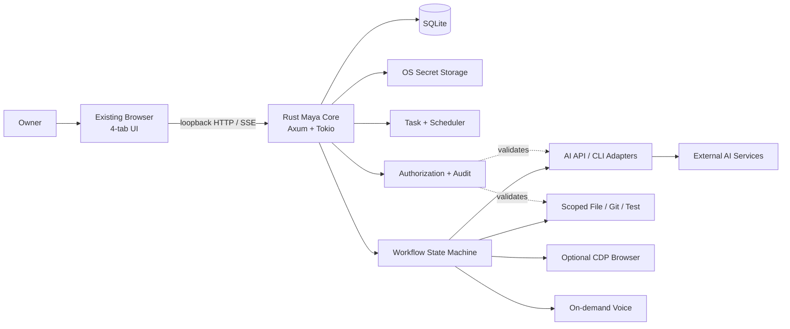

# 04 — Technical Architecture

## System shape
**One resident Rust executable** serves static HTML/CSS/JS and JSON/SSE API on `127.0.0.1`, manages SQLite/tasks/jobs/notifications, and launches on-demand external tools (coding CLI, optional Chromium browser interaction, STT/TTS). Avoid split services unless profiling justifies them.

## Logical modules (internal Rust modules, not separate resident daemons)
| Module | Main responsibilities | Must not do |
|---|---|---|
| `server` | Axum routing, static UI, SSE, request limits | run shell commands directly |
| `identity_chat` | user preferences, bounded conversation and intent routing | issue write permissions from model text |
| `tasks` | CRUD, recurrence, reminders, reports, evidence tags | guess task completion |
| `jobs` | durable workflow orchestration, finite states, interruption/checkpoint | bypass approvals / call arbitrary shell |
| `policy` | canonical path scope, action classification, approval token, audit | rely on prompt text as enforcement |
| `projects` | registration, discovery, project snapshots, verified file scope | access other user folders |
| `providers` | model registry, role selection, capabilities, quotas, cancellation | automatically use disabled provider |
| `coding_cli` | supported official CLI adapter, stdout/stderr streaming, status capture | assume every CLI has same flags |
| `tools` | OS launch, safe commands, file reader, Git/test adapters | accept raw model-supplied shell string without review |
| `browser_bridge` | optional scoped CDP pages and consent-based handoff | depend on AI website scraping as critical path |
| `voice` | on-demand STT/TTS adapter | always-listen |
| `store` | SQLite transactions, backups/migrations, bounded retention | store secrets in plaintext |
| `telemetry` | process RSS/CPU, external process breakdown, diagnostics | always poll fast in background |

## Dependency boundaries
- Server calls domain services; domain services use **traits** (`ModelProvider`, `CodingRunner`, `FilesystemPolicy`, `VoiceAdapter`, `Notifier`, `Clock`), implemented by adapters.
- Orchestrator owns transitions; tools report results, not authority. No LLM or CLI can directly write workflow state outside validated events.
- SQLite is single source of durable job/task truth; keep ephemeral stream buffer size bounded and replay the latest events after UI reconnect.
- High-risk requests need `PolicyDecision` before any call to OS, workspace write or external agent.
- Use `tokio::process` with bounded concurrent children, resource/timeouts, process group cleanup where supported; no shell wrapping by default (`Command::new` + explicit args).
- All expensive scanning/API/tool work is on demand, cancellable when safe, or runs in `spawn_blocking` when synchronous IO requires it.

## Job state model
`Created → Inspecting → Planned → AwaitingApproval → Approved → Executing → Verifying → Reporting → Completed`; alternative `Blocked`, `Failed`, `Cancelling`, `Cancelled`. `Paused` applies at a safe step boundary. The state machine must persist *before* side effects where possible and reconcile uncertain side effects after restart.

## Failure & crash recovery
1. Validate persisted step+checkpoint on restart; any `Executing`/`Verifying` state with unknown subprocess outcome becomes `NeedsReconciliation` (proposed internal status), not silently `Completed`.
2. Read actual file status/Git diff and last test events; prompt owner for safe continuation if file state diverged.
3. Retry read-only/idempotent steps automatically within bounded policy; **do not auto-replay unconfirmed file writes**.
4. Use atomic writes for Maya-owned configs and transaction boundary for DB updates; never claim all-or-nothing transactions over external CLIs.

## API/UI behavior
- Server binds loopback only, uses unpredictable per-session token, Origin/Host checks and CSRF protection on mutating requests, CSP on static UI, and does not enable permissive CORS.
- Server-sent events (SSE) are **proposal** for compact activity updates; fallback to bounded manual refresh if unsupported.
- Static UI avoids massive in-memory model transcripts. Paginate tasks/messages/logs and cap per-event payload.
- Locale/timezone stored explicitly; timestamps in UTC and rendered in Asia/Kolkata/user-selected IANA timezone as appropriate.

## Implementation conventions
- Rust 2024 edition **proposed**, stable toolchain pinned when M0 approved; do not hard-code crate version until dependency audit.
- `axum`, `tokio`, `rusqlite`, `serde`, `tracing` as likely stack; choose minimal features and measure binary/resident RAM.
- No mandatory Python, Node runtime, Redis, Electron, container server, or local inference engine.
- Keep CLI/browser/voice integrations behind capability flags so task-only core remains offline and small.

## Architecture review exit criteria
All edges have an owner, writes cross policy boundary, persistent states support recovery, external-process resource accounting separate, `09_SECURITY_PRIVACY.md` negative cases mapped to tests.
