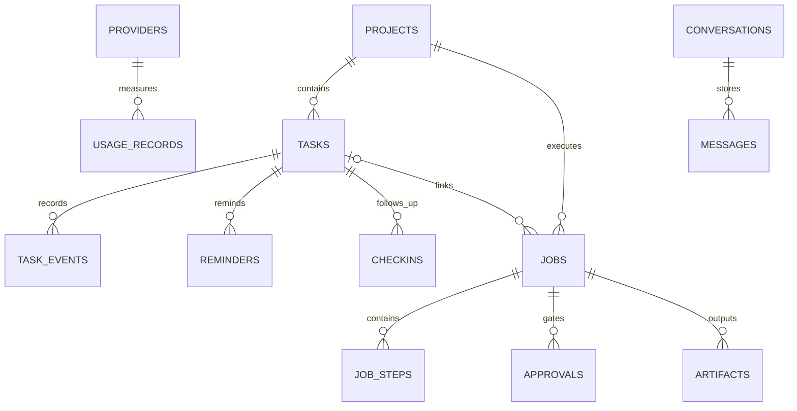

# 06 — SQLite Data Model (Design Baseline)

This is a proposed logical schema, **not an applied migration**. Schemas can evolve through reviewed ADR+versioned migrations; avoid storing large logs/transcripts unbounded.

## Entities and minimum fields
| Entity/table | Minimum fields | Notes |
|---|---|---|
| `settings` | key, typed_json_value, updated_at | no credential plaintext |
| `providers` | id, label, kind, endpoint?, enabled, roles/capability_ref, secret_ref? | secret_ref points to OS secret store |
| `model_roles` | role, provider_id?, model_id?, timeout_ms, fallback_policy | default chat/planning/coding/fallback |
| `projects` | id, name, canonical_root, allowed_paths_json, cli_adapter_id?, archived | one registered root scoped by owner |
| `conversations` | id, project_id?, model_role, created_at | recent context bounded |
| `messages` | id, conversation_id, kind, content_redacted, provider_id?, timestamp | limit retention and content size |
| `tasks` | id, parent_task_id?, project_id?, title, description, priority, status, progress_pct?, progress_source?, due_utc?, timezone, created_at, updated_at | subtasks via self-reference |
| `task_events` | id, task_id, kind, payload_json, evidence_ref?, at_utc | audit status/progress/history |
| `reminders` | id, task_id?, label, due_utc, tz, recurrence_rule?, next_fire_utc?, enabled | recurring rules bounded/supported |
| `checkins` | id, task_id, requested_at, responded_at?, progress_pct?, blocker?, source | no automatic factual invention |
| `jobs` | id, task_id?, project_id, state, approved_plan_hash?, created_at, updated_at, last_checkpoint_ref? | durable state machine |
| `job_steps` | id, job_id, sequence, kind, state, started_at?, finished_at?, attempts, artifact_ref?, error_code? | each step recoverability |
| `approvals` | id, job_id, scope_json, plan_hash, action_class, requested_at, decided_at, expires_at?, decision, owner_ack | required before side effects |
| `artifacts` | id, job_id?, task_id?, kind, scoped_path?, checksum?, size_bytes?, created_at | summaries/plan/diff/test logs; sensitive scans |
| `audit_events` | id, actor, action, resource_kind, resource_id, decision, metadata_redacted_json, at_utc | append-only through application API |
| `usage_records` | id, provider_id, job_id?, model_id?, input_tokens?, output_tokens?, billed_amount?, billing_mode, at_utc | unknown cost stays unknown |

## ER model

## Schema guarantees
- UUID/ULID identifiers; explicit UTC ISO 8601 or integer epoch fields chosen once in first migration.
- Foreign keys enabled; indexes for due reminders, task status/due date, job state, event time and message pagination.
- SQLite WAL where appropriate; explicit busy timeout and checkpoint strategy; backup with SQLite's safe backup interface, not naive copy under concurrent writes.
- All mutations transactionally write the domain state and corresponding audit/event row when feasible.
- No API keys, refresh tokens, browser cookies or credential secrets in SQLite; store opaque secret references only.
- Separate task note/event from verified progress evidence and AI suggestion.
- Deletion/retention: remove requested data and indexed summaries; make active audit retention visible and configurable where safe, preserving required security records in minimal form.
- Schema migration version tracked and idempotently applied; migration preflight backup + rollback strategy for failure.

## Proposed domain validation
- `progress_pct` either NULL/unknown or integer 0..100, with `progress_source = manual|observed|verified`.
- `status` in `todo|in_progress|blocked|done|cancelled` for tasks; independent job states.
- `due_utc` never silently inferred without explicit timezone when phrase is ambiguous.
- `approved_plan_hash` and `scope_json` immutable after approval; any plan change invalidates current approval.
- `artifact.path` constrained to Maya-owned artifact store or canonical approved project path.

## Verification
Migration-up from empty DB, migrated DB backup/restore, power-loss simulation, retention/export, foreign-key failures, transaction replay, duplicate reminder delivery test, approval expiry test.
