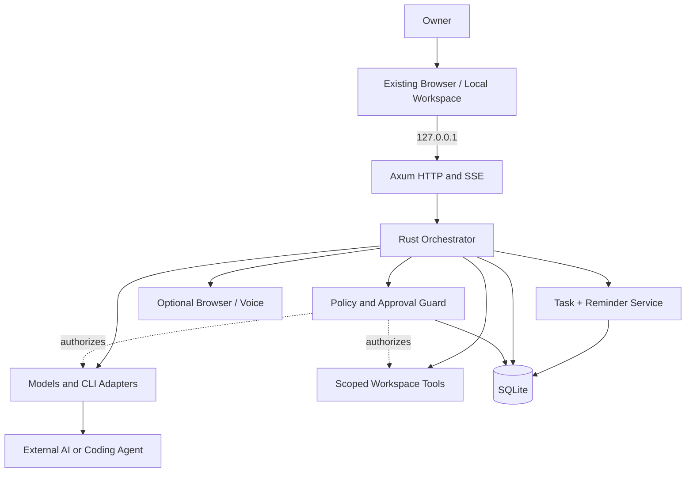
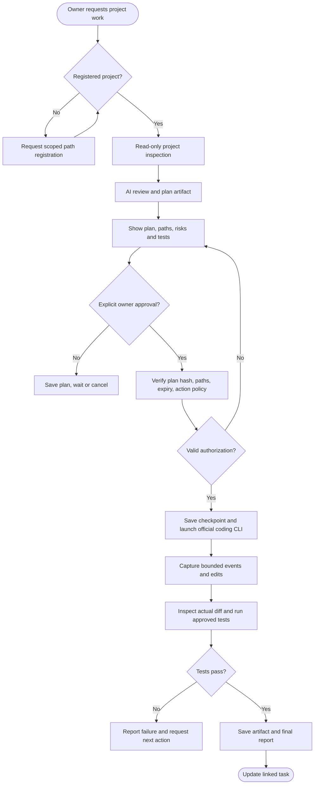
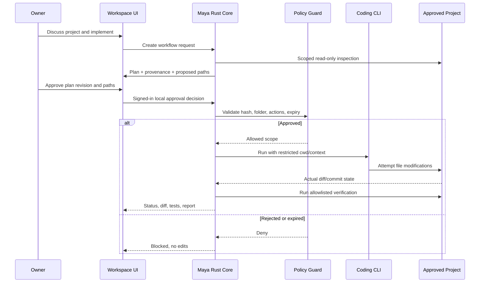
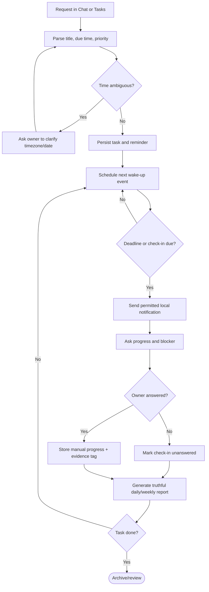
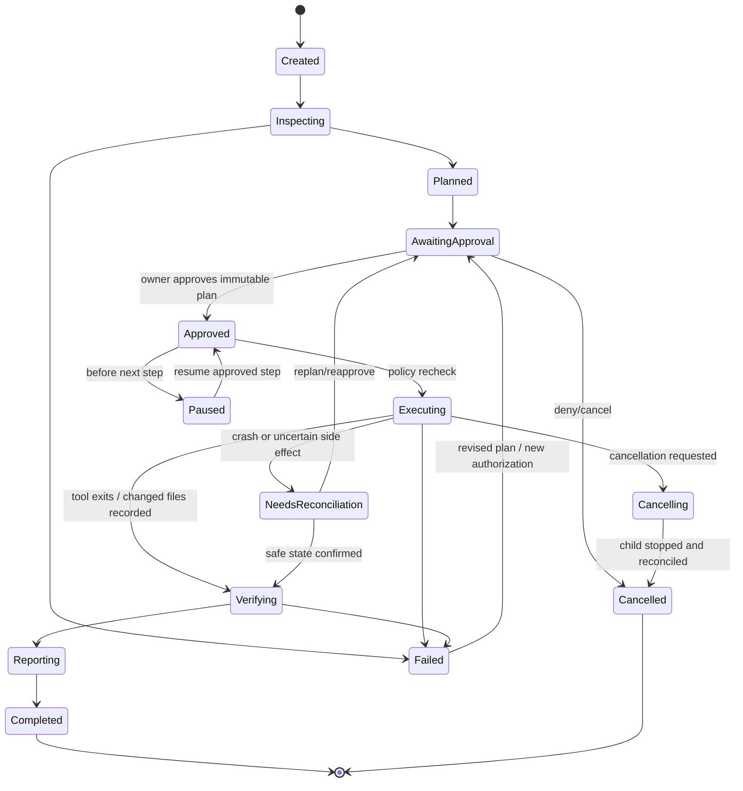
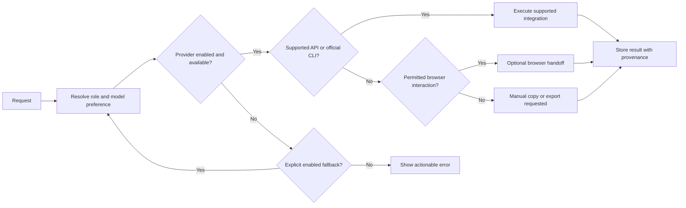
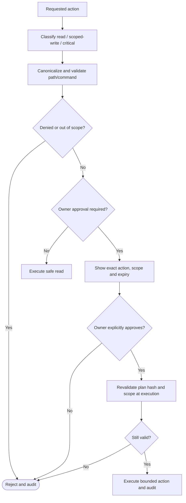
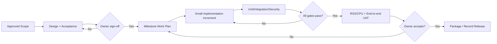

# 08 — Flowcharts, Sequences & State Machines (Mermaid)

The diagrams are **editable text** and render in Mermaid-enabled Markdown viewers (for example GitHub). They visualize *proposed* design, not working software. All workflow writes route through host-side security gate.

## 1. Architecture overview

## 2. User request to coding delivery

## 3. Coding workflow interaction / sequence

**Implementation warning:** Simply setting a CLI cwd does not guarantee filesystem confinement. Host authorization + OS sandbox/mechanism must be considered separately, see `09_SECURITY_PRIVACY.md`.

## 4. Personal task lifecycle

## 5. Persisted job state diagram

Note: `NeedsReconciliation` is a proposed internal recovery status derived from source requirement H05, not an additional end-user capability.

## 6. Provider/model routing and website fallback

## 7. Security decision flow

## 8. SDLC flow

